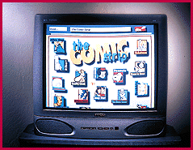

# Internet TVs Arrive

*Bits*

Internet TVs that offer built-in Web browsing and e-mail will come in at least two varieties. One, seen here, is a TV from Zenith that sells for about $1000 and includes built-in Internet software from Diba (Belmont, CA). Other, less expensive solutions (about $350) will consist of boxes that attach to your existing TV set. Companies such as Philips Consumer, Samsung, Sony, and Zenith will begin shipping Internet TV products this fall.

## World Wide Web Does Television

## Images

