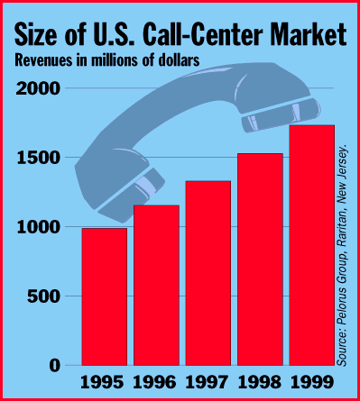

# Call Centers Deliver Data on Time

*Bits*

Curt Harler

Whether it's serving as a help desk, an inbound order center, or an outbound marketing operation, the call center can be the best source of real-time marketing and market intelligence that a company has. The payoff for computer-telephony-integration (CTI) systems linked to the corporate LAN is true, up-to-the-microsecond details on buying trends, customer complaints, accounts-receivable data, and other business basics.

CTI traditionally lets users connect a computer or server on a LAN to a phone switch. The computer then moves calls around and gives agents a "screen pop," showing data about the caller. But this is yesterday's news.

Today, the computer is grabbing a much larger share of the CTI equation. Call-center managers are switching from telephony-tied operations to ones that gather data from wherever it originates and from whatever medium it's generated in. Thinking of the call center's traditional role as a group of phone-answerers is pass

, says Max Fiszer, director of product marketing for CTI solutions at Siemens Communications ((800) 765-6123). Call centers today take "calls" over cable-TV networks; via fax, modem, and the Internet; and from other computer-centric sources.

"We're moving to the age of CTI as an enormous C, a small bit of T, and total I," says Bob Deurr, manager of CTI products for Rockwell International ((630) 960-8000). Deurr says that in the call center of the future, companies will manage transactions that include everything from a caller's initial contact with a company to the delivery of products by way of a package-delivery system.

AT&T is now field-testing a new service that lets Web surfers initiate a phone call with a customer-service agent from within a browser. Traditional networking-oriented firms, such as Artisoft ((520) 670-7100), are reorienting their R&D to focus on the growing communications/computer-telephony business.

Fiszer agrees that the big challenge in this trend is the integration of all the different parts of call centers: "The challenge is to make integration simple and standardized so that we don't need 50 applications for each of 50 platforms."

As call-center commerce moves to the Web, several firms are rolling out Web-based call-center solutions. For example, NetSpeak's ((407) 997-4001) WebPhone can be used with an automatic call distributor (ACD) in a call center. A customer's call made through the Internet from a PC appears like any other inbound call to the ACD, but it can be identified on the agent's console as an Internet call. NetSpeak provides server software and desktop applications, allowing a real-time voice connection from the Internet.

Teloquent's ((508) 663-7570) Open@gent allows firms to use corporate intranets as the backbone of a call center. The company's Web Call Center lets inbound calls reach agents while the caller browses the Web.

## Size of U.S. Call-Center Market

## Images

