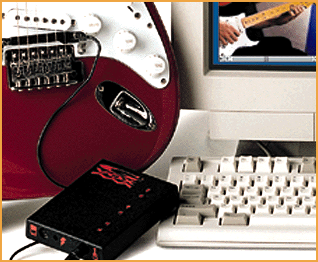
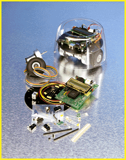
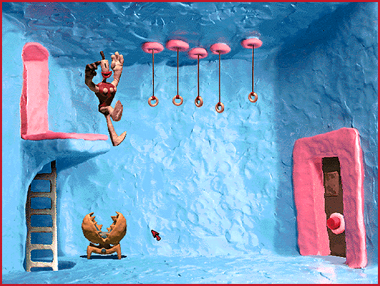
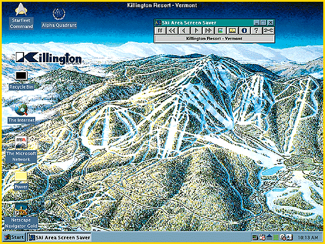

# Holiday Gift Sampler

*Bits*

When we asked vendors to send us products for consideration for this year's holiday gift section, we received a wide variety of merchandise. Some of the submitted products, such as new accounting programs, database-access tools, and a new compiler, smacked a little too much of work. But we received some more-festive ideas as well. Here's a sample of products to give you ideas for holiday presents.

Men of Clay

Forget the singing California Raisins. Never mind Gumby or Gromit. The Neverhood ($49.95) may be the ultimate adventure game for fans of clay animation. As the head of an army of Klaymen, you are the protagonist in a humorous clay world filled with dozens of puzzles that you must solve to fulfull your destiny and defeat the evil Klogg. Stop-frame animation enables your Klaymen to lope through a landscape filled with amazingly realistic 3-D clay sets, where they face a man-eating venus fly trap and other surprises.

The action scenes are pure slapstick comedy -- the attack of the crustacean is hilarious -- and the visual and sound effects are first-rate (as one would expect from the first interactive game from DreamWorks Interactive [(310) 234-7000]). The game requires a Pentium 75-MHz PC, 8 MB of RAM (16 MB is recommended), a quad-speed or faster CD-ROM, and an SVGA display. The Neverhood succeeds on the merits of its adventure-game challenges, but the production quality of this romp breaks the mold for its genre.-- Rob Mitchell

Find the Perfect Beer

http://www.multimedia.discovery.com

http://www.beerhunter.com

Everything else is on CD, so why not a virtual world tour of the world's best beers? That's the premise behind Michael Jackson's World Beer Hunter ($34.95), a Windows CD-ROM from Discovery Channel Multimedia [(800) 678-3343;

#http://www.multimedia.discovery.com

]. Your host is a genial beer expert (the other Michael Jackson). There's plenty to learn here, backed by audio and video clips, and you can select beers by region. It includes links to a "beerhunter" Web site (

http://www.beerhunter.com

). Other favorites: a pub crawl and a list of the 10 beers Jackson would want to have on a desert isle. Informative and recommended.-- Jon Pepper

Be A Guitar Hero

Now guitar players can have as much fun with computers as people who play MIDI keyboards. G-Vox ($379 for the basic package) from Lyrrus [(215) 922-0880] is a hardware/software combo for Macs or Windows PCs that lets you connect any guitar (acoustic or electric) directly to a PC. Plug into the serial port and use any of the G-Vox software series to learn to play guitar or play along with some guitar greats. This package includes full MIDI support. Great for anyone who loves guitars and computers.-- Jon Pepper

New Robot Kits Are More Mobile

Here's a gift that's both fun and educational. The last time we looked at the A K Peters [(617) 235-2210; akpeters@tiac.net] Mobile Robot Kit, you had to add the motor and wheels yourself to create your own mobile robot. The new version ($500) now includes the brains for creating a robot (processor, memory, and sensor circuitry) plus the body (motor, wheels, chassis, and other parts). As you program the robot on either a PC or a Mac, you learn about how to make it react to the physical world (e.g., using infrared to avoid collisions or to seek light). The company plans to add support for sonar in 1997.

New CD-ROMs Bring Music to Life

http://www.gzone.com

Does someone on your list spend after-dark hours prowling the Net instead of the nightclubs? If so, then new "cybrid" CD-ROMs from the Graphix Zone [(714) 833-3838;

http://www.gzone.com

o] might be just the groovy thing. These discs combine multimedia elements with links to related on-line sites.

Herbie Hancock Presents Living Jazz ($39.95) covers the music's history by playing back bits of tunes, interviews (such as the Doors' Ray Manzarek explaining how "Light My Fire" was based on "Ole Coltrane"), and rare film clips. Click on the Connect button, and your browser fires up and takes you to the Living Jazz home page, which links to other Web sites that cover jazz. You can also download material from the Living Jazz site to your hard disk.

But make sure your recipient has at least a six-speed drive. Anything slower, and you could transcribe a Coltrane solo in the time it takes to get from one screen to another.

Willie: The Life and Music of Willie Nelson ($39.95) has Internet links but no downloadable extras. Harassing IRS agents also not included. Or you can check out the latest enhanced CDs, such as the Graphix Zone's Bob Marley: Soul Almighty -- the formative years ($17.98). You can view great interviews with early producers.-- Dennis Barker and Dave Andrews

Ski-Area Screen Saver

http://www.cylogic.com/skidata/

If your friend likes to hit the slopes, he or she will be interested in the Ski Area Screen Saver ($19.95) from Cylogic [(800) 295-6442;

http://www.cylogic.com/skidata/

~]. During a spare moment, this one lets you browse some of your favorite ski resorts, such as Killington and Alta. Cowabunga!

Questions? Ask the Net!

http://www.cdnow.com

http://www.virtualvin.com

Want more gift ideas? Then check the Internet. Practically anything you want is available through the Web. Want hard-to-find audio CDs? Check out

http://www.cdnow.com

. Want some good wine? See

http://www.virtualvin.com

. Or just go to any of the Web-search engines, such as Lycos, Yahoo, and AltaVista, and ask away. You'll probably find it. Or you can check out Egghead for holiday greeting cards with computer themes created by cartoonist Bruce Bolinger.

## Guitar Man Goes MIDI

## Robotic Mobility

## Sooth Anyone's Soul

## Claymation Run Amok in 3-D

## Ski Your Desktop

## Images

