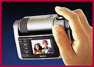

# Digital Cameras Give an Instant View

*Bits*

Jon Pepper

Digital cameras are rapidly evolving from expensive toys to viable and affordable image-capture devices. But beyond lower prices and improved quality, the trend currently driving the market is the inclusion of LCD screens in just about every camera that's out or about to be released.

Six new products will sport LCD displays this fall. These products include offerings from Casio, Epson, Kodak, Olympus, Ricoh, and Sony and rumored models from Pansonic and even Sega.

Why LCDs? Credit their immediacy, convenience, and pure gadget appeal. Cameras with LCDs let you view the images you've snapped and delete those you don't like. Casio's QV-10, the first product to offer an LCD, has drawn rave reviews, despite marginal picture quality.

One impressive new device, Sony's ((800) 476-6972) DSC-F1 ($849), features innovations in a high-quality product. With 640- by 480-pixel resolution, the DSC-F1 can store up to 108 images at its lowest JPEG compression ratio, or 30 to 58 images using higher compression modes at the same resolution.

The DSC-F1 has a 1.8-inch LCD that you can use to review pictures or to frame your next picture. The camera also lets you take "continuous" action photos.

Both of Olympus's ((800) 622-6372) offerings, the D-300L ($899) and the D-200L ($599), have 1.8-inch LCDs and Olympus optics. The D-300L can store 30 images at high resolution (1024 by 768) or 120 images at standard resolution (512 by 384). It has built-in flash and red-eye reduction. The less-expensive D-200L stores images at a lower resolution (640 by 480) but, like the D-300L, it includes auto-flash and auto-focus. Both are lightweight and stylish and let you use the LCD for picture review or to frame an image.

Epson's ((310) 782-0770) $499 PhotoPC 500 is a smaller, higher-quality version of the company's PhotoPC camera. It can store 30 images at 640 by 480 resolution. With proprietary memory modules, you can store up to 100 or 200 images, depending on the resolution you use. The 1.8-inch color LCD ($199) is optional and snaps onto the PhotoPC 500.

Add to these offerings two enhanced models from Casio ((201) 361-5400) that are based on the QV-10 design (the $679 QV-30 and the $699 QV-100), Ricoh's ((800) 225-1899) RDC 2 ($900), and the Kodak ((716) 724-4000) DC 25 ($499), and it's quite clear that there's no shortage of choices for LCD-based digital cameras. Expect to see this trend continue, with new players joining in over the next six months. In the digital-camera world of the 1990s, image may not be everything, but instant image may well be.

## LCD Included

Sony's new DSC-F1 features an LCD and support for TV output for presentations.

## Images

