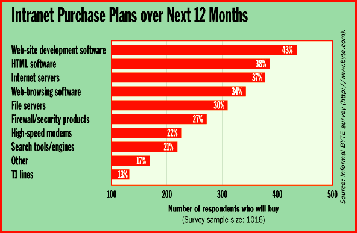
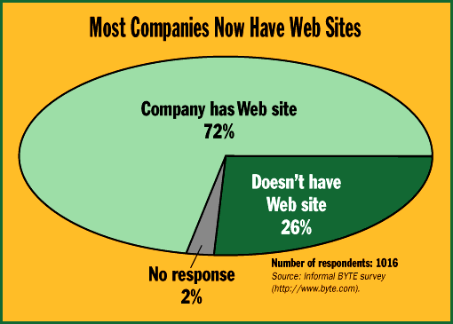

# Survey

*Bits*

,Intranet Purchase Plans Over Next 12 Months

Web-site development software and HTML (e.g., page-creation) software lead the list of planned intranet purchase items.

"Most Companies Now Have Web Sites

}The survey results shown in these two charts suggest that most companies plan to add new applications to existing Web sites.

## Images

