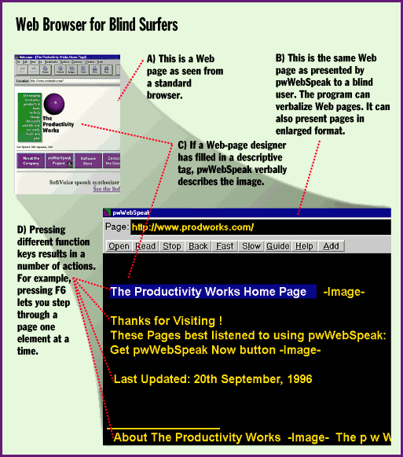

# Browse the Web with Your Eyes Closed

*Bits*

Joe Lazzaro

Surfing the Web can be extra challenging if you can't see your screen. Thousands of blind or visually impaired computer users access the Web using speech, braille, or screen-enlargement hardware and/or software. If you have a PC and a visual disability, you probably know that it's possible for you to access the Web, but most Web sites won't work well with your adaptive equipment.

Webmasters who don't add

descriptive tags

to the elements in their pages make it more difficult for adaptive programs. But awareness about adaptive technology is increasing in the computer industry. Microsoft is leading an ambitious effort to make adaptive technology more mainstream, and Netscape is investigating ways to make its software better support accessibility products. The company's Active Accessibility program will make future versions of Windows and related applications more accessible to users with vision impairments. Software developers can use the Accessibility SDK, slated to ship in November, to write adaptive Windows programs.

The flagship Active Accessibility product is Microsoft Internet Explorer (MSIE) 3.0, which has hooks to enable the screen-reader software used by the blind community. MSIE works with synthesizers, braille displays, large print programs, and other assistive technology.

The Productivity Works ([609] 984-8044; info@prodworks.com) wrote its pwWebSpeak Web browser for the blind from scratch. The browser has its own built-in speech processor and doesn't require a separate screen-reader program. The browser parses a Web page's Hypertext Markup Language (HTML) code to present the information in a more speech-friendly manner. And pwWebSpeak can drive a variety of speech synthesizers, including the Sound Blaster voice card.

With the awareness of adaptive technology among mainstream software developers increasing, the future may loom a bit brighter for computer users with disabilities.

## Web Browser for Blind Surfers

## Images

