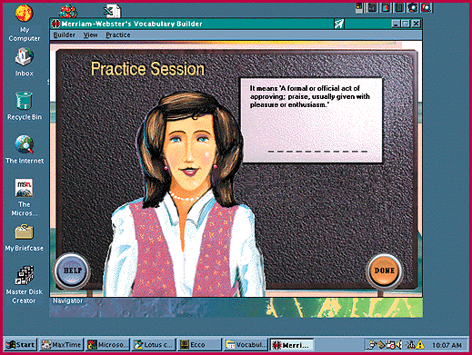

# CD-ROM Review:  Lots of Words

*Bits*

Rich Friedman

Here are two CD-ROMs for people who love words. Merriam-Webster's Vocabulary Builder (MWVB) guides you through a series of exercises that will strengthen your English vocabulary. Each lesson introduces the common roots of a group of words and leads you through playful exercises that skillfully reinforce what you've learned.

The lessons are fun. The program pronounces each new word, gives a definition, uses the word in a sentence, and asks to you to complete fill-in-the-blank, synonym/antonym-type exercises that keep track of your progress. After a few weeks of 15-minute daily drills, you'll be amazed at how many new words you've mastered.

Random House Webster's Unabridged Dictionary CD-ROM recently came out in version 2.0. Enhancements include voice pronunciations, line-art illustrations, and a choice of English, French, or Spanish as the language of the dictionary interface. The dictionary contains more than 316,000 entries, of which 1500 have been updated. A more powerful search engine lets you, for example, find any word that came into English after 1890 or any date you specify.

## Product Information

Merriam-Webster's Vocabulary Builder.............$29.95

Merriam-Webster

Phone: (800) 828-1880

@Random House Webster's Unabridged Dictionary CD-ROM version 2.0

(for Windows 3.1 and 95)

.................................................$39.95 CD-ROM alone

.................................................$64.95 book/CD-ROM package

Random House

Phone: (800) 733-3000

## Can You Say "Vocabulary"?

?Merriam-Webster's exercises are a fun way to build vocabulary.

## Images

