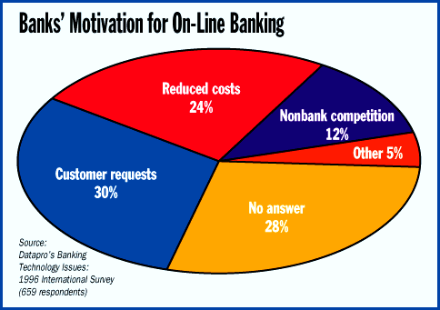

# Datapro Report

*Bits*

'Banks Eye PC Banking and the Internet

Jannette Alston

Although automatic teller machines (ATMs) and telephone services are currently the most popular on-line banking services, the future of on-line banking growth lies in PC banking and the Internet. According to Datapro's 1996 international survey of banking-technology issues, 67 percent of banks offered ATMs in early 1996, and 52 percent provided telephone-banking services.

But based on survey results, only 2 percent of banks that don't already have ATMs plan to install them in 1997, compared to the 21 percent and 19 percent that will offer PC banking and Internet banking, respectively (see the table

#"New On-Line Banking-Service Plans"

Banks are moving toward on-line banking, which includes ATMs, phone and PC banking, the Internet, screen phones, and interactive TV, primarily due to customer requests (see the figure

'"Banks' Motivation for On-Line Banking"

f). But reduced operations costs is another motivation for banks to adopt electronic banking services.

These results may demonstrate that banks are attempting once again to tap into the home-banking market. Perhaps now is the time that the retail-banking trend will begin to show more growth.

"New On-Line Banking-Service Plans

Early Late 1997 1998 No No

> 1996 1996 answer plans

<ATM 67 4 2 1 13 14

<Telephone 52 12 8 4 11 14

<PC banking 19 19 21 8 17 18

<Internet 7 17 19 6 21 31

<Screen phone 3 3 5 2 31 56

<Interactive TV 1 1 4 4 32 58

-Source: Datapro's Banking Technology Issues:

# 1996 International Survey.

'(Questionnaires mailed in early 1996.)

5Contact Datapro for the full version of this report.

## Banks' Motivation for On-Line Banking

Customer requests and reduced operations costs are the primary motivation ofr banks' move toward on-line banking.

http://www.datapro.com

Jannette Alston is a senior analyst, financial services industry, at the Datapro Information Services Group (Delran, NJ). For more information, call (609) 764-0100 or contact

http://www.datapro.com

. The survey is a report from Datapro's Financial Industry Technologies & Trends: World View, Datapro's new information service.

## Images

