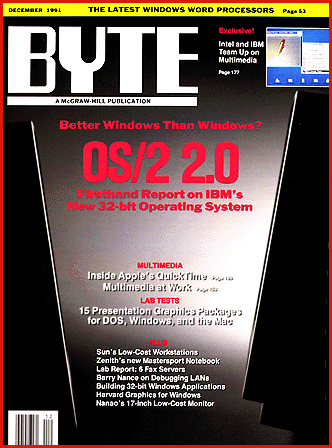

# 5 Years Ago in BYTE

*Blasts From The Past*

BYTE looked at the new version, 2.0, of OS/2, and we liked its ability to multitask DOS applications while offering better crash protection for Windows programs. We noted, however, that 32-bit OS/2 software was still waiting in the wings. We also delved inside Apple's QuickTime multimedia extensions for the Mac OS.

From

## December 1991

g we bring you the inside scoop on Apple's QuickTime from then-and-now Consulting Editor, Peter Wayner.

STATE OF THE ART: Inside Quicktime

Apple's multimedia extensions for System 7.0 provide a standard mechanism for managing dynamic data.

by Peter Wayner

The Macintosh has always enjoyed a well-deserved reputation for being easier to understand and use than other platforms. Its system software makes the Macintosh very accessible to anyone who needs to create and manipulate text and graphics information. Today, multimedia technology is bringing dynamic data -- full-motion video and digitized speech-to desktop systems. To cope with these new forms of data, Apple has introduced a broad class of simple multimedia standards called QuickTime, which will make it easy to manipulate multimedia data and integrate multimedia technology into your working environment. QuickTime will take much of the hassle out of creating your next multimedia presentation or training application.

QuickTime is an extension of System 7.0, the latest version of the Macintosh system software, which was released last spring. By dropping the QuickTime icon into your System Folder, you make your Macintosh aware of a standard way of displaying, compressing, reexpanding, cutting, copying, and pasting multimedia data (e.g., color images, animation sequences, and sounds).

QuickTime is designed to insulate you from the complexities of multimedia applications. For example, you won't have to worry about which decompression algorithm to use when viewing an animation--QuickTime automatically calls the correct code. When developers start including QuickTime in their programs, you will be able manipulate multimedia data as easily as you manipulate pictures today. Apple has also extended its Human Interface Guidelines so developers can implement QuickTime's features in a consistent fashion.

Tracking Data

The core of QuickTime is contained in its support for two file formats. The first, a new format called Movie, is used to manage different forms of dynamic data. The Movie format consists of different tracks that begin and end at different times during a presentation. QuickTime synchronizes the playing of the tracks, and it makes sure that all data is decompressed and ready to flash on the screen or be sent to the sound chip at the right time. It acts as an electronic stage manager. So far, Apple has released two types of tracks--one for video and one for digitized sound--and it can add new types via hooks into QuickTime. Future possibilities for tracks include such robust synchronization protocols as MIDI and SMPTE. Eventually, Apple also plans to release the track interface so that developers can create their own track types.

The second QuickTime format is an extended version of the venerable PICT format, which was introduced with the first Macintosh. When applications cut and paste images, they use PICTs. The new extensions allow PICTs to be compressed, and they let you scan the contents of image files easily.

QuickTime's job is to maintain these specialized formats. It is divided into three sections: the Movie Manager, the Image Compression Manager, and the Component Manager. The Movie Manager makes sure the tracks are played in the proper sequence, and it relies on the Image Compression Manager to juggle the available compression algorithms.

Underneath these is a novel piece of software known as the Component Manager. The range of multimedia peripherals (e.g., microphones, video digitizers, hardware compression boards, and video boards) available for the Mac is wide indeed. The Component Manager lets an application determine the resources available on a machine by determining the capabilities of a machine rather than the specific configurations. Thus, a program says, "Give me the 24-bit video digitizer," and not "I know how to interface with the FooBaz Zooper 500 and the Grumster KittyPuff 210. Are there any out there on this bus?" Programs don't have to include device drivers for every possible attachment. This part of QuickTime should have broad use in many different applications.

The Movie Format

In a simple system for displaying animated presentations, the data file is just a set of screen images dumped onto a disk. The software calls up the images one after another, and it flips them on the screen. This low-budget approach may get the job done, but it is hardly the beginning of an easy-to-use system for creating or distributing multimedia.

Consider these problems: Cutting and pasting segments of video involves copying and moving large blocks of data--a very slow process. Pasting a 20-second cut may mean moving 20 MB of data. If you want to create a version of the presentation with a soundtrack in French or Japanese, you must copy the entire file and add the new soundtrack. To segue from one image to another, you have to splice different image streams together. These are just some of the frustrating limitations that arise when using a simple presentation platform.

The QuickTime architecture was designed to handle these problems by placing an intermediate abstraction known as the track between the raw data (called the media) and the presentation itself (referred to as a movie). A track is a routine for doing specific things with the data at a specific time; each movie contains one or more tracks.

When you start a movie, QuickTime first finds the data used by each track. If the data is compressed, it calls the Image Compression Manager to turn the data into a usable form. Then it starts each track at the right time. Notice that the data does not have to be stored with the movie. It is kept in separate media files. The movie file contains only the tracks, which themselves contain only the pointers to the media files, although you can copy the media data into a movie file to create a self-contained presentation.

QuickTime gives tracks a great deal of flexibility beyond simply specifying the starting and ending points of the media display. Each track has its own time scale as well as its own coordinates on the screen. You can program the tracks to display multiple segments on the screen at their own speed in their own positions at the same time. Moreover, you can specify the display of certain tracks at certain times to get different effects. (To get a feel for how you use tracks to control and synchronize a presentation, see the text box "On-Track Presentations" on page 192 in the print edition of BYTE.)

QuickTime Compression

The greatest obstacle to the widespread use of animation and multimedia is storage limitations on personal computers. Pictures just take up too much room. One color image for a standard screen can easily take 400 KB of memory. A movie will use up 24 of these images in a second. At this rate, even a CD-ROM can only hold 67 seconds of full-screen animation. The solution is image compression, and Apple has made this one of the cornerstones of the QuickTime system.

In theory, the concept is simple. Images contain redundancy that can be squeezed out to save space. A large section of red that might take up 10 KB of disk space can be reduced to a small set of commands describing the size and color of the patch. If this is done everywhere on the image, the resulting file can be much smaller. The effectiveness depends on the variation in the image. The Japanese flag is very easy to compress, but it is difficult to save much space in a complex image, such as an overhead shot of Times Square on New Year's Eve.

Four basic parameters determine the usability of the various different algorithms for image compression. The first is the compression ratio that expresses the size reduction. Very efficient algorithms can reduce a simple picture by as much as 100 to 1. This is rare, however, and an average performance ranges from 5-to-1 to 10-to-1.

The second factor is speed. Some algorithms work much faster than others. Generally, the slower ones do a better job than the faster ones.

The accuracy of the algorithm is the third factor. Some decompression algorithms produce an exact duplicate of the original, and they are called "lossless." Others are known as "lossy" because they cut corners to increase compression and lose some of the data contained in the original image.

The latter are designed so that the losses will have little effect on the final image. The red apple won't reappear as blue, but it may be grainier or have a much more homogeneous red surface. Image quality is the last and most subjective factor. Some of the problems ofvarious lossy algorithms are documentable, but often people simply develop preferences for the qualities of certain algorithms and ratios.

Apple designed QuickTime with the future in mind. QuickTime has three built-in compression schemes as well as room for either Apple or third-party developers to add new algorithms.

The basic algorithm is the Joint Photographic Experts Group (JPEG) international standard, which is based on the discrete cosine transform. This mathematical approach models each segment of the image with several cosine functions.

The JPEG standard allows some information to be lost when there is a tiny amount of noise in the image, because it lumps large, similarly colored regions into one chunk. The quality is very good, and the compression ratios are generally impressive (about 10-to-1), but the algorithm is computationally expensive.

Compression using the JPEG standard can take 60 seconds on a Mac IIcx. This is acceptable for still images, but it is much too slow for full-motion video and animation. This fact will change in the distant future, when faster processors are available. When this happens, the compression system will be able to grow to include new systems to take advantage of these processors.

The other two built-in compression algorithms were designed by Apple to handle real-time video decompression. One works well for video images (its internal name was RoadPizza), and the other is tuned for the noise-free domain of computer-synthesized animation. Both processes do temporal as well as spatial compression: They look for redundancy between sequential frames of animation, and then they compress the repetition. The algorithms are simple, and they can run efficiently at video speed on a standard Macintosh. The documentation, for instance, reports that a Mac can practically display a 240- by 180-pixel image at 15 frames per second.

The maximum compression of a video is 25-to-1, but average ratios are much less. They usually range from 5-to-1 to 6-to-1. The differences between the compression techniques are largely transparent to the user and the programmer. Whenever you want to open up an image, the Image Compression Manager finds the proper decompression code and provides the decompressed image. In the future, more compression algorithms will probably be developed, and QuickTime can expand to hold them. There are already hardware implementations of the JPEG standard, and QuickTime will be able to take advantage of them.

The Component Manager

Apple will release the Component Manager in conjunction with QuickTime because it provides many necessary services for QuickTime. The Component Manager lets an application ask the system software for a particular solution; the system then provides the best solution available. When a QuickTime application asks for a JPEG decompressor, the system will check to see if it has a hardware board available to do the work. If it does, the system tells the application to call up the hardware; otherwise the system informs the application of the location of a software decompression routine.

The Component Manager can make value decisions and choose, for example, between the fastest or the most accurate decompression routine. Apple has designed a standard set of flags and values that specify the characteristics of a solution (e.g., a particular compression algorithm's speed or quality). These flags also describe the formats that an algorithm can handle, as well as any undocumented technical details, such as the pipeline latency. When the system starts up, the Component Manager assembles a list of the algorithms so that it can provide the best one for the particular job.

The Component Manager software is designed for use by all software. Software will be able to ask for either the fastest or the most accurate hardware/ software combination installed in a host computer, and the Component Manager will provide the pointers to the best resource. The Component Manager should prove useful in many other areas (e.g., encryption or telecommunications).

The Interface Factor

Naturally, Apple issued a number of Human Interface Guidelines for programmers creating software that will utilize QuickTime movies and still pictures. It wants to ensure that every application sports a consistent and standard interface for manipulating movies and pictures.

Apple provides some of these ideas as standard Toolbox routines so that the developer needs to write only one line of code to solve simple problems. One of these standard interfaces is the Open File dialog box. Before QuickTime, this routine would just display a scrolling list of files and let you move from folder to folder. This list just held the name of the file, and that alone is often not very helpful.

Now the Open File dialog box includes a small image of the file when a picture or movie is currently selected. In movies, this image is stored as a particular one-frame track. Another track called a preview points to a 3-second section of the movie.

When you select a still photo, the new Open File dialog box displays a smaller version of the image called a thumbnail PICT. The thumbnail is stored in the Resource Fork of the file by QuickTime-aware software, so the system doesn't have to open the entire image file and compute a little compressed version. This would take too long and make the previewing dialog box unusable.

The Human Interface Team also provides a standard movie controller with play, fast-forward, and rewind buttons. A scroll bar lets you scroll through a movie the same way you'd scroll through a document. The team was thinking ahead when it required a sound-muting button, because the software can be used in places where loud soundtracks are inappropriate. This standard movie controller is designed to be included in every QuickTime application.

Apple has also considered some of the more subtle interface issues that may cause problems for a user. Remember that a QuickTime movie can be a collection of pointers to other data files. What happens, then, if you copy a movie to another system without these basic data files? The Human Interface Guidelines suggest that the save boxes warn you of this possible danger and provide a way to save a complete version of the movie with all the necessary data embedded inside of it.

## First Impressions

QuickTime was "introduced" in June, but don't look for it on dealers' shelves. You must be a certified developer just to look at the information provided with the beta release. By the time you read this article, QuickTime-aware software should be making its way into the world in new versions of multimedia programs, word processors, and drawing programs.

The adoption of QuickTime, however, doesn't mean that your Macintosh will have achieved multimedia nirvana. On my Mac II, the software was slow, although it was smooth and usable. The seamless execution is a tribute to Apple's engineering ability. The company has created good compression schemes that work well on older, slower machines. QuickTime, in fact, works on any color Macintosh, including the LC.

On the other hand, QuickTime makes it apparent that home computers are just not ready to edit a Hollywood production. Even when compressed at a 10-to-1 ratio, some images that I worked with still took up 40 KB of memory. Thus, you might be able to store 1000 of your home photos on a 40-MB disk at about 600 by 500 pixels of resolution -- a far cry from the 150,000 much higher quality frames used in a feature film.

To illustrate the processing power and storage required for multimedia, consider the QuickTime demo that Apple distributes on a 1.4-MB floppy disk. The demo takes a few minutes to decompress before the speaker starts trumpeting and the movie begins. The accompanying animation is displayed on a small portion of the screen--about 100 pixels square. The movie -- a NASA rocket disposing of a spent booster stage -- is over in less than a minute.

Although multimedia on home computers seems a bit sluggish, this is almost certain to change in the future. Apple has made QuickTime open-ended so that it can grow as faster machines, cheaper memory, and next-generation CD-ROM drives arrive. Given the importance of solid yet flexible standards in any new technological area, you might say that QuickTime has arrived just in time.

## December 1991

Peter Wayner is a BYTE consulting editor and is working toward a Ph.D. in computer science at Cornell University. You can reach him on BIX as "pwayner."

## Images

