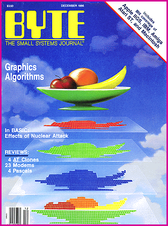

# 10 Years Ago in BYTE

*Blasts From The Past*

We looked at graphics algorithms and modems that ran at speeds up to a whopping 2400 bps. US Robotics' Courier 2400 listed at $699. New products for the Amiga highlighted Bruce Webster's Christmas column.

Our

## December 1986

j coverage included Bruce Webster's Christmas selections. Compare them to the holiday offerings from 1996!

Season's Greetings

New products for the Amiga highlight Bruce's Christmas column

by Bruce Webster

I find that it's strange to be writing a Christmas column in late August, but such are the vagaries of a three-month lead time. At least I am finally settled into my new office in my new home: boxes are unpacked, papers sorted (more or less), desk organized.

Most of the products discussed this month are for the Amiga. I didn't plan it that way; that's just how it happened to work out. But the Mac and the Atari ST are well represented, so there is something for just about everyone. What? You say there are folks out there who own other machines? Hmm, I'm going to have to look into this.

Memory for the Amiga

When the Amiga made its appearance last year, I -- like many others -- commented favorably on its open architecture and the free space (8.5 megabytes) in the memory map. Unfortunately for Amiga owners and Commodore, the third-party manufacturers have been slow to release reliable products that take advantage of those features. I would guess that as of this writing, less than 1 percent of all Amigas have more than 512K bytes of RAM. Since the Amiga is a graphics-intensive machine -- even more so than the Mac -- it eats up RAM quickly and that 512K bytes disappears fast. So the ideal peripheral for the Amiga would be a cheap RAM expansion box, and I expected to see them flooding the market within weeks of the Amiga's introduction.

No such luck. Some RAM boxes have come out, but they've been expensive and often unreliable. To be fair to the manufacturers, part of the problem is the expansion bus itself. In order to pass the bus through for other peripherals, you've got to deal with a number of headaches, including the protection of your own components should the next box down the line do things wrong.

Access Associates decided that the simplest solution was not to pass the bus through at all, and that's how they built their Alegra memory expansion. The unit is a slim grayish-brown box. It's about 1/2-inch wide and hugs the side of the Amiga. The top, bottom, and rear of the box are flush with the Amiga's main unit, and the front starts about 1/4 inch back from the second mouse/joystick port. Installation is simple, though not necessarily easy. I found the best way to get the box to sit firmly on the expansion bus was to stand the Amiga on its side and push down on the Alegra.

The Alegra comes with 512K bytes of RAM, implemented using 256K-bit dynamic RAM chips. On boot-up under version 1.2 of the operating system, the RAM is automatically added to the memory map; you don't have to worry about anything. For systems running version 1.1, Alegra has supplied the necessary utilities for system configuration -- but if you're still running 1.1, shame on Commodore! The Alegra's DRAM sockets are set up so that you can pull all the 256K-bit DRAMs and replace them with 1-megabit DRAMs. That gives you 2 megabytes of extra RAM, instead of just another 512K bytes.

Does the extra 512K bytes make the Amiga nicer? Very much so. First, you can now use more RAM for your RAM disk. My boot disk copies all the command files (in directory DFO:C/) into RAM:C/, then assigns that as the command directory (ASSIGN C: to RAM:C). That way, both floppy disk drives are free for work disks, and I avoid the eternally annoying "Please replace volume WHAZIT in any drive" messages. It also speeds up system response significantly.

Second, applications can now run in the "fast RAM" memory space, that is, memory outside the bottom 512K bytes (which is known as "chip RAM"). Running your program in fast RAM has two advantages. First, it frees up more space for bit planes (graphics images) and any other data that has to be read by the Amiga's custom chips, since those chips can access only chip RAM. Second, it prevents bus contention from slowing down your application. Admittedly, you'd have to be doing a lot of chip work (high resolution with multiple bit planes, etc.) in order to cause bus contention, but it's nice not having to worry about it.

Not passing the bus through isn't as much of a limitation as you might think. If you want to add other expansion-bus peripherals to the Amiga, you simply unplug the Alegra, plug in the peripheral, then plug the Alegra into the peripheral that we're assuming does pass the expansion bus through. If it doesn't, then you're out of luck.

What's the cost of the Alegra? As of mid-July, it was $379. It might be cheaper by the time you read this. Even at $379, though. it's worth the price for the added power.

I know that I'm hooked; I don't think I could stand a 512K-byte Amiga now.

Microbotics MAS-20 Hard Disk

The other peripheral the Amiga has lacked is a fast, cheap hard disk. Unfortunately, cheap hard disks may be slow in coming for the Amiga, just as they were for the Mac. Two problems crop up here: first, the bugaboo of the expansion bus again; and second, the perception by manufacturers of a small, soft marketplace. The former has already been discussed; the latter means that manufacturers aren't willing to commit to produce more than, say, a thousand units (into an installed base of about 90,000 Amigas as of mid-August). Because of that, the manufacturers can't get a great price on the drives, and that keeps the price relatively high.

However, high-quality hard disks are finally coming out for the Amiga. One such drive is the MAS-20 (20 megabytes) from MicroBotics. The unit is about 2 inches high by 5 inches wide by 12 inches long, and it is the same beige shade as the Amiga. The MAS-20 avoids the problems of the expansion bus by plugging into the parallel port. This allows you to place it wherever is comfortable (within the reach of the cable, of course).

The first time you set up the MAS-20, you must format it and create a boot disk. To do this, you make a copy of your regular Workbench or CLI boot disk, since the setup program will modify portions of the disk (like the StartupSequence file). You then run the setup program (provided with the MAS-20). This updates the boot disk with the proper drivers, creates the needed start-up file, and does the formatting (which takes about 40 minutes). After that, you use your modified boot disk when you start up or reset, and the MAS-20 does the rest. All the command files (your C directory) were copied onto the hard disk during the setup process, so commands operate more quickly; likewise, setup copies the device and library files to the hard disk.

Having a hard disk on the Amiga was nice; as was the case with the extra RAM, it spoiled me. It makes a big difference in what I accomplish when I have Aztec C, Lattice C, CSI MuItiFORTH, and TDI Modula-2 all on-line at the same time. Twenty megabytes, while not as much as it sounds (about equivalent to 23 floppy disks), still can go a long way. And the access time -- about three times faster than a floppy disk -- helps a lot, too.

I didn't have time to really wring out the MAS-20. MicroBotics has just started shipping them and could lend me a unit for only a week or so. During that period, though, the unit was trouble-free: no crashes, no lost files, no mysterious happenings. The only major grievance I've heard is that printing and disk accessing tend to interfere with each other since both are using the parallel port. Unfortunately, I don't have a printer cable for my Amiga, so I haven't been able to verify how much of a problem this is.

My only complaint with the MAS-20 is its price: $1495. Unfortunately, the dynamics of the Amiga marketplace will keep that price up for quite a while. I'm not sure if that price is low enough to entice someone who has already spent $2000 or so on the Amiga system to buy a hard disk. But if you can afford it, the MAS-20 is a great addition to the Amiga.

Product of the Month: Instant Music

Speaking of power, a new package from Electronic Arts shows off the capabilities of the Amiga. Instant Music, written by Robert Campbell, truly provides "the triumph of technology over talent" (to quote BYTE's Gregg Williams). Briefly put, Instant Music turns the Amiga into an intelligent electronic instrument that even an untalented hack like me can play. It allows me to jam by moving the mouse up and down and pressing the button. What's more, it plays three other voices while I jam, forming the musical background for the piece. And what comes out sounds like real music.

The secret is in the "musical intelligence" of the program. By moving the mouse up and down, I pick the relative pitch of the music I want to play and Instant Music generates accompanying chords. This can be limiting at times -- it's disconcerting to hold the mouse button down and get only occasional notes or chords -- but the result is pleasing to the ear (usually).

To play, you select the piece of music you want to hear. There are more than 40 different selections from 4 to 24 measures long, ranging in style from rock to classical. A given piece has four voices, though often only three (the ones the computer usually plays) are actually scored. Each voice represents an instrument: electric guitar, flute, organ, and so on. A total of 19 instruments are available, including a "DoVoice" instrument that allows "do wah" vocals for songs. You start the piece and play your part while the computer plays the others. A graphical display shows the entire piece, so you can see what each voice will be doing. You can switch voices and take over another part; you can change instruments: you can change the tempo; you can even make the program do less for you and gain greater control over chords and rhythm.

Once you've gotten comfortable with all that, you can start creating and editing pieces of your own. Composition is almost as easy as playing: in fact, it's just like playing. First, decide how many measures long the piece will be (up to 64). Second, pick the instruments for each of the four voices. Then pick a given voice and use the mouse and button to play what you want the track to be. Pick the next voice and lay down the next track. When you're done, you can play back your composition. You can also "step in" for a given voice and play it yourself.

My only complaint with Instant Music is that it's copyprotected. True, it's the key disk method, which does allow for installation on a hard disk, and, also true, you can buy an unprotected version for another $20, but it's still a pain. Copy protection seems to be a dying trend in the industry; maybe Electronic Arts will see that and follow the other firms that are dropping protection from their products.

I've enjoyed having Instant Music to use, and my kids have been fascinated by the ability to sit down and play real music without much effort. It's an outstanding program, and Robert Campbell should be commended.

The Hackers Corner

Every few weeks, I receive some piece of software that a solitary programmer working long hours has feverishly pieced together. Sometimes the programmer sends it to me: sometimes I get it by other means (downloaded from bulletin boards, etc.). In either case, the software itself is either public domain (i.e., free) or it's shareware (i.e., free unless your conscience bothers you enough to compel you to send some amount of cash to the author). I plan to periodically review some of the PD/shareware programs out there, calling attention to the fine efforts of kitchen-table hackers everywhere.

The two programs I'd like to mention this month are, at first glance, frivolous, but both illustrate the strengths of the computers they run on. The first is a public domain desk accessory for the Macintosh. known simply as Talking Moose. It was written by Steve Halls, a doctor in Canada, who apparently had a great deal of fun putting the program together. When you activate the desk accessory, it installs itself in the system heap, then allows you to go back to whatever you were doing. However, if an interval of time (user-adjustable) goes by with no activity, a small window with a moose's head in it appears near the upper left corner of the screen. The moose then makes some smart-aleck remark, usually (but not always) having to do with your lack of work, and the window goes away. The moose head -- somewhat reminiscent of Bullwinkle -- is animated while it talks, moving its eyes, ears, nose, and mouth.

At any time, you can bring up the desk-accessory window again, which allows you to adjust the rate and pitch for the voice, as well as the delay between comments. You can also click a box to remove the moose from the system, in which case the moose appears and makes some sort of plea or threat ("Oh, no! Don't do that!"). If you then turn the moose back on, it replies with some expression of gratitude ("Splendid decision!"). The desk accessory requires two support files: MacinTalk, Apple's speech synthesizer program; and Moose Phrases, a resource file full of comments converted to MacinTalk phonetics.

Halls was offering the assembly language source code for the price of a disk and postage (or for a disk with sufficient return postage). I don't know if the offer is still in effect; you might want to write him (with a self-addressed envelope and money for postage) to find out. The last address I have for him is Steve Halls. M.D., 1113550 Ave., Edmonton, Alberta. Canada T6H 0J1.

The other program is for the Amiga, and it arrived in the mail with a pair of the old red-and-blue three-dimensional movie glasses. The program, 3-D Breakout, was written by Tim Kemp of Columbus, Ohio. As you might guess, it's a variant of the old Breakout game in which you keep bouncing a ball off a paddle back toward a group of bricks. In this version, the "bricks" (one layer thick) line the ceiling and three walls of a room, with the screen forming the fourth wall. The "ball" (which is square) bounces off the ceiling and walls. It will, however, sink into the floor and disappear unless you bounce it off your paddle: a square that you move around the floor with the mouse.

The three-dimensional effect is quite good. The program actually draws two versions of the game on the screen, one in red and one in blue. Each version corresponds to what each eye would see if the scene were truly three-dimensional. For the eye looking through red plastic, the pale red looks gray and the pale blue looks black; vice versa for the eye looking through the blue plastic. The background is a light purple, which looks gray through either color of plastic. The net effect is that the left and right eyes see two different two-dimensional images and your brain fuses them together into a three-dimensional scene.

The effect, while good, is not perfect. The "ball" is only two-dimensional, a flat square that grows and shrinks according to its distance from the front wall (the screen). That flatness tends to nullify some of the effect. Likewise, the program needs some adjustment as to when the paddle has actually hit the ball; the ball tends to sink through the back end of the paddle but easily bounces off the paddle's very front edge. Of course, that hasn't stopped me and the kids from putting in a fair amount of time on the game.

Tim was willing to correspond about the program and to sell the plastic material for the glasses. I suggest you write him (with a self-addressed stamped envelope and sufficient money to cover his time and effort) at Tim Kemp, P.O. Box 23101, Columbus, OH 43223.

Stocking Stuffers

By the time you read this, there won't be too many more shopping days until Christmas, and you may be wondering what to get for the computerphile in your life (even if that's just you). I don't talk much about games in this column, but I hope you won't mind too much if I make some recommendations for your last-minute Christmas shopping. Since computer games are something of a passion in this household, we've had a fair amount of experience.

My favorite game this year has been Major Motion, written by Philip MacKenzie and Jeffrey Sorenson for the Atari ST and published by Michtron. It was inspired by the video arcade game Spy Hunter and involves car-to-car combat. Your mission is to travel as far as you can, destroying enemy (blue and/or black) cars and helicopters as you go along while avoiding injury to civilians. Your car starts out armed with just guns, and they work only against some of the enemy. As you drive along, a red semi appears from time to time; if you drive into it, you come out with a new weapon (oil, smoke screen, repulsor, missiles for the helicopter, or turbo boost). Each new weapon is good for only three attempts, and you lose one of those weapons each time you crash. You start out with six cars and get a new one for each 10,000 points.

The enemy, of course, is not idle during all of this. One type of enemy car is equipped with tire slashers; if it bumps into your side, you're gone. Other enemy cars will try to run you off the road while the enemy helicopters drop oil spots in front of you. If you go far enough, you'll encounter your "evil twin"; if you get past him, you'll soon run into two of them. Somewhere past that you'll find the bridge is out, but...well, that would be telling.

The car, controlled by the mouse, handles very nicely, and the graphics are smooth and colorful. Also, the game plays background music (themes from James Bond, Batman, etc.) from time to time as you drive; a nice touch. The game has other features, like an abort key, pause and music toggles, and the ability to reassign the weapons keys. And, best of all, it keeps a "Top Ten" list that provides solid documentation for bragging rights.

I'm not sure why I like this game more than the others I've played. I think it has to do with the way I drive or, more precisely, the way I'd like to drive. And Major Motion had one welcome feature over the other two: it is not copy-protected. That helps, because my kids have already creamed one working disk, and it took me just a few minutes to make a new working disk from the master. I'd hate to think what would happen if they messed up the master disk for one of the other games.

Nevertheless, those two other games gave Major Motion serious competition. Both are superior in one way or another: I just didn't happen to get as hooked playing them. One is Time Bandit, written by Bill Dunlevy and Harry Lafnear for the Atari ST and also published by Michtron. This is easily the finest all-around arcade game to come out on a home computer to date. It is actually a collection of 16 different arcade games, 15 of which follow the same basic pattern: Once you get into it. you can't get out until you find the key(s) and unlock the gate(s) that bar your way. In the meantime, of course, all sorts of nasty creatures are trying to kill you by running into you. You can run, fire, or fire as you run. In an interesting twist, the points you get for each creature you destroy vary according to your "bravery": If you just sit in a corner and blast away, the points-per-creature value drops; if you run at the things, the PPC value goes up. Each game has 16 levels, which get tough fairly quickly.

Interwoven into all this is an adventure game that lets you solve puzzles, find (and use) objects, and generally work toward an eventual goal. This adds a depth to the game that holds your interest even when the arcade elements grow old. Other features include a pause function (press P) and a "Time Lord" list that keeps track of the top six scores -- the top five, actually, since it includes "Krazy Kev," who (allegedly) racked up more than 500,000 points. The only complaint I have is that there is no "Save Game" function, which is a significant shortcoming given the time it would take to completely solve the game. Even so, all the great features, as well as the outstanding graphics, make this game a must if you have an Atari ST (with color monitor).

The other competitor to Major Motion is Marble Madness, written by Larry Reed for the Amiga and published by Electronic Arts. This is a licensed port of the Atari video arcade game, and the graphics are really amazing. The basic theme is guiding a marble through a downhill maze. You have so many seconds to complete each maze; any time left over is then added to the time you have for the next maze. Various obstacles and enemies confront you as you proceed, the mazes get tougher, and the time for each maze gets shorter. You can use either the mouse or a joystick; for that matter, the game is designed to let you use a trackball if and when one becomes available for the Amiga.

I do have some gripes with Marble Madness. There's no pause function, so once you start a game, there's no way of stopping even for a second until the game is over. Even less forgivable, there is no "top scores" list, and once you've run out of time, the game goes back to the starting screen after a second or two, making it difficult to even see what your final score was. Even so, Marble Madness is definitely worth having if you own an Amiga.

Outlining and More

The success of a product can be judged by the number of imitators. By that standard, ThinkTank from Living Videotext has done very well. The Winer brothers, Dave and Peter, managed to create an entirely new category of software: outline processors (also referred to as idea processors). In doing so, they've managed to pull in no little amount of money while spawning the type of competition that forces products to get better and better. Two results of that competition: Acta and More, both for the Macintosh.

Acta, written by David Dunham and published by Symmetry Corporation, is your basic no-frills outline processor. "No frills" doesn't mean limited, though: You can quickly create outlines, rearrange the topics, add and delete items, cut and paste text, and generally do most of what you'd want to do with an outline.

What makes Acta different -- dare I say unique? -- is that it's not an application: It's a desk accessory. Once you've installed it in your system file, you can call it up from within any application that supports desk accessories, which is to say 95 percent of all Mac applications. You can be working in, for example, MacProject, Excel, or Microsoft Word, and you can pull down the Apple menu, select "Acta," and there you are. Acta brings up its own window and appends its menu to the end of the current menu bar. You then create a new outline or load in an existing one. You can change it as you please, then save it out in one of three formats: Acta, MacWrite, or Text. And if you're using it within Microsoft Word or MacWrite, you can copy (or cut) part of the outline, exit Acta, and then paste it into your document, where it will appear properly indented and with bullets at the start of each line.

Acta is larger than most desk accessories -- about 37K bytes -- but smaller than you'd expect for a program this complete. I've found it very useful for doing outlines of documents that I'm writing using Microsoft Word. I get into Word and open the document (or start a new one). I then bring up Acta from the Apple menu. Having done that, I can now switch between the two programs by just clicking on their respective windows. Cutting (or copying) and pasting works in both directions, so that I can insert text from my Word document into the Acta outline and vice versa. And at only $59.95, Acta can provide all the outlining capabilities that the majority of Mac users need.

At the other end of the spectrum is More, the new package from Living Videotext. Written by Peter and Dave Winer and Doug Baron, More picks up where ThinkTank left off and runs like crazy. You can convert outlines to bullet and tree charts, then print the charts if you desire. You can create documents (letters, memos, etc.) under a given line of the outline, then print them out (independent of the line) as needed. You can open multiple windows, then ask More to tile them (lay them out with no overlap) the way you want them. You can set up a series of screens as items in a "flip chart"-style presentation. You can have More do math for you, time-stamp text, and sort entries. In short, you can do just about anything you'd like (or expect) to be able to do.

More has features and aspects that you may never use; on the other hand, its capabilities may lead you to try things you might never otherwise attempt. The price is somewhat full-featured, too -- $295 -- but if you have any serious outlining needs, More may well be the way for you to go.

In the Queue

You would think that I'd learn not to predict what I'm going to cover next month, since I'm so often wrong. Well, I'm a slow learner. Next month, I hope to review the predictions for 1986 made in last January's column and make some new predictions for 1987. I'll also pick some products of the year. These are meant more to reflect my personal preferences than any objective standards of what the most significant products of 1986 were. I'll also have a first look at the Apple IIGS, the newest offering from Cupertino, as well as whatever additional software products I can squeeze in. Until then, Merry Christmas, and I'll see you on the bit stream.

## Items Discussed

Acta ..................................... $59.95

Symmetry Corporation

761 East University Dr.

Mesa, AZ 85203

Phone: (602) 844-2199

2Alegra Memory Expansion Box...............$379.00

Access Associates

491 Aldo Ave.

Santa Clara. CA 95054

Phone: (408) 727-0256

Instant Music..............................$49.95

Marble Madness.............................$49.95

Electronic Arts

1820 Gateway Dr.

San Mateo, CA 94404

Phone: (415) 571-7171

Major Motion...............................$39.95

Time Bandit................................$39.95

Michtron Inc.

576 South Telegraph

Pontiac, MI 48053

Phone: (313) 334-5700

2MAS-20 Hard Disk Drive..................$1,495.00

MicroBotics Inc.

P.O. Box 85115

Richardson, TX 75085

Phone: (214) 437-5330

2More......................................$295.00

Living Videotext

2432 Charleston Rd.

Mountain View, CA 94043

Phone: (415) 964-6300

## December 1986

|Bruce Webster, a consulting editor for BYTE, can be reached c/o BYTE, P.O. Box 1910, Orem, UT 84057, or on BIX as bwebster.

## Images

