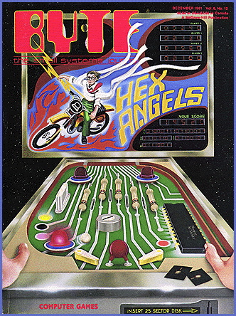

# 15 Years Ago in BYTE

*Blasts From The Past*

We wrote about how to get the most our of the color grahics features of the Atari 400 and 800. We also extolled the virtues on on-line databases that let you access data without having to drive to the library.

## December 1981

e found this article by Steven Roberts drawing lots of attention in hopes of easy information access.

Online Information Retrieval: Promise and Problems

by Steven K Roberts

How many times have you experienced the frustration of showing someone your computer system and finding yourself confronted with such questions as: "Can I ask it something?" or "Have you got anything in there on me?" Thanks to a wealth of naive fiction and movies, the general public (still!) thinks of even the smallest computer as a great, mysterious storehouse of information that dwarfs human minds and invades personal privacy.

We all know that our little micros hardly justify this reputation, but some systems out there do harbor astonishing volumes of information. That isn't news, but recent developments have brought some of these robust resources within the grasp of the personal computer user.

An example: not long ago, when the words were coming far too slowly on a book project, I fell into a tea-sodden brainstorming session with one of my associates concerning schemes which might bring us wealth. Both design engineers with a degree of entrepreneurial fervor, we naturally settled upon high-tech products. As avid cyclists, we chose as one of our potential projects a digital bike odometer/speedometer with liquid crystal display, trip memory, and zero-drag interface with the machine.

After we refined this idea and rejected most of the other harebrained schemes, the time came for some serious research.

I picked up the phone, dialed the local Telenet access number, specified the Lockheed Dialog system, entered my password, and informed the system that I would begin with the Magazine Index (file #47). [Editor's note: For more information about Dialog, see Stan Miastkowski's review, "Information Unlimited: The Dialog Information Retrieval Service," in the June 1981 BYTE.] All this was taking place through my Cromemco Z-2D system, which had been converted into a simple dial-up terminal via the command CHAT.

Once the big West Coast system acknowledged my presence in the Magazine Index, I said:

SELECT BICYCLE?

AND ODOMETER?

(The "?" symbols are wild-card characters to accommodate plural forms of the words.) The system responded with the fact that there were, in its files, 904 articles on bicycles, two on odometers, and one dealing with both. When I directed the system to provide the details about that article, I received a bibliographic reference (and a short abstract) for the article, "How Far Did You Cycle Today?" by Arthur V Clark, which appeared in the May 1980 issue of Popular Electronics. On a hunch, I tried:

SELECT BICYCLE?

AND SPEEDOMETER?

and received two more references -- one to a Beaber article in RadioElectronics and the other to a Sandler piece in Popular Mechanics. Further probing yielded pieces on bicycle accessories in Better Homes and Gardens and Consumer Guide.

This was all very interesting and likely to yield some ideas, but what about marketing? I directed the system to change to the "Encyclopedia of Associations" database and quickly located the addresses and phone numbers of the Cycle Parts and Accessories Association and the Bicycle Wholesale Distributors Association. Both groups would probably be useful in assessing the market potential of our device. If not, there were 17 other groups listed that were somehow connected with cycling.

We also needed to know about related patents. Would our device infringe on an existing patent? Would we be spending thousands of dollars on research and development just to conclude that round is the optimum shape of a wheel? Or, looking at it somewhat differently, could we take advantage of someone else's development effort, modifying it slightly and presenting it to the world as our own?

Formerly, a patent search was expensive and represented a major portion of the cost associated with filing a new invention, but no longer. I merely typed "B 25", to begin searching in database 25 (CLAIMS-US Patent Abstracts), and then issued the identical command that I used in the Magazine Index. Instantaneously, the system informed me that since 1978 there have been 1255 patents related to bicycles, 100 linked to odometers, and five somehow corresponding to both.

It was easy to get a lengthy description of those five, including the assignee's name, an explanation of the technique, descriptions of drawings, etc. In about five minutes, I had reviewed the recent US patent history of bicycle odometers. A quick check revealed nothing of interest from 1971-1977.

It's tempting to offer esoteric descriptions of methods for deriving information from a bicycle wheel and accumulating the data in a nonvolatile counter; but that's not the point here. Of interest to us is that much of the preliminary research was conveniently completed in a few minutes with a home computer, in a process that hardly exercised the capabilities of the interactive information-retrieval system at the other end of the data link.

Five Prerequisites

Information hasn't always been that accessible. Not until the development of at least five crucial ingredients could an untrained, casual user like me rapidly obtain so much information.

First, the obvious: there had to be great volumes of data in machine-readable form. Dialog alone houses over 35 million records -- each heavily cross-indexed in ways ranging from a simple directory listing to a thorough bibliographic citation containing an abstract.

Much of this machine-readable information began to appear in the mid 1960s, when publishers discovered the wonders of computer phototypesetting and began compiling directories, magazines, handbooks, and the like in a form that could be read directly by computer. The original motivation for creating databases was thus not so much the anticipation of interactive information-retrieval systems as it was the economic considerations of the publishing industry.

Second, the development of computer hardware and relatively low-cost mass storage facilities progressed throughout the 1960s and '70s, yielding facilities that could host masses of data and allow multiple users simultaneous access to it. This was a major achievement, for the amount of data involved in a system like Dialog would have dwarfed the systems of the '60s, which also lacked the resources required for efficient information access and timesharing.

Third, all the fine hardware, then as now, was of little use without decent software. Early approaches centered around batch mode, in which a user's information requests were handled open-loop -- frequently overnight. This precluded the kind of system whose responses to a person's queries guide the selection or refinement of further queries -- altogether a more efficient and desirable way of doing things. Such interactive software presents problems that have occupied designers for years, and complaints about "friendliness" and resolution of ambiguities still exist. But the combination of good search software and high-speed machines has reduced system response time even during peak-load periods, to an average of perhaps three or four seconds.

The big and fast machines, good code, and an abundance of useful in formation were fine. But there were still two things needed to make database systems practical for users outside well-funded research environments.

One was the development of data communication networks (such as Tymnet and Telenet) that could lift the burden of long-distance charges from those not blessed with WATS lines and accommodating department budgets.

The final requirement was filled with the advent of the microprocessor. Along with all its other accomplishments, the microprocessor has lowered equipment costs to the point where just $250 can buy a reasonably decent video terminal with a built-in modem. Some people (mostly long-time owners of expensive systems, no doubt) would call this obscene, but the major economic barriers to serious widespread computer use have been removed. Well...almost. A quick glance down Dialog's list of over 120 databases shows hourly "connect time" rates ranging from $25 to $300. This, to the casual observer, seems anything but cheap.

What's Your Time Worth?

Bibliographic information, such as that derived from the Magazine Index, is readily available from a well-stocked public library (although usually not so efficiently). But travel time and the extra digging made necessary by the lack of centralized indexing can make the typical goal-directed library visit trying. Unless you know what to look for and where to find it, you might end up just browsing.

Of course, you can always browse in the Dialog system, though connect time charges averaging $1 per minute discourage that. Instead, a session online is best approached with a "search strategy," which minimizes the time spent chasing down loosely related information. In our example, we took advantage (at a rather low level) of the Boolean operators (which include OR and NOT, as well as AND) to eliminate the need to check all 904 bicycle articles for references to odometers. I decided on this approach before signing on and interacted with the system as briskly as possible, with no time out for coffee breaks, chitchat, or manual retrieval of the referenced articles (which, it turned out, were on my bookshelf all along).

In most cases, this approach produces intense interplay with the machine that takes only as long as necessary -- rarely more than 10 minutes for a specific search. The resulting charge is far cheaper than the gas and time that might otherwise be required, and the scope of the references is far greater than what would be found in a typical library.

It is this last point that underscores the value of online information retrieval. The Magazine Index is only one of Dialog's many databases, yet it provides cover-to-cover indexing of more than 370 publications. The index is updated monthly, with cumulation since January 1977.

Even more impressive are the specialized files: BIOSIS, for example, covers life sciences research with roughly 200,000 citations per year from 8000 serial publications, as well as books, notes, symposia, etc. In the engineering disciplines, there are COMPENDEX (100,000 citations per year in a variety of fields), INSPEC (150,000 per year in electrical engineering and computer fields), ISMEC (15,000 per year in mechanical engineering), SAE (800 per year in automotive engineering), and many more. It should be noted that some of these are found in the SDC ORBIT system; others both there and in Dialog.

Any consideration of the economics of using databases must include the scope of the available information. What combination of traditional information resources could offer the multidisciplinary abundance of frequently updated material in Dialog? You can even obtain reports on SEC filings of corporations, find the student-teacher ratio in your old grade school, poke around in a worldwide index of doctoral dissertations, or find out how your congressman voted on a recent issue.

Add to this the facility, in most databases, of obtaining the full-text documents of interest through an online ordering facility. At first glance, this ultimate dependence on paper appears to be a system weakness, though far superior to online transmission of documents at 300 bits per second (bps), especially in light of the connect-time charges.

Cheaper Searching

With the exception of certain dedicated systems, such as Mead Data Central's LEXIS (a legal research database) and Pergamon's VIDEO PATSEARCH (a patent database), database facilities are designed to be accessed by any dial-up terminal. Therefore, all of the system resources are housed at the far end of the data link.

Although this minimizes the equipment requirements placed on the person who desires access to the system, this approach is hardly efficient. In using Dialog and ORBIT, I have already noticed my creeping panic at the rapidly accumulating cost of online time -- especially when I employ inefficient search strategies to locate something about whose classifications I am uncertain. The clock's ticking tends to encourage haste and inhibit use of some of the system's more subtle capabilities. Even line editing costs $35-$300 per hour, depending on the database.

But with a local processor, a database searcher can prepare most messages associated with a session prior to the sign-on. This allows a calmer approach to preparing a search strategy, increasing precision and efficiency. Such an approach would have helped during a brief Dialog demonstration that I gave while preparing this article. Workmen were installing a security system in my house as I wrote, the din of men and machines drowning out the gentle pattering of the Hazel's keyboard. The workmen needed a break at about the time I needed some information, so I called them over to see the system. To lend a personal touch, I interrogated the Newspaper Index for references to articles about their company, Warner Security Systems. My command was:

SELECT WARNER AND SECURITY

I should have known better. Of the five articles referenced, only one was related to the company. One extraneous piece touched on Volney F Warner's opinions about national security. Another contained a quote from John W Warner Jr, concerning the conduct of security services during the attempt on President Reagan's life in March 1981.

Since I was paying $1.25 per minute for 300 bps transmission of these references, I should have issued a more specific search command. The following command, for example, yields only the article of interest (a Wall Street Journal piece from March 12, 1980):

SELECT WARNER AND SECURITY

(W)SYSTEM?

(Incidentally, SELECT is normally abbreviated S, and in the above command the (W) implies that the words SECURITY and SYSTEM must be adjacent to one another.)

My first exploration of the CLAIMS database covering US patents was equally inept. For reasons of prurience, I inquired about sex-related inventions. The very first one displayed was a method for inducing the early flowering of young deciduous trees!

A Larger Perspective

So far, my emphasis on the Rolls Royces of the database world has neglected a new wave of economy models that together address a larger market. The Source and Compuserve have brought large-system resources to the individual at much less intimidating prices. Providing electronic mail and a variety of consumer-related services, these less expensive databases represent a service that rests between the giant systems already described and those that will ultimately appear in the living room of Mr and Mrs John Q Smith of Anytown, USA. But the mass market presents several challenges. One is achieving "user-friendliness." Another lies in the choice of a "delivery mechanism" that can accommodate millions of users. Marketing and copyright and other legal snags pose still other challenges. Let's consider these separately.

Friendly Systems

A long-standing problem in all computer systems -- the lack of intuitively obvious ways to interact with the machine -- is especially troublesome to untrained users lacking interest in computers. A "veteran" like me can forgive an antique text editor its idiosyncracies: the idea of a "virtual pointer" is solidly established in my head, and I know most of the 25 or so commands by heart. But I have sometimes had to turn clerical personnel loose on the system, with discouraging results. The difference between string and insert modes becomes a mystery, and the commands seem like black magic.

Of course, screen editors (such as Wordstar and VEDIT) solve this problem by allowing the objects of interest to be manipulated more directly and making the resuhts of any change immediately visible on the screen. But systems must go further to be palatable to the masses. Future systems must incorporate many of the characteristics that make arcade games fun: provision for developing competence without having to study manuals or even use reference cards; direct correlation between hand movement and visual results; freedom from intimidating error messages (like the cryptic ERROR CODE 19); and fostering of graceful evolution from novice to expert, with enjoyment and challenge at every level.

To this end, current developments in "object-oriented programming" (like Smalltalk) offer interesting alternatives to the classic, command-oriented style of system use. For database and information utility systems to win wide acceptance, they must enable a newcomer to step up to a teletext terminal (or whatever), play around, and within a few minutes begin to derive some satisfying result, without reading any documentation or instructions. For the present, systems like Dialog and The Source, with their counter-intuitive command syntaxes and their unforgiving error-handling facilities, will serve only those who need them badly enough to tolerate their inhuman natures.

Delivery of Online Services

If you want to research the world's literature on bicycle odometers, you dial your Telenet access number, specify the network address of the online vendor of choice, enter your password, and go to it. But if 43,608 Chicago residents simultaneously decide to check with their viewdata systems for movie information, news headlines, "yellow pages" service, airline schedules, and horse racing results, something other than a dialup network must be available. And so it is: cable TV and all its permutations. However, since no subscriber possesses his own private cable, some clever means must be provided to give at least the illusion of a "dedicated" system.

One approach involves continuous transmission of a full database and interception of desired frames by an intelligent local terminal. Another technique, called a hybrid network, accommodates the widely divergent bandwidth requirements of user input and video display. It uses the phone line for communication from the user to the system and the cable TV network for information flow in the other direction (a sort of video packet-switching scheme).

Whatever the solution, the cost will clearly be great, and numerous competing technologies will ensure a lack of standardization for many years.

Yes, You Need This System!

Before the world becomes a community of electronic cottages, someone must do a very clever selling job. Ask a person who's not already involved with computers what he or she would do with a home system or with access to an information utility, and the answer will likely be: "Huh? I dunno." But the reality is that everyday almost everyone uses information resources that are amenable to "computerization." The online telephone directory is already under development by the French Postal Telegraph and Telephone Agency (PTT), which plans to produce 200,000 electronic-directory terminals for free distribution. PTT expects to recover the $50 million manufacturing cost through the obsolescence of telephone books. As a fringe benefit to the users, the terminal is compatible with Teletel (the French videotex service), as well as database, electronic mail, funds transfer, and shopping services.

In addition to telephone-directory service, we take many other information sources for granted. News media, airline and theater schedules, stock market data, and classified advertising -- all are continually updated compendia of information that the bulk of the population uses routinely. And, although people are paying for these compendia in a variety of ways, cost to the individual is not obvious.

Monthly billing based on usage time for a home information terminal, however, would be very obvious. This fact may frustrate the marketing of information services for some time, especially since most potential customers will initially have trouble seeing the need for the service.

The Fine Print

We are already confronting another problem that will require landmark legal decisions before we can enter the era of online databases for the masses. Now that data storage is becoming cheap enough to permit storage of "full text" in databases, instead of offering mere bibliographic references, interesting copyright questions arise. For example, if I sell only "first serial rights" on an article to a magazine, I may not be enthusiastic about the article's subsequent appearance in an online information utility from which anyone can draw at will. In some countries, this same problem, in the nonelectronic arena of library loans, has already spawned "Public Lending Right" laws that require royalties for the author upon each borrowing of a book. If access to books in machine-readable form becomes widespread, some modifications of copyright laws will be necessary to provide compensation to authors for electronic consumption of their work.

Other legal hurdles remain. Printers' unions are likely to resist the erosion of their industry by electronic data transmission. We'll probably also see lawsuits claiming restraint of trade, monopolistic practices, invasion of privacy, copyright infringement, and unfair labor practices.

Despite these four problem areas, the information industry is experiencing explosive growth at all levels of sophistication. Though many field trials have failed, there has been enough positive feedback from users to convince corporate giants that there's big money to be made in this business. At the 1981 National Online Meeting in New York City, the largest draw of the entire three-day conference was a panel discussion on mergers and acquisitions. The intensity and scope of this industry were clear.

## A Look to the Future

We must consider a broad range of database services to achieve a clear perception of the information industry: everything from consumer-oriented, cable-delivered teletext to encyclopedic "research-grade" repositories. Some database services are reputedly simple enough for a child to use and others so complex that the online vendors must routinely offer seminars and consulting services.

We are likely to see a convergence of these extremes into systems that combine depth of scope with ease of use. Present videotex services have limited appeal to the professional market, and other potential users may prefer hard copy. But if new concepts of easier and more productive use of computer systems (the subject of a three-day conference in Ann Arbor, Michigan this May) enter the design of online systems, then the robust services will become much more palatable.

It is a situation comparable to the personal computer's market penetration at the consumer level: beyond games, there has to be some distinct practical value (not contrived, either -- show me a recipe filing program that can beat the Joy of Cooking and a 3-by-5 card index!) before people will spend a few hundred dollars on something they suspect is a toy.

Above this level, however, development is proceeding apace. In most cities, small firms, calling themselves "database intermediaries," are preparing to provide infrequent users with search services. This relieves people of the need to develop expertise in using complex systems. Considering the problems associated with categorizing all of reality in a way that would allow anyone to find one item easily, such sales of expertise may represent the wave of the future.

The problem of categorizing reality becomes even more awkward where images are concerned. Superficially amenable to standard database techniques, images become troublesome when multilayered meanings call for widely divergent classifications. Should a particular painting of the crucifixion be considered in its iconographic context, or as a skinny man hanging on a cross? The question seems absurd in the twentieth century, but similar confusions of meaning have plagued art historians through the ages and render every system of classification ambiguous and ultimately traceable to the cultural biases of a few people.

The question of categorizing images is especially important, because the new technology of videodiscs has given us a powerful tool for the storage and retrieval of graphic and textual information. One commercial service (VIDEO PATSEARCH from Pergamon) already combines online database access with a local library of drawings on videodisc. With at least one manufacturer's disc capable of storing 108,000 video frames, there is great potential for the inclusion of graphics, as well as "full-text," in specialized database systems.

The online storage capabilities described here seem to presage enormous changes in the library of the future. We can only assume that mass storage of all types will continue to grow cheaper as human time becomes more expensive; it follows that ever-better tools for information seekers will continue to develop. As we gain facilities that far surpass the efficiency of books, shelves, and call slips, perhaps we can somehow avoid losing the human warmth of libraries.

## December 1981

## Images

