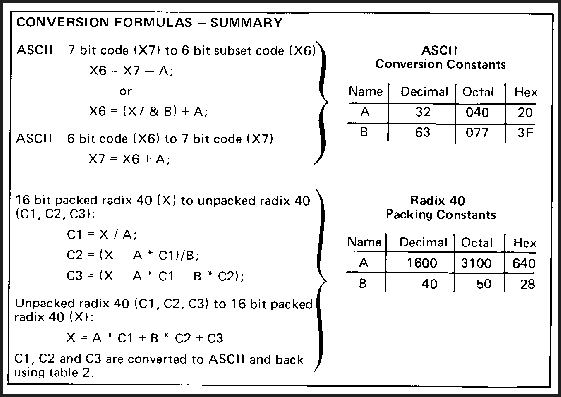
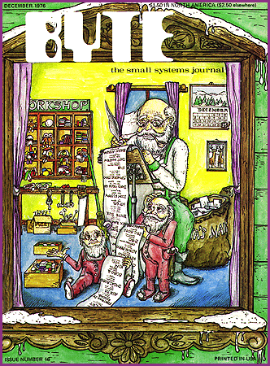

# 20 Years Ago in BYTE

*Blasts From The Past*

What was on Santa's list? Perhaps more memory. We printed an article that discussed how to squeeze the fat out of text strings. In addition, we wrote about do-it-yourself weather stations. Advertisers such as Sol Systems touted $995 make-it-yourself small-computer kits.

Now we look even further back. In

## December 1976

* we helped readers maximize their memory.

Don't Waste Memory Space

(One Way to Squeeze Fat Out of Text Strings)

by Robert Baker

If your system uses plenty of canned messages, chances are you're wasting valuable memory space. Most small systems are currently using a 7 bit ASCII code with one character per 8 bit byte of memory space. Why use a 7 bit code, capable of selecting 128 characters, when you really only need 64 or even 40 different characters for simple alphanumeric text? Your simple video display may only be able to handle 64 characters anyway, so why waste memory space needlessly?

By using less bits for a character code, messages can be condensed or packed in memory very easily. For example, a 6 bit ASCII code that is a subset of the standard 7 bit ASCII code allows a character set of 64 characters. The 6 bit ASCII code is easily obtained from the 7 bit code by converting all lower case letters to upper case letters and simply subtracting octal 40 from the 7 bit code (or adding octal 40 to the 7 bit code and truncating to the rightmost 6 bits). With a 6 bit code, four characters can be packed into three 8 bit bytes of memory providing a 25% saving on the required memory storage space for a given message.

On the other hand, the normal text typing routine must be modified to unpack the compressed 6 bit character codes and convert them back to standard 7 bit ASCII for output to the terminal device. To unpack the characters, use a combination of shift (or rotate) and bit masking (logical AND) instructions, then add octal 40 to the 6 bit code to restore it to 7 bit ASCII. Unused printing characters may optionally be decoded by the typing routine and converted to special function characters such as carriage return, line feed, etc, for special applications.

Another possibility is to use a radix 40 coding scheme that provides a character set of 40 characters, packed three characters per 16 bit double byte unit of data. A typical radix 40 scheme is summarized in

## Table 1

. This scheme takes advantage of the fact that a 16 bit integer has 65,536 distinct states, while a set of three radix 40 characters has 40*3 = 64,000 distinct states. To create a given 16 bit radix 40 three character field, X, from characters C1, C2 and C3 (assumed to be integers from 0 to 39) the following arithmetic expression must be evaluated:

(1) X = C1*1600+C2*40+C3;

All arithmetic is assumed to be unsigned, performed with 16 bit precision for the results. Similarly, to unpack a given 16 bit radix 40 field into individual character codes, evaluate the following expressions:

(2) C1 = X/1600;

(3) C2 = (X - 1600*C1)/40;

#(4) C3 = (X - 1600*C1 - 40*C2);

Going from the radix 40 character representations C1, C2 and C3 to ASCII equivalents and back is done with a table lookup using information found in

## Table 2

accompanying this article. For conversion to radix 40, each three character grouping of text is converted from ASCII to radix 40 values C1, C2 and C3, then formula (1) is evaluated giving the 16 bit value to be stored. For conversion from radix 40 packed storage into ASCII, formulas (2), (3) and (4) are evaluated in sequence, then the ASCII codes equivalents of the C1, C2 and C3 values are looked up in the conversion table.

Using either coding scheme you gain space by packing characters in memory but lose space elsewhere due to modified type routines to unpack and convert the codes to usable ASCII. The amount of space you gain is variable, depending on the length and number of messages to be stored, as well as the coding scheme used. On the other hand, the amount of space lost is fixed and depends only on the coding scheme used. Thus the overall saving in memory space is totally dependent on the application. The more messages you use in your system, the more memory space you can save by implementing these ideas.

## Table 1

One assignment of radix 40 character values to printable

6graphics is provided by this table. Using 26 letters,

610 numbers and 2 special characters leaves two states

>unassigned. One, the value 0, is given the "null" assignment,

4and the other value 29, is left open in this table.

8Conversion can be done between ASCII and radix 40 codes

using table 2.

Character

.Graphic Decimal Hexadecimal Octal

-null 0 00 000

-A 1 01 001

-B 2 02 002

-C 3 03 003

-D 4 04 004

-E 5 05 005

-F 6 06 006

-G 7 07 007

-H 8 08 010

-I 9 09 011

-J 10 0A 012

-K 11 0B 013

-L 12 0C 014

-M 13 0D 015

-N 14 0E 016

-O 15 0F 017

-P 16 10 020

-Q 17 11 021

-R 18 12 022

-S 19 13 023

-T 20 14 024

-U 21 15 025

-V 22 16 026

-W 23 17 027

-X 24 18 030

-Y 25 19 031

-Z 26 1A 032

-$ 27 1B 033

- 28 1C 034

-unused 29 1D 035

-0 30 1E 036

-1 31 1F 037

-2 32 20 040

-3 33 21 041

-4 34 22 042

-5 35 23 043

-6 36 24 044

-7 37 25 045

-8 38 26 046

-9 39 27 047

## Table 2

Equivalences between ASCII 7 bit codes, ASCII 6 bit subset codes,

Cand radix 40 codes. This table can be used to design lookup tables

@for use in compressing character strings and expanding them for

external formatting purposes.

@ Standard 7 bit 6 bit Modified Radix 40

Character ASCII Code ASCII Code Character Code

Graphic Hex Octal Hex Octal Hex Octal

Space 20 040 00 000 00 000

/! 21 041 01 001

/" 22 042 02 002

/# 23 043 03 003

B$ 24 044 04 004 1B 033

/% 25 045 05 005

/& 26 046 06 006

/' 27 047 07 007

/( 28 050 08 010

/) 29 051 09 011

/* 2A 052 0A 012

/+ 2B 053 0B 013

/' 2C 054 0C 014

/- 2D 055 0D 015

B. 2E 056 0E 016 1C 034

// 2F 057 0F 017

B0 30 060 10 020 1E 036

B1 31 061 11 021 1F 037

B2 32 062 12 022 20 040

B3 33 063 13 023 21 041

B4 34 064 14 024 22 042

B5 35 065 15 025 23 043

B6 36 066 16 026 24 044

B7 37 067 17 027 25 045

B8 38 070 18 030 26 046

B9 39 071 19 031 27 047

/: 3A 072 1A 032

/; 3B 073 1B 033

/< 3C 074 1C 034

/= 3D 075 1D 035

/> 3E 076 1E 036

/? 3F 077 1F 037

/@ 40 100 20 040

BA 41 101 21 041 01 001

BB 42 102 22 042 02 002

BC 43 103 23 043 03 003

BD 44 104 24 044 04 004

BE 45 105 25 045 05 005

BF 46 106 26 046 06 006

BG 47 107 27 047 07 007

BH 48 110 28 050 08 010

BI 49 111 29 051 09 011

BJ 4A 112 2A 052 0A 012

BK 4B 113 2B 053 0B 013

BL 4C 114 2C 054 0C 014

BM 4D 115 2D 055 0D 015

BN 4E 116 2E 056 0E 016

BO 4F 117 2F 057 0F 017

BP 50 120 30 060 10 020

BQ 51 121 31 061 11 021

BR 52 122 32 062 12 022

BS 53 123 33 063 13 023

BT 54 124 34 064 14 024

BU 55 125 35 065 15 025

BV 56 126 36 066 16 026

BW 57 127 37 067 17 027

BX 58 130 38 070 18 030

BY 59 131 39 071 19 031

BZ 5A 132 3A 072 1A 032

/[ 5B 133 3B 073

/\ 5C 134 3C 074

/] 5D 135 3D 075

/(up arrow) 5E 136 3E 076

/(left arrow) 5F 137 3F 077

## Conversion Formulas

## December 1976

Steve Roberts is a freelance writer and microprocessor systems consultant who lives in Dublin, Ohio. He is the author of two books and some 40 articles and, when he tears himself away from the word processor, enjoys photography, bicycling, and music.

## Images

