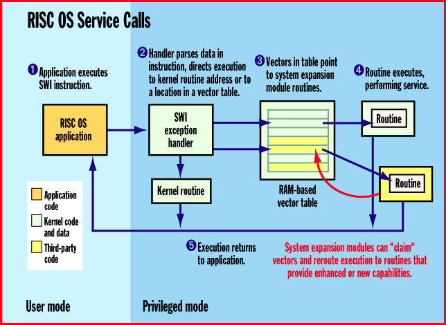
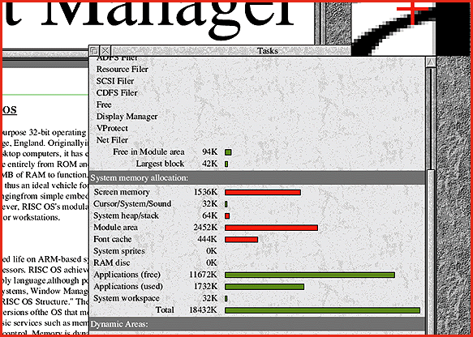

# A RISC OS for All Seasons

*Core Technologies*

_Acorn's OS is ideal for embedded applications, yet it scales up to operate desktop computers.

Stewart Palmer

RISC OS is a general-purpose 32-bit OS developed over a 10-year period by Acorn Computers. Originally intended to offer an easy-to-use GUI environment for users of the Acorn RISC machine-based (ARM) desktop computer, it has evolved into a low-footprint, general-purpose OS. Acorn designed it to execute entirely from ROM and share resources. Thus, a fully configured system requires only 4 MB of RAM to function. Such a system can be operational in seconds after being switched on. It is therefore an ideal vehicle for low-cost, high-performance applications on a variety of platforms, ranging from simple embedded systems to set-top boxes to network computers. However, RISC OS's modular architecture allows it to scale up in capabilities so that it can drive multiprocessor workstations.

Kernel Features

Since RISC OS began on ARM-based systems, it operates on ARM610, ARM700, ARM7500, and StrongARM microprocessors. RISC OS's compact code size and high performance come from the use of ARM assembly language, although portions of it are in C. Many of RISC OS's services (e.g., file systems, font rasterizer, and GUI) are implemented as system expansion modules. You can separate and recombine these modules in a variety of ways to produce new versions of the OS that meet the specific needs of a particular hardware environment.

The kernel provides basic services such as memory allocation, interrupt handling, and DMA services, plus video-display generation and control. Memory is dynamically allocated from a free pool. Memory blocks are assigned one of several protection levels to limit a program's access to certain areas of memory.

RISC OS runs primarily in three of the four execution modes that the ARM processor supports. These privileged modes are interrupt mode, fast interrupt mode (a high-priority interrupt), and supervisor mode. You activate the latter mode by a processor-specific software interrupt instruction (SWI) that RISC OS uses to enter system routines or system expansion modules. RISC OS also uses certain SWI calls to communicate with different parts of itself or to converse with applications. The fourth mode is, of course, the unprivileged user mode that RISC OS applications use.

RISC OS implements multitasking by using a cooperative mechanism, where only one process is active at a time and must periodically yield the processor so that other processes get execution time. Neither the kernel nor system expansion modules are multithreaded. However, because much of the OS code is interrupt-driven, major OS processes get enough processor time to operate effectively.

Like OS service calls, modules use the SWI instruction as their entry point. Because RISC OS's SWI handler uses a RAM-based interrupt vector table to route most system calls, you can modify this table to reroute calls to another module. (Not all kernel calls get directed through the vector table, and you can't modify such routines.) A system call lets you "claim" a vector, making it easy to add a module that offers enhanced capabilities to existing services, or provide new OS functions, as shown in the figure

"RISC OS Service Calls."

Modules must be both relocatable and reentrant. These requirements enable a module to be loaded into any section of memory (relocatable) and its code to be shared by several applications (reentrant), thus making the best use of memory.

Acorn built networking into the OS. It is largely based on BSD 4.4 Unix. Unlike Unix, RISC OS offers well-defined interfaces so that drivers or protocol stacks integrate easily into the kernel. TCP/IP is included as standard, with support for peer-to-peer networking that allows the easy sharing of disks and printers. NFS is also available, as are LAN Manager protocols (over NetBEUI or IP). A common desktop filer interface gives you a seamless view of all attached network resources.

Acorn Replay offers both application developers and users a simple, layered architecture dedicated to rendering time-based media such as audio and full-motion video. The Replay architecture is interrupt-driven and incorporates a clipping module that allows full and partial overlays of video windows on the desktop. The initial layer of the architecture is a Recognizer that determines what type of file container is to be operated on. Supported containers include the native ARMovie format, AVI, WAV, and MPEG. The second Replay layer, the Fetcher, transforms data held in the file container into a standard format that is interpreted by the appropriate Decompressor. A final layer, the Painter, renders decompressed data into a window. Each layer of the Replay architecture is capable of being extended by third-party developers.

System Expansion Modules

While the kernel provides low-level services such as I/O, system expansion modules implement RISC OS's higher-level services. Such services include file I/O, drawing and maintaining a GUI, and responding to user events. While RISC OS has many system expansion modules, I'll describe only two of them here.

The most visible and complex system expansion module is the Windows Manager. Responsible for implementing RISC OS's windows, icons, menus, and pointing device (WIMP) graphic interface, it is frequently referred to as the Wimp. Besides drawing and maintaining RISC OS's GUI, the Wimp also handles user events, starts and terminates applications, supports the cooperative multitasking mechanism, implements an applications intercommunications protocol, and performs some memory management. In short, it is the linchpin of RISC OS's operations. Many other system expansion modules (e.g., the Font Manager and the Replay architecture) provide support services for the Wimp.

The RISC OS Font Manager provides antialiased outline fonts. Small text is highly legible when viewed on low-resolution displays. Such text even retains its crispness on systems using TV screens because of an antitwittering algorithm.

Applications and Environment

RISC OS applications use a suite of common facilities to render data, communicate with each other, and interoperate. These facilities are conducive to a consistent programming style. A comprehensive style guide ensures that all applications offer a similar look and feel to the user. A memory-based save/load protocol implements an applications intercommunications mechanism and uses a disk-based scrap file to handle large amounts of data. This save/load protocol lets you drag and drop data from one application to another, which enhances the system's overall ease of use. It also is the cornerstone for crafting applications that execute a few functions extremely well and link seamlessly with other applications that provide additional functions as needed.

A Task Manager lets you dynamically alter the amounts of memory allocated to system resources and applications (

see the screen

). If you choose to antialias text at an unusually large point size, you can increase the amount of RAM devoted to the system's font cache by dragging a slider bar on the Task Manager display. You can deallocate this memory by the same method when no longer required. Similarly, you can create and delete a RAM disk of any size as necessary by dragging on a slider bar.

RISC OS's functions are both modular and scalable, which lets the kernel play the embedded program in a consumer device. RISC OS components are finding their way into new generations of multimedia kiosks, navigational aids, and mobile communications devices. When combined with its GUI, a file system, and multimedia modules, RISC OS also can command desktop computers or workstations. While its dependence on ARM processors once may have seemed limiting, the emergence of high-performance StrongARM-based systems has begun to change this situation dramatically.

## Where To Find

Acorn Risc Technologies

Cambridge, U. K.

Phone: +44 1223 577817

Fax: +44 1223 577900

E-mail: sales@art.acorn.co.uk

http://www.art.acorn.co.uk/

Internet:

http://www.art.acorn.co.uk/

## RISC OS Service Calls

\The mechanism for handling service calls allows new features to be added easily to the OS.

## Dynamic Management

The Task Manager lets you dynamically assign memory to OS processes to applications.

mailto:"spalmer@art.acorn.co.uk"

^Stewart Palmer is design engineering manager at Acorn Risc Technologies. You can reach him at

spalmer@art.acorn.co.uk

## Images

