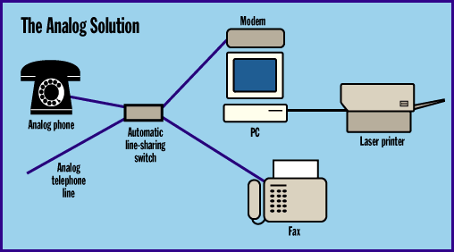
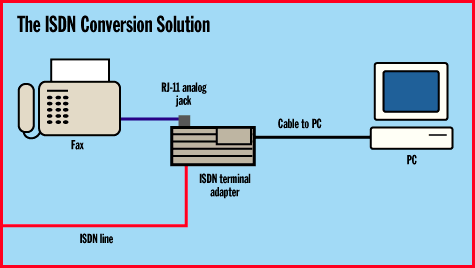
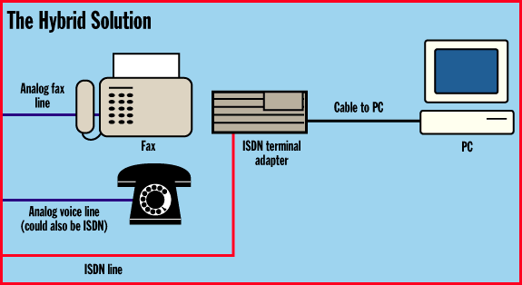

# The Complete ISDN Telecommuter

*Core Technologies*

WA look at several techniques for getting the remote office worker connected via ISDN.

Jeffrey N. Fritz

The primary objective of telecommuting is to set up an environment in a worker's home that's analogous to the environment he or she finds in the office. Typically, that means a computer connected to the corporate network, along with a telephone and some form of fax service. Therefore, when designing a comprehensive telecommuting solution, careful attention has to be given to all three of these categories -- networking, voice, and fax.

Placing an additional analog line in the telecommuter's home is one of the most commonly used methods for supplying an integral telecommuting solution. Such a line can be switched from voice to modem to fax, either manually or by installing an automatic line-sharing device switch, such as Black Box's Automatic Sharing Device-4, or ASD-4 (see the figure

"The Analog Solution"

As the figure illustrates, this approach is cost-effective and easy to implement. But it also has disadvantages, particularly for remote LAN access. Analog modems require long training periods of 10 to 20 seconds before they can begin transferring data. And once a connection is made, throughput speeds are limited.

The ISDN Connection

Because of analog's disadvantages, ISDN is often a preferred telecommuting solution -- if it's available and can be obtained at a reasonable cost. Basic-rate ISDN offers two B (bearer) channels at 64 Kbps each and one D (delta) channel at 9.6 Kbps. By using data compression and combining the two B channels, ISDN is capable of 10 times the throughput of a 28.8-Kbps modem. Moreover, ISDN's local connection time is measured in milliseconds.

Another telecommuting method takes advantage of a number of ISDN products that allocate one of the ISDN B channels for analog devices. ISDN terminal adapters, such as the BitSurfr Pro from Motorola and the Adak 221, incorporate an RJ-11 telephone jack that allows you to plug an analog telephone, modem, or fax machine directly into an ISDN device. This allows you to make analog calls to and from such devices via the ISDN-based connection. It's important to note that some of these devices won't allow you to receive analog calls, as described below.

The figure

"The ISDN Conversion Solution"

illustrates such an arrangement. Since the terminal adapter is the device that handles the conversion from ISDN to analog, any analog phone or fax will work -- including internal PC fax modems.

Yet another method is to employ a mix of ISDN and analog lines to support voice, fax, and data services. As the figure

"The Hybrid Solution"

shows, each device is connected to a single line dedicated to that device. Voice service can be supplied via either an analog or ISDN line, depending on the desired features each service offers. But it requires the installation of multiple phone lines, making it costly and complex to support.

Intelligent channel-contention ISDN devices, such as the Ascend Pipeline 75, automatically take care of call control and on-demand bandwidth management. When the user wants to make an analog voice call or send a fax, the ISDN device recognizes this. It automatically releases one of the B-channel network connections for use in the analog call. During the call, network throughput will slow down to the single B-channel rate of 64 Kbps, but the connection will stay in place.

When the user hangs up, the device releases the B channel that was used for the analog connection. The network connection can then automatically recover the extra bandwidth. If the additional bandwidth is not necessary at that moment, the ISDN device may simply decide to leave the channel down, keeping it open for other calls.

The telecommuter knows nothing of the magic that's occurring behind the scenes to make all this possible. Having been given simultaneous, nonblocking access to data, voice, and fax services, the worker sees only the ability to work at home in much the same way as he or she would in the office.

Ringing Voltage Issues

On an analog telephone line, the phone switch creates a ringing voltage that signals an incoming call. This voltage, typically at 100 V, causes the phone's bell mechanism to operate. When you pick up the handset, or when the modem or fax machine goes off-hook, a switch in the device turns off the ringing voltage, and the connection begins.

ISDN signals its connections entirely through the packet information that is placed on the D channel. Therefore, an ISDN device must generate a ringing voltage for any attached analog devices. This requires a much larger power supply than is normally necessary for the ISDN device alone. In addition, the ISDN device must be continually powered in order to support analog calls.

To keep the cost and size down, some ISDN devices do not support ringing voltage. This allows connected analog devices to make, but not receive, calls. If incoming calls are important in your work, be sure to check the specification on the ISDN device you're considering before making a purchase.

Remote-Access Security

It's a simple fact of life that remote connections, whether ISDN or analog, increase the security risk to the corporate network. Therefore, absolutely no one should be allowed to obtain access to the network without first having to enter both an account number and a password.

If passwords are considered the first line of defense, then callbacks are usually considered the second line of defense. When a remote user wants to establish a network session, a network host verifies that he or she has supplied a legitimate account number and password. At that point, the network-side device drops the connection and calls the user back at a preassigned phone number.

The new caller ID service provided by the telephone companies is a great deal like callback security, but without the need to dial the remote user. On call setup, caller ID passes the remote user's number to the remote access device. A network device can be configured to accept only recognized numbers and reject all other calls.

The Internet Engineering Task Force (IETF) has defined two security protocols, Password Authentication Protocol (PAP) and Challenge-Handshake Authentication Protocol (CHAP), which are specified in RFC 1334, "PPP Authentication Protocols." Both allow authentication of a remote device beyond caller ID through the PPP connection.

PAP provides only basic user/password authentication, while CHAP is more robust. The latter sends a "challenge" to the remote unit that's attempting to make a connection to the network. The remote unit responds with a prearranged calculated numerical value. The authentication device checks the response against its own calculation of the expected value. If the values match, the authentication is acknowledged; otherwise, the connection is terminated.

Unfortunately, some remote devices default to no security when they're first installed or if they are reset. This creates a security hole that can catch members of a network staff completely off-guard. Therefore, it pays to be sure that any new network device, or any device that has been reset from its previous configuration, is not offering unauthorized outsiders the opportunity to get a free ride on your network.

## The Analog Solution

]All of a home office's equipment can be placed on a single line with a line-sharing switch.

## The ISDN Conversion Solution

Some ISDN devices provide connections for analog office equipment.

## The Hybrid Solution

An ISDN/analog-line combination can best support a mix of office equipment, but it can be costly.

mailto:"jfritz@wvu.edu"

Jeffrey N. Fritz is responsible for new technology development and the operational management of WINnet, the West Virginia University network. He is the author of Remote LAN Access: A guide for networkers and the rest of us (Manning Publications/Prentice-Hall PTR, 1996) and Sensible ISDN Data Applications (West Virginia University Press, 1996). You can contact him by sending e-mail to

jfritz@wvu.edu

## Images

