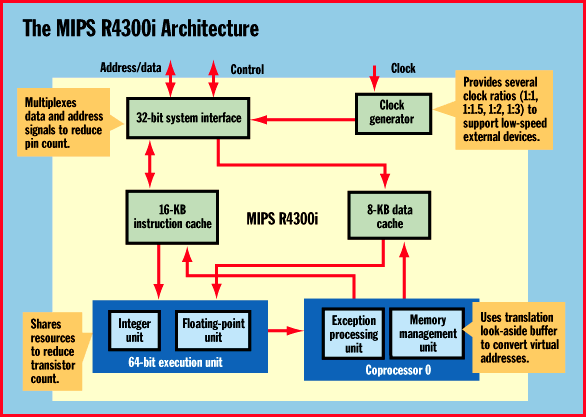
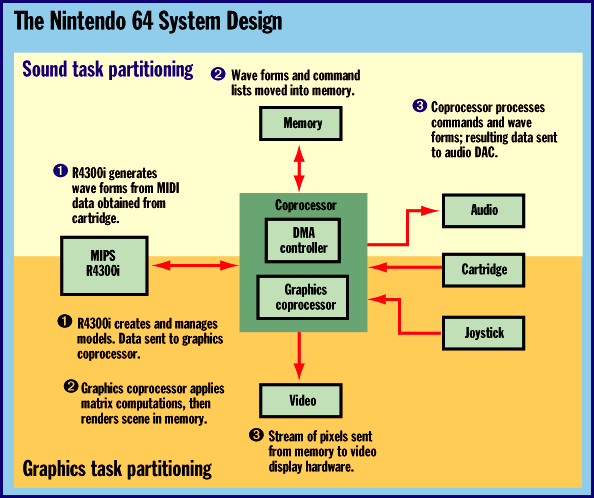

# Super Mario Chip

*Core Technologies*

The 64-bit MIPS R4300i RISC processor powers a compute-intensive consumer game system.

Satya Simha

If you buy your kids the new Nintendo 64 game machine, prepare thyself to be envious: Their graphics processor will stomp all over your desktop computer's. The N64 delivers visually realistic 3-D images and very high-quality audio, thanks to the 64-bit RISC processor -- something you'd normally expect to find in a spare-no-expense high-end server or workstation -- at the core of its design. This processor, the MIPS R4300i, provides a number of distinctive characteristics that enable high performance in a mass-market device, all while reducing its overall cost and power consumption.

A Tour of MIPS R4300i

The R4300i derives much of its microarchitecture from MIPS Technologies' R4400, a workstation-class microprocessor. The chip is code-compatible with the MIPS I, II, and III instruction sets. While the design was tailored to reduce the chip's cost and power consumption, the R4300i still has a number of workstation-caliber features. For example, the processor can operate in either 32-bit or 64-bit mode. Besides a 64-bit integer data execution unit, the R4300i also contains -- surprise! -- a 64-bit FPU.

The R4300i has a single-issue, five-stage instruction pipeline that handles both integer and floating-point instructions. The pipeline minimizes the latencies of load and branch operations so that they have a single-cycle latency. To keep the pipeline filled, the processor has two large on-chip caches: a 16-KB instruction cache and an 8-KB data cache, both of which are 64 bits wide. Both caches are direct-mapped and store physical tag addresses, which reduces the address-matching circuitry and avoids address contention. Specific memory pages in each cache can be locked, which boosts performance by storing frequently accessed items. A system coprocessor contains a memory management unit (MMU) that supervises both caches, as shown in the figure

"The MIPS R4300i Architecture."

The R4300i supports a virtual memory space of 1 terabyte (40-bit addresses). However, to reduce the complexity of the design, the processor does not supply on-chip support for a secondary cache or multiprocessing.

The R4300i has an internal phase-locked loop circuit that enables the internal pipeline frequency to be a multiple of the system clock frequency. This lets the system designer utilize slower external components (perhaps memory) yet operate the processor internally at a higher clock speed for better performance.

The R4300i is manufactured using 0.35-micron, three-layer metal CMOS technology, which reduces the die size and thereby the manufacturing costs. Both the integer unit and the FPU share the same data path, which further shrinks the die. The processor also uses a 32-bit system interface, with multiplexed address and data lines, so that it can be housed in a low-cost 120-pin plastic quad flat package (PQFP).

The R4300i operates at 3.3 V for low power consumption. The engineers also used other methods to reduce power dissipation. For example, the caches are segmented so that only the requested segment is powered rather than the entire cache. The integer unit and FPU are integrated into a single execution unit with shared resources (such as the data path), which both reduces the die size and power consumption. In standard operating mode, a 40-MHz R4300i (running internally at 80 MHz) eats up only 1.5 W.

Building the Box

The Nintendo 64 system was designed with the objective of providing a realistic multimedia experience while keeping the unit compact and inexpensive. The figure

"The Nintendo 64 System Design"

shows the basic blocks used to build the device. At the heart of the system are two components: a custom R4300i clocked at 93.75 MHz and a custom MIPS coprocessor, the Reality Coprocessor (RCP), clocked at 62.5 MHz. The R4300i and the RCP interface directly to each other without requiring any additional glue logic. The R4300i supplies the processing brawn, while the RCP handles most of the audio and graphics. The RCP has on-board DMA logic, audio and video outputs, plus a joystick input. This enables the RCP to manage data transfers, create the display, and generate sound using a minimum number of supporting chips. The RCP also supports the timing and signals for a game cartridge unit. A graphics coprocessor internal to the RCP has a memory interface to external DRAM, which serves as a frame buffer and scratchpad storage. The memory interface supports a transfer rate of 500 MB per second to high-speed RAMBUS DRAMs, all while keeping the pin count low.

## Divide and Conquer

The biggest challenge to obtaining high performance was how to partition tasks, both from the software and the hardware standpoint. For efficient processing, the N64 partitions audio and graphics operations into separate tasks. The R4300i works as the central controller and interrupt handler. It also handles all high-level audio processing functions. For example, the R4300i uses the FPU to synthesize high-precision audio wave forms. The RCP handles those jobs where software algorithms alone can't meet the bandwidth requirements. To generate sounds, the R4300i processes a list of musical events (for example, MIDI notes) to determine the resource and timing requirements. It then builds a digital signal processing command list, starts a DMA transfer of data from mass storage to main memory, and then goes to the next task. The RCP parses the command stream and processes the data in main memory. The DMA controller then sends the processed data to a digital-to-analog converter (DAC) for sound generation.

For generating graphics, the R4300i can readily create and manipulate models (3-D objects described as a mesh of polygons) for use in game scenes. When the game code needs to update the position and the attributes of the models, the R4300i can handle these updates in real time. The models are next forwarded to the graphics coprocessor, which performs matrix manipulation and renders the image. The R4300i's 64-bit mode gives game developers extra precision for models and other calculations without having to write high-precision algorithms or incurring a performance penalty.

The R4300i's large caches are crucial for achieving the N64 system's performance. Without these caches, the frequent memory accesses to fetch program code or data would degrade performance by as much as 20 percent. The large instruction cache allows both upper-level software routines (such as event loops) and the interrupt handlers to be locked on-chip at the same time. The data cache also assists in graphics processing because a small set of data can be stored on-chip and manipulated for every image frame.

Not Just for Workstations

New process technologies allow workstation-class MIPS processors to be fabricated at a lower cost and higher volume, making them appropriate for consumer machines and embedded systems. The R4300i was created specifically to suit low-end applications. Because of the chip's roots, software developers can apply their expertise to the R4300i, and hardware designers can use it to build products for new markets.

## Where To Find

MIPS Technologies

Mountain View, CA

Phone: (415) 933-6477

Fax: (415) 390 6172

http://www.mips.com

Internet:

http://www.mips.com

## The MIPS R4300i Architecture

This 64-bit processor provides an FPU and virtual memory for sophisticated consumer applications.

## The Nintendo 64 System Design

Partitioning game operations between the R4300I and a coprocessor delivered the best performance.

mailto:"editors@bix.com"

Satya Simha has an M.S. in engineering management from Stanford and an M.S.E.E. from Michigan Technological University. Prior to joining Silicon Graphics, he worked as a product definition and applications engineer in the MIPS RISC division. You can reach him in care of

editors@bix.com

## Images

