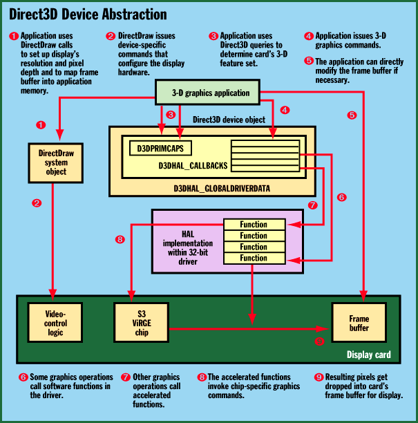

# Direct3D Revealed

*Core Technologies*

Microsoft's 3-D API provides device-independent access to acceleration hardware. Here's how it works.

Stephen P. Johnson

Microsoft's Direct3D, which was released in June, is the latest of the DirectX APIs available for the PC platform. Direct3D offers programmers a hardware-independent API that displays 3-D graphics and provides a mechanism whereby an application can tap into any graphics-acceleration hardware present on a system. (For more information on the Direct3D architecture, see "Must-See 3-D Engines," June BYTE.)

Because it provides OS-level support for 3-D graphics while uncoupling the hardware from the interface, Direct3D enables programs that use 3-D imagery to run on a wide variety of desktop computers. Where possible, these programs can take advantage of the hardware's capabilities to provide optimal quality and rapid generation of 3-D graphics.

It's important to note that hardware-acceleration techniques for 3-D graphics vary widely. This is because 3-D graphics is a new concept on the PC, and the intense cost constraints of the market are forcing new designs and algorithms at the chip level. Also, it can sometimes be difficult to fit a certain hardware design into Direct3D's programming model. For these reasons, expect to see wide variations in performance among the various 3-D graphics cards.

In Your Interface

How does Direct3D manage to hide the details of a display card's hardware yet allow access to acceleration features that are obviously hardware dependent? At the interface level, the low-level Direct3D API abstracts hardware features in a consistent manner that allows such portability. In addition, Direct3D consists of two types of drivers. The first type, which is at the software level, is called the hardware emulation layer (HEL). The HEL generates all graphics operations using the desktop system's processor, and the resulting pixels are sent to a DirectDraw frame buffer. (DirectDraw is a DirectX API that deals with 2-D graphics.)

The other Direct3D driver type implements a hardware abstraction layer (HAL). Chip and board manufacturers use the HAL to expose the hardware's capabilities in a device-independent manner. Through the use of a query mechanism, the Direct3D API lets a programmer obtain access to these features.

The hardware driver must implement all the features exposed by these query operations. It can do so by using software or a combination of software and hardware. The application chooses which driver to use -- either the CPU-intensive HEL or the hardware-accelerated HAL.

Direct3D is made up of many C/C++ header files and Component Object Model (COM)-based interfaces. The header files contain many enumerated types and data structures used to convey device information to the OS. This information lets the application control the appearance of a 3-D object, such as its texture and rendering surfaces.

Several of the data structures handle the translation of device-independent API calls into device-dependent rendering calls. The table

"Direct3D Data Structures"

C summarizes these data structures and their use inside the driver.

Essentially, these data structures describe the capabilities of the driver's underlying 3-D-rendering chip to the OS. One structure provides entry points to the HAL functions that operate the chip's rendering engine. Usually it's easy to define these structures: You simply compare the feature-capability bits described by the Direct3D headers to the features that the chip supports and then set the appropriate bits. Implementing these chip-supported features is more difficult because of interactions among the display management software, the 3-D-rendering driver software, and the capabilities of the underlying hardware.

Building the Driver

For this article, I'll use S3's ViRGE as the sample hardware. This chip has extensive 3-D graphics capabilities, including the ability to support numerous rendering modes, z-buffer compare operations, and several texture-map formats.

You start a drawing operation by passing the coordinates of a triangle or line to the chip. Next, you set up attribute bits, such as texture mapping, z-buffer compare mode, fog, and Gouraud shading, and turn the corresponding bits in the chip's command register on or off. The ViRGE chip is a true immediate-mode 3-D-rendering chip; the moment that you complete the process of programming the command register, it starts drawing the triangle or line.

The Direct3D driver starts with a DirectDraw driver, which provides access to the card's frame buffer and any off-screen buffers that the Direct3D driver requires. Furthermore, a HAL data structure in the DirectDraw driver, DDHALINFO, contains device-capability bits that define the Direct3D driver. When a Direct3D driver is initialized, it turns on certain bits inside DDHALINFO.

The sequence of the creation of a Direct3D driver thus starts with the initialization of a DirectDraw driver. As part of its initialization process, the DirectDraw driver calls a create-driver function inside the card manufacturer's 32-bit driver, which sets up the Direct3D driver.

This function first sets the capability bits inside the DirectDraw driver. Then it builds the data structures shown in the table

"Direct3D Data Structures."

This function then gets data from the card's firmware and plugs it into these structures. For example, data that indicates that the ViRGE chip supports several texture maps gets placed within a D3DHAL_GLOBALDRIVERDATA field, while capability bits that describe chip features, such as z-buffer compare modes and color-dithering support, get activated in the appropriate fields in D3DPRIMCAPS.

The addresses to rendering functions get stashed in a table called D3DHAL_CALLBACKS. These addresses are returned to the DirectX software layer and serve as entry points to the driver's callback functions. A 3-D graphics operation thus invokes a callback function in this table. The invoked HAL function implements the specified 3-D operation, as shown

in the figure

The driver must support a minimum of six callback functions, several of which deal with the context of the graphics environment. Two functions control the environment's state and its rendering characteristics. The callback of interest here is RenderPrimitive(); it implements the driver's actual drawing functions. This function receives geometric data via a pointer to a display list that consists of vertex data and a drawing command. The driver copies the vertex information and calls a ViRGE-specific drawing function. The RenderPrimitive() function is thus reduced to a for loop, with calls to the appropriate ViRGE drawing functions. The driver accelerates all 3-D primitive types: triangle, line, and point.

The Application's View

But what creates the DirectDraw object? The 3-D application. To set up the display's pixel depth and obtain the location of a frame buffer, the application must create a DirectDraw object. The application then queries the OS for a Direct3D system object, which is used to obtain information about all the drivers that support 3-D rendering and their capabilities.

The application walks through the list of drivers to locate the one that best fits its graphics or performance requirements. If the host system lacks a certain acceleration feature, for example, the application can respond by lowering the display's pixel depth or resolution or by eliminating certain rendering attributes, such as texture mapping.

Because access to the driver is obtained through a well-defined interface and an array of callback functions, the application programmer is never exposed to the hardware. Thus, he or she can write an application whose code runs on most any hardware combination. Such an application can also configure itself appropriately so that it runs on older or less-capable systems, which makes the program available to a larger audience.

## Direct3D Data Structures

5Data Structure Description

JD3DHAL_GLOBALDRIVERDATA Contains the driver's global data. The data

I structures that follow are embedded within

. this structure.

ED3DDEVICEDESC Describes the hardware's 3-D-rendering

, capabilities.

LD3DPRIMCAPS Describes the capabilities of a 3-D primitive

J (a triangle, line, or point). These reflect

O the 3-D attributes that each primitive supports.

JD3DHAL_CALLBACKS This structure contains a table of function

G pointers that implement the Direct3D HAL

) interface.

## Direct3D Device Abstraction

DirectDraw and Direct3D hide the display hardware from the programmer.

mailto:"STEPHENJ@diamondmm.com"

Stephen P. Johnson assisted in the creation of Apple's Power Mac and worked on QuickDraw 3D, Apple's 3-D API. He now works on 3-D drivers and software at Diamond Multimedia Systems, Inc. (San Jose, CA). You can contact him at

STEPHENJ@diamondmm.com

## Images

