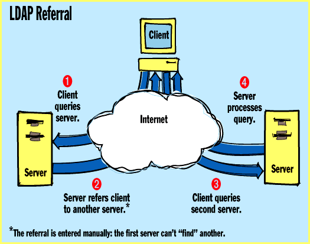
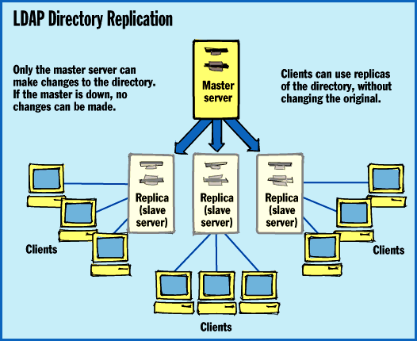

# LDAP Unites the Internet

*State Of The Art*

Is LDAP the answer for better over-the-Internet access to data and applications?

Jamie Lewis

Who would have thought that directory services -- the white pages of the network world -- would emerge as a prime technology for enabling new Internet-based applications? Sure, directory services have always served as background guides to network services, applications, and people. Now, because companies are using the Internet for communications and to unify internal networks, directories are on the front burner for applications developers.

In many ways, the current surge in directory development can be attributed to Lightweight Directory Access Protocol (LDAP). LDAP 2, the Internet standard for directory services, is a distillation of X.500, the Open Systems Interconnection (OSI) protocol for directory and resources management. LDAP gives applications developers a vendor-independent mechanism for directory interoperability. That's important for the Internet, where public-directory access and interoperability are pressing issues, and also for the intranets, where directory integration is a significant problem.

As a result, LDAP may indeed deliver many of the benefits promised by X.500. Vendors such as AT&T, Lotus, Microsoft, Netscape, and Novell are jumping on the LDAP bandwagon. This helps make interoperable directory solutions not only possible, but likely.

LDAP is not a panacea, however, and there are holes in the range of

what it offers

. As vendors such as Netscape add extensions to the protocol, some people question how long it will remain a standard for interoperability.

What LDAP Does

The University of Michigan developed LDAP in conjunction with the Internet Engineering Task Force (IETF). LDAP 2 is a current Internet standard; further extensions to the protocol are in version 3, which is being formulated.

The protocol's foundation is Directory Access Protocol (DAP), the X.500 standard's link between clients (directory user agents) and servers (directory service agents). As is the case with many OSI protocols, however, DAP creates so much overhead that it's not practical for use in typical DOS, Windows, and Mac client environments.

Thus, the University of Michigan developed LDAP as a streamlined way to access and update directory information in a client/server model. Using LDAP, for example, applications can add, delete, and modify objects and their attributes in a directory database. One or more LDAP servers contain the data comprising the directory tree, and LDAP clients connect to an LDAP server to query or modify the contents of the tree.

LDAP does not require an X.500-compliant directory; the protocol can communicate with any hierarchical, attribute-based directory. For interoperability, LDAP assumes support for the X.500 naming model. For example, object classes include country and organization, and generally follow the hierarchy defined by X.500. The new LDAP specification defines a syntax that supports the attributes of X.500 directory objects.

For reasons of security, LDAP supports authentication. Version 2 uses simple authentication (an encrypted password passing "on the wire") and Kerberos (the network security and authentication system that provides secure log-ins and authentication services using the Data Encryption Standard). LDAP 3 will take advantage of X.509 strong authentication, which uses public-key security certificates. However, LDAP does not provide for standard access-control mechanisms.

Besides the on-the-wire protocol itself, the term LDAP often refers to an LDAP API that offers a simple, low-level interface for applications to make a connection to a server and access the directory.

Multiple Uses

Commercial developers and corporate programmers can use LDAP in three ways. First, it can be a protocol for anonymous browsing. With LDAP, Internet surfers can browse directories and access publicly available information. Netscape and Microsoft both say that their Web browsers will support LDAP.

Second, LDAP's authentication services mean you can use it to give users authenticated access to sensitive information.

The third and final application of LDAP is server-to-server communications, including replication capabilities and client referrals to other servers in a directory search.

The standard does not explicitly specify the use of LDAP as a replication protocol. However, the basic operations LDAP enables -- such as reading, comparing, writing, modifying, and deleting data -- are those required for the creation and maintenance of replicas.

Netscape says it will use LDAP for replication in its Netscape Directory Server. This use of LDAP for replication has its roots in the first implementation at the University of Michigan, which uses a single-master replication topology. One server is the master of the database, and only it can make changes in the directory. Multiple "slave" servers provide replicas of the entire directory database, which balances the load of search and access operations across multiple servers (

see the figure

). While reads usually far outnumber writes, this single-master model creates a single point of failure: If the master is down, no changes can go into the directory.

Existing directories such as NetWare Directory Service (NDS) and StreetTalk use a multimaster design that can make updates to any read/write replica. This allows high availability in both read and write operations.

To handle failed queries, LDAP 3 will let an LDAP server refer a query to another server if a particular server cannot satisfy a search request. The LDAP server can refer the requesting client to a server that may be able to satisfy the request. The referral capability also sends all write operations to the master server. As the figure

"LDAP Referral"

illustrates, the referring server passes the name of the second server to the LDAP client. The client then connects to the server to which it has been referred.

But LDAP does not let multiple trees -- in other words, multiple master servers -- learn about each other and their contents automatically. Referrals are static, based on entries for other servers manually made in the directory database.

The University of Michigan is working on extensions to LDAP that would let master servers create indexes of their contents and pass them to other master servers. These so-called forwarding indexes would allow for dynamic referrals based on the nature of the client query and knowledge of the content of other trees. Until intelligent referral capabilities are added, an LDAP referral could in theory lead you on a wild-goose chase across the Internet, with each server referring you to yet another server, with no end in sight.

Who's Doing What?

Initially, most vendors said they would use LDAP only as an anonymous browsing protocol to make directory information available over the Internet. Novell, for example, announced LDAP support for publishing the information available to a guest log-in to NDS via LDAP. Netscape was the only vendor to go on record stating that it would use LDAP in all three ways mentioned earlier.

But as LDAP's momentum grew, the other vendors fell in line. Novell has said that it will use LDAP in all three ways. Microsoft says it will use LDAP as "its core directory protocol" in a subsequent version of Windows NT. Microsoft had originally planned to use the Object File System (OFS) as the directory repository in future NT releases. Microsoft now says it will use some of the technology from the directory in Microsoft Exchange Server.

While Microsoft will provide OFS capabilities through extensions to the NT File System (NTFS), the company is using the Exchange directory database and replication engine, expanding them for use with the new NT directory. For example, the basic schema of the Exchange directory will expand to reflect the needs of a general-purpose directory, and the replication model will extend to support full multimaster replication.

The resulting directory will increase the functionality of the domain-based naming system found in NT Server today. Rather than serving as the basic component for organizing the directory, for example, the domain will become a security and replication boundary in the directory tree. The directory will also extend to support a deeper hierarchy, including organizational units in domains. The directory will also let administrators delegate authority over groups and organizational units, without giving the delegates control over the entire domain or tree.

To accommodate Internet connectivity, future NT Server directories will work with the Internet's Domain Naming System (DNS) name space and support names based on DNS and Internet domain names. DNS names (e.g., acme.com) will be names of directory trees in future versions of NT. Applications and services will perform DNS lookups to find directory servers both on intranets and over the Internet. Having found a directory via DNS, applications will be able to use LDAP to access the information in those directories. Applications will also be able to use OLE DB and OLE DS, which are interfaces that are based on Microsoft's Common Object Model (COM) and ActiveX technologies.

Microsoft says it will integrate the content of the separate file-system and directory repositories in future versions of NT. For example, index and query services will let you search both the NT directory and the OFS provided by extensions to NTFS. Microsoft says that when this integration happens, you will be able to search for objects based not only on conventional attributes, such as filename, date, and owner, but on content as well.

As a result, LDAP may indeed inadvertently accomplish what X.500 never was able to: directory interoperability among different vendor implementations. Netscape Directory Server is already in beta testing and is due to ship this year. Novell, too, says it will ship anonymous LDAP support this year, with authenticated client/server access and replication support coming next year. Finally, Microsoft says it will ship the NT directory sometime in 1997. LDAP everywhere?

So What's the Catch?

As always, there is a downside to this. LDAP 2 does not include strong authentication and multimaster replication. In addition, the search model has limits, and the need for more intelligent referral capabilities and access-control mechanisms is clear. Also, like any standard, many product implementation details -- such as the specific directory database to use and how to replicate it -- are left up to the vendor.

Because of these limitations and the need to build competitive products, vendors will extend LDAP with features specific to their implementation. Novell continues to tout the multimaster replication capabilities of NDS, for example, and Microsoft says it will add similar capabilities to the NT directory. While Netscape is basing much of its work on LDAP 2, it's also making extensions that go beyond the current draft of version 3. Netscape is adding access-control capabilities, for example, that aren't in any current draft of the standard.

One of the biggest questions with LDAP is what level of interoperability will vendors achieve, given the various extensions that have been made to the standard? Today, Microsoft, Netscape, and Novell agree that the version 2 functions will be the interoperability baseline. However, interoperability will also depend on the degree to which Netscape publishes its extensions and the degree to which Microsoft, Novell, and other vendors support version 3 and track Netscape's extensions to it.

Although none of the vendors have explicitly stated their support for version 3 and Netscape's extensions, Netscape's market clout will create pressure to do this. Netscape has also made it clear that it intends to publish its extensions and that it will work to enable most of them through the Internet standards process.

LDAP Brands

Other characteristics will also differentiate LDAP implementations. For example, Microsoft will tightly integrate its directory with NT. Microsoft insists that tight integration with the OS is the only way to yield the performance and features developers need. Netscape, on the other hand, is building a set of services designed to run on multiple platforms, insisting that cross-platform capabilities are essential to interoperability.

Netscape and Microsoft are also taking different approaches to the kind of directory products that they're going to ship. Netscape is choosing to forgo the more sophisticated -- and more complex -- features (e.g., multimaster replication), choosing instead to get something out the door fast. Microsoft is building support for those additional features into its product, which will take longer to reach the market.

Given that we need to learn to walk before we run with directories -- and that most users have yet to crawl -- Netscape's approach is valid. By getting its product out the door fast -- and before Microsoft -- Netscape will continue to put pressure on Microsoft in the intranet-server market. But don't count out Microsoft: Its ability to integrate the BackOffice products with a unified directory will be attractive to many users.

What Should You Do?

As the Internet and LDAP drive directory development, you'll have a number of decisions to make. Which directory is right for you depends on your current needs. For example, both the OS-specific and OS-independent approaches have merit. If you're using NT, the integration of the Cairo directory with NT and the BackOffice applications may be attractive. If you have a heterogeneous network, the cross-platform products from Netscape may provide the multivendor integration you need.

For most companies, e-mail systems and the intranet are the logical places to start with directories. As you choose the electronic-messaging, Web-server, and other infrastructure services that will comprise your intranet, making sure that you integrate them in a unified directory model will make administration much simpler. It will also give you the foundation for the intranet/Internet applications that will be the future of your network.

Understanding features is also important. For example, a lack of multimaster replication could be a problem in large networks if you can't centrally deploy and maintain the directory. If departments or divisions independently deploy multiple Netscape Directory Server masters, you will have to do a lot of customizing if you want those master servers to communicate, making implementation more difficult than it would be under a multimaster design.

In comparison, NDS already provides multimaster replication today, allowing changes to occur at many servers, which will accommodate distributed organizations more effectively. Microsoft also plans to support multimaster replication in its directory.

Also expect the advent of so-called meta-directory services, which could integrate multiple directories in applications and OSes. For typical organizations, beginning the long transition to directory-enabled computing won't be practical until they integrate the directories they already have and manage them in a more holistic fashion. Meta-directory products from such companies as Zoomit and WorldTalk will let you integrate multiple application-specific and NOS-based (network OS) directories, and manage them as a whole, logical enterprise directory.

In any case, basic levels of interoperability will be guaranteed because LDAP will be the common denominator. The emergence of LDAP as the Internet standard protocol for directory services is a watershed event. It will enable interoperability between clients and servers, and between servers, on the Internet. In addition, it will be the catalyst for directory interoperability between the Internet, intranet products based on Internet technologies, and existing NOS-based and application-specific directories used in today's organizations. And that's a major step forward in directory services, the prime technology surprise.

## Where To Find

LDAP 3

http://www.ietf.cnri.reston.va.us/html.charters/asid-charter.html

Internet:

Ahttp://www.ietf.cnri.reston.va.us/html.charters/asid-charter.html

## How LDAP and X.500 Compare

Feature LDAP X.500

Objective Simplicity. Global directory services.

Transport TCP/IP. OSI protocols, ACSE/ROS on session

C mechanism and transport layers.

Data model X.500 as a baseline. Use Rigid hierarchical data model that

O standardized attributes scales for a worldwide directory.

J where applicable. Publish Emphasis on generality. Many

F standards to allow easy specifics are undefined.

interoperability.

Worldwide Directories can grow from Rigorous hierarchy of naming con-

O directory bottom up (the "Internet texts and Directory Server Agents

M way"). Vendors can solve (DSAs) for worldwide directory.

M directory problems in many Assumes top-down model for name

M ways with interoperability. resolution. Tough to get every-

M LDAP offers the freedom to thing to fit exactly right on a

> mix rigorous X.500 DITs and worldwide basis.

) Internet-style randomness.

Security Does not specify an encryp- Defines X.50 authentication

J tion mechanism. Netscape will framework, but an encryption

P use LDAP over SSL. Kerberos algorithm is not specified (RSA is

E is available (not in the de facto standard).

) Netscape). Will improve in

future.

Server Client referrals to navigate Another protocol, the Directory

K protocol multiple servers. Servers System Protocol (DSP) to talk

> can talk to each other (for between servers.

& replication or creating

! server hierarchy).

Replication Use LDAP for replication. Use DISP/DOP to address replica-

H tion (only in 1993 X.500).

Referrals Already does this. Chaining X.500 supports referrals over

J is supported based on server DAP/DSP as well as chaining.

implementations.

OAPI Simple C API defined in Complex, object-oriented API such

E RFC 1823. as XDS API from X/OPEN.

Multicasting Implementation dependent, X.500 supports multicasting over

6 not protocol specified. DAP/DSP.

( Client may query multiple

& servers simultaneously.

Encoding Many as strings. All elements Use full ASN.1 and full BER.

J ultimately in lightweight Harder to parse and compose.

* Basic Encoding Rules (BER).

Bulk import/ LDIF standard to interchange X.500 does not address bulk

7 export LDAP information in text transfer.

files.

## LDAP Referral

TLDAP directory replication helps you search for resources across multiple servers.

## LDAP Directory Replication

\Netscape will use LDAP's single-master model for replication in Netscape Directory Server.

mailto:"editors@bix.com"

Jamie Lewis is president and a principal analyst of The Burton Group, where he specializes in NOSes, messaging systems, directory services, security systems, and network management products. You can contact him on the Internet via

editors@bix.com

## Images

