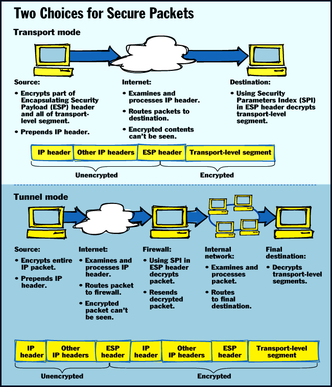
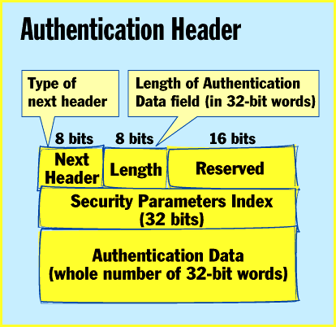
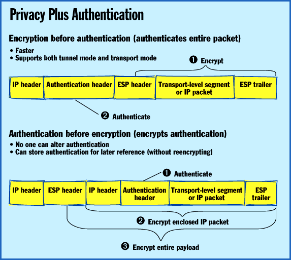

# Internet Armor

*State Of The Art*

Secure IP fuels the drive for secure transactions and communications over the Internet.

William Stallings

The Internet's a scary place. With packets whizzing to everywhere, from everywhere, and through anywhere, who knows who might be intercepting messages, listening in on communications, or stealing data? Any business trying to persuade the mythical on-line shopper to enter his or her Visa number faces an uphill battle. Even if your company wants all workers' e-mail messages to be confidential, how can you guarantee that? Lay your own cable from office to scattered office?

Don't fret; secure IP is coming. The Internet Activities Board (IAB), in response to the above issues, has included authentication and encryption as necessary security features in the next-generation Internet Protocol, called IPv6 (see "The New and Improved Internet Protocol," September BYTE). Even better, these security capabilities are usable with both the existing IP and the future IPv6. This means that developers and vendors can begin writing applications using these features today. And users can start taking advantage of them now, too.

What's the Problem?

The latest annual report from the Computer Emergency Response Team (CERT) lists nearly 2500 reported security incidents, affecting over 12,000 sites, in 1995. The most serious types of attacks reported include IP spoofing (by which intruders create packets with fake IP addresses and exploit applications that use authentication based only on IP), eavesdropping, and packet sniffing (in which attackers can directly read transmitted information, including confidential log-on information and database contents).

In 1994, the IAB issued a report titled "Security in the Internet Architecture." The report stated that the Internet needs more and better security, and it also identified key areas for security mechanisms. Among these were the need to protect a network's infrastructure from unauthorized monitoring and control of network traffic, and the need to defend end-user-to-end-user traffic using authentication and encryption mechanisms.

Clearly, no one wants to take on the task of rebuilding the Internet from the ground up as a secure network. The problem, then, is ensuring secure transmissions over the nonsecure system that's already in place.

Secure IP

is one answer.

Security at the IP Level

The Internet community has already developed application-specific security mechanisms in several application areas, including e-mail (e.g., Privacy Enhanced Mail and PGP), network management (e.g., SNMPv2 security), and Web access (e.g., Secure HTTP and Secure Sockets Layer). But users have security concerns that cut across protocol layers. For example, an enterprise can run a secure, private TCP/IP network by disallowing links to untrusted sites, encrypting packets that leave the premises and authenticating packets that arrive.

By implementing security at the IP level, an organization can ensure secure networking, even for security-ignorant applications. For example, all corporate e-mail can be run among corporate sites over secure IP pipes.

IP-level security encompasses two functional areas: authentication and privacy. Authentication ensures that a received packet was in fact transmitted by the source identified in the packet header; the packet you just received actually did come from trusted colleague X, as it purports. In addition, authentication ensures that nothing has altered the packet in transit; what you received is indeed what was sent.

Privacy enables communicating nodes to encrypt messages to prevent eavesdropping by third parties. Even if somebody intercepted the message, he or she wouldn't be able to read it.

Support for these features is optional for the current IP but mandatory for IPv6. In both cases, you implement the security features as extension headers that follow the main IP header in a packet. The extension header for authentication is the Authentication header (

see the sample

X). The extension header for privacy is the Encapsulating Security Payload (ESP) header.

Developers and vendors who want to take advantage of these authentication and privacy features must make their applications aware of these extension headers. When an application encounters such a header, it must know what to do with the remainder of the packet, which primarily involves decryption and possible resending. (More on this later.)

There's a clear need for APIs of some sort for an application to invoke security. Alternatively, a network manager can configure certain applications -- or all of them -- to use secure IP. In the former case, an application would need to have a feature for invoking security. These configuration and implementation details all fall outside the scope of the standard, thus providing a golden opportunity for vendors to exploit this product niche.

Data Integrity

The Authentication header provides support for data integrity and the authentication of IP packets. This header consists of the following fields:

Next Header (8 bits): Identifies the type of header immediately following the Authentication header. (As you'll see, this might be an ESP or other type of header.)

Length (8 bits): The length of the Authentication Data field in 32-bit words.

Reserved (16 bits): For future use.

Security Parameters Index (32 bits): Identifies a security association.

Authentication Data (variable): An integral number of 32-bit words.

The Authentication Data field's contents depend on the specific authentication algorithm chosen and configured by the network manager. It can be configured so that secure IP is used for all off-site TCP/IP traffic.

Configuration can be in every host, or a firewall system can invoke security features. These features might involve APIs at some point, but few vendors have announced products. The network manager typically distributes encryption keys, so it's unlikely that a third-party source would be trusted.

In any case, the Authentication Data is calculated over the entire IP packet, excluding any fields that might change in transit. (Such fields are set to zero for purposes of calculation at the source and the destination.) The authentication calculation happens before fragmentation at the source and after reassembly at the destination. Hence, fragmentation-related fields are included in the calculation.

There are many ways to use the IP authentication service. For example, you can provide authentication directly between a server and its client workstations. Each workstation can be either on the same network as the server or on an external network. So long as the workstation and the server share a protected secret key, the authentication process is secure.

Another application for the service is to allow a remote workstation to authenticate itself to a corporate firewall (see the figure

"Two Choices for Secure Packets"

). This can get the workstation access to the entire internal network. Also, the requested server might not support the authentication feature.

Using the Encapsulating Security Payload provides support for privacy and data integrity for IP packets. Depending on the user's requirements, this mechanism can encrypt either a transport-layer segment (e.g., TCP, UDP, and ICMP), known as transport-mode ESP, or an entire IP packet, known as tunnel-mode ESP. Transport mode supports all applications automatically and is reasonably efficient, making it the most likely choice, except for the cases outlined below.

The ESP header begins with a 32-bit Security Parameters Index (SPI), which identifies a security association. The remainder of the header, if any, might contain parameters that are dependent on the particular encryption algorithm being used. In general, the first part of the header, including the SPI and possibly some of the parameters, is transmitted in unencrypted (i.e., plaintext) form, while the remainder, if any, is transmitted in encrypted (i.e., ciphertext) form.

Transport Mode

You use transport-mode ESP to encrypt the data carried by IP. Typically, this data is a transport-layer segment, such as a TCP or UDP segment, which in turn contains application-level data. For example, you might encrypt confidential e-mail messages or database data using transport-mode ESP. For this mode, the ESP header goes into the IP packet immediately before the transport-layer header (e.g., TCP, UDP, and ICMP).

Transport-mode operation works as follows. At the source, you encrypt a block of data, consisting of a trailing portion of the ESP header plus the entire transport-layer segment. You replace the original plaintext of this block with its ciphertext to form the IP packet for transmission (see the figure

"Two Choices for Secure Packets"

This packet is then routed to the destination as usual. Each intermediate router needs to examine and process the IP header plus any plaintext IP extension headers, but it doesn't have to examine the ciphertext.

The destination node examines and processes the IP header plus any plaintext IP extension headers. Then, using the SPI in the ESP header, the destination node decrypts the rest of the packet to recover the plaintext transport-layer segment.

Transport-mode operation provides privacy for any application that uses it, thus avoiding the need to implement privacy in each application. This mode is also reasonably efficient, adding little to the total length of the IP packet.

One drawback to this mode is that it's possible to do traffic analysis on the transmitted packets. (Basically, if destination addresses and source addresses are in the clear, an unscrupulous person can build up a traffic profile on you or your company. There are some possible scenarios -- lots of e-mail between a company and a stock-brokerage house before the company goes public, for example -- in which you might want to prevent outsiders from knowing the amount of traffic flowing between various endpoints.)

Tunnel Mode

Tunnel-mode ESP encrypts an entire IP packet (including its own header). For this mode, you prefix the ESP to the packet and then encrypt the trailing portion of the ESP header plus the packet. You prefix the IP header (and any other headers) to the ESP header. You can use this method to counter traffic analysis.

Why all this rigmarole? Because the original IP header contains the destination address (and possibly source-routing directives and hop-by-hop option information), it's impossible to simply transmit the encrypted IP packet prefixed by the ESP header alone. Intermediate routes would be unable to process such a packet. Thus, it's necessary to encapsulate the entire block (ESP header plus encrypted IP packet) with a new IP header that contains sufficient information for routing but not for traffic analysis.

Whereas transport mode is suitable for protecting connections between hosts that support the ESP feature, tunnel mode is useful in a configuration that includes a firewall or other security gateway that protects a trusted network from external networks. In such a case, encryption occurs only between an external host and the security gateway or between two security gateways. This relieves hosts on the internal network of the burden of encryption and also simplifies the key-distribution task by reducing the number of needed keys. Further, it thwarts traffic analysis based on ultimate destination.

You can use tunnel-mode operation to set up a virtual private network. Here, an organization has two internal private networks that interconnect across the Internet. Hosts on the internal networks use the Internet for data transport but don't interact with other Internet-based hosts. By terminating the "tunnels" at the firewall or security gateway to each internal network, the configuration allows the hosts to avoid implementing the security capability.

Consider a case in which an external host wishes to communicate with a host on an internal network protected by a firewall and in which the external host and the firewalls implement ESP. The following steps must occur for transfer of a transport-layer segment from the external host to the internal host.

First, the source prepares an inner IP packet with a destination address within the target internal host. An ESP header prefixes this packet. Then the packet and a portion of the ESP header are encrypted. The resulting ciphertext block is prefixed with a new IP header (consisting of a base header plus optional extensions, such as routing and hop-by-hop options) whose destination address is the firewall; this forms the outer IP packet (see the figure

"Two Choices for Secure Packets"

Next, the outer packet is routed to the destination firewall. Each intermediate router needs to examine and process the outer IP header plus any outer IP extension headers, but it doesn't need to examine the ciphertext.

Third, the destination firewall examines and processes the outer IP header plus any outer IP extension headers. Then, using the SPI in the ESP header, the destination node decrypts the remainder of the packet to recover the plaintext inner IP packet. It then retransmits this packet on the internal network. Finally, the inner packet may or may not pass through a router as it travels by way of the internal network to the ultimate destination host.

All implementations that are said to conform with the ESP specification must implement the Data Encryption Standard-Cipher Block Chaining (DES-CBC) method of encryption. In this method, the data to be encrypted -- plaintext -- is processed as a sequence of 64-bit blocks. The input to the encryption algorithm is the XOR of the current plaintext block and the preceding ciphertext block; the same key is used for each block. In effect, this chains together the processing of the sequence of plaintext blocks.

The input to the encryption function for each plaintext block bears no fixed relationship to the plaintext block. Thus, repeating patterns of 64 bits are not exposed. To produce the first block of ciphertext, an initialization vector (IV) is XORed with the first block of plaintext. On decryption, the IV is XORed with the output of the decryption algorithm to recover the first block of plaintext.

Security and Privacy

You can combine the IP security mechanisms to transmit an IP packet that has both privacy and authentication. There are two ways to do this, based on the order in which you apply the two services.

The top portion of the figure

"Privacy Plus Authentication"

illustrates the use of encryption before authentication. In this approach, the user first applies ESP to the data to be protected and then prepends the authentication header and the plaintext IP header(s). In this case, the entire transmitted IP packet is authenticated, including encrypted and unencrypted parts.

As mentioned earlier, there are actually two types of authentication:

Transport-mode ESP: Authentication applies to the entire IP packet delivered to the ultimate destination, but only the transport-layer segment is protected by the privacy mechanism (i.e., encrypted).

Tunnel-mode ESP: Authentication applies to the entire IP packet delivered to the outer IP destination address (e.g., a firewall), and authentication is performed at that destination. But an entire inner IP packet, rather than just a transport-layer segment, is protected by the privacy mechanism for delivery to the inner IP destination.

The bottom part of the figure

"Privacy Plus Authentication"

illustrates the use of authentication before encryption. In this approach, which is appropriate only for tunnel-mode ESP, the authentication header is inside the inner IP packet. This inner packet is authenticated and protected by the privacy mechanism.

Thus, you can apply the functions of authentication and encryption in either order for tunnel-mode ESP. The use of authentication before encryption might be preferable for several reasons. First, since the Authentication header is protected by ESP, it's impossible for anyone to intercept the message and alter this header without detection.

Second, it may be desirable to store the authentication information with the message and the destination for later reference. It's more convenient to do this if the authentication information applies to the unencrypted message; otherwise, the message must be reencrypted to verify the authentication information.

Whither IP Security?

The driving force behind the acceptance and deployment of secure IP is the need to connect private WAN/LAN infrastructures to the Internet for access to Internet services and to use the Internet as a component of the WAN transport sys-tem. Users need to isolate their networks and, at the same time, send and receive traffic over the Internet. The authentication and privacy mechanisms of secure IP provide the basis for a sound security strategy.

Because the definition of these IP security mechanisms is independent of their use with either the current IP or IPv6, their deployment does not depend on the deployment of IPv6. Indeed, we are likely to see widespread use of secure IP features long before IPv6 becomes popular.

One practical issue hindering the deployment of secure IP is the export restrictions imposed by the U.S. and some other countries. These restrictions do not affect the IP authentication mechanism, because it only provides authentication and integrity; it does not provide message encryption. But the ESP mechanism is most definitely subject to such limitations. The IAB recently issued a "Statement of Cryptographic Technology and the Internet," urging the removal of such restrictions, thus adding its voice to that of many other groups and individuals seeking this relief.

One recently announced product is Secure WAN (S/WAN), codeveloped by RSA Data Security and TimeStep. S/WAN operates at the IP level and incorporates the IAB-secure IP standards. Its intent is to enable corporate customers to secure connections between their private networks and the Internet.

We can expect to see many IP-level security products announced throughout 1997. Because of the export-restriction problem, it's likely that authentication mechanisms will be more widely marketed and deployed. Nevertheless, both authentication and privacy at the IP level seem destined to proliferate over the next several years, making the Internet a less scary place.

## Where To Find

RSA Data Security, Inc.

Redwood City, CA

Phone: (415) 595-8782

Fax: (415) 595-1873

http://www.rsa.com/

Internet:

http://www.rsa.com/

TimeStep Corp.

Kanata, Ontario, Canada

Phone: (613) 599-3610

Fax: (613) 599-3617

http://www.timestep.com

Internet:

http://www.timestep.com

## Why You Need Secure IP

To send confidential e-mail

For protection from IP spoofing

)To secure transactions over the Internet

;For remote access to corporate databases over the Internet

To avoid traffic analysis

## Two Choices for Secure Packets

Both modes encrypt part of the packet, but tunnel-mode packets contain an inner packet that's used to cross an Internet firewall.

## Authentication Header

The authentication header includes data that confirms its stated origin.

## Privacy Plus Authentication

You can encrypt and authenticate in either order; encrypting last protects authentication information.

mailto:"ws@shore.net"

http://www.shore.net/~ws

William Stallings is a consultant, lecturer, and author of numerous books on data communications and computer topics. This article is based on material from his just-published book, Data and Computer Communications (Prentice-Hall, 1996). You can reach him at

ws@shore.net

or at

http://www.shore.net/~ws

## Images

