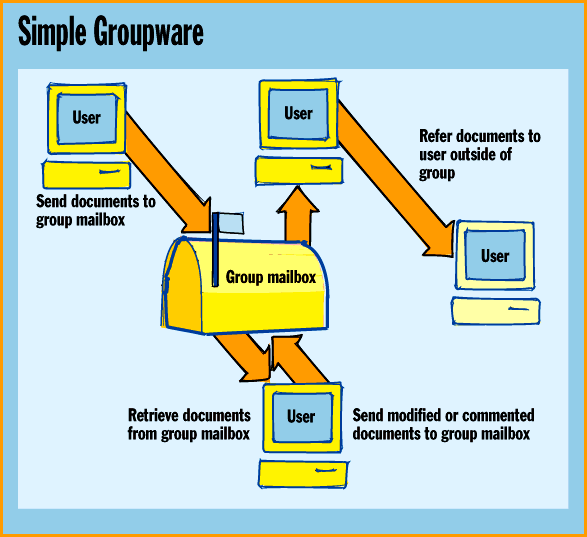
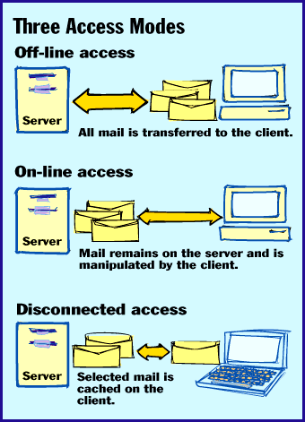

# E-Mail Grows Up

*State Of The Art*

XIMAP promises better message management -- for those who can cope with its complexity.

Dave Kosiur

Hang around an airport long enough, and you will see an ironic sight: Mobile workers frozen in their tracks, standing at the pay phones. After originally planning to pause just long enough to grab an important e-mail message, they now have one eye on a notebook screen and one eye on the clock as a behemoth message attachment crawls over the telephone line. Only a final boarding call can get these warriors moving again.

Part of the problem is POP, the Post Office Protocol that we've relied on for many years to retrieve e-mail messages. It's simple and pervasive, and before e-mail became ubiquitous, it was efficient. But people who communicate via TCP/IP networks -- most notably the Internet -- now need a protocol that offers more.

For example, if you have 20 inbox messages, you want to be able to choose messages to download. When you're on the road, you may not want all of them. If a message comes with a 2-MB graphic-file attachment, you want the option of downloading the short text message and keeping the attachment on the mail server until you're back in the office. POP just can't deliver these capabilities.

But the Internet Message Access Protocol (IMAP) can. This newer protocol offers selective retrieval of messages and message parts from a server, server-based message processing, and shared mailboxes. This last feature can make IMAP the foundation for simple groupware applications (

see the figure

Unfortunately, there's a catch. IMAP makes the process of launching e-mail applications more complex, and its resource requirements can strain your mail server. In time, IMAP might help you communicate more efficiently. But before it enters your world, you must learn how to cope with its demands.

## POP vs. IMAP

Both

POP and IMAP

define methods for e-mail clients to retrieve messages from a server. They both also depend on a third protocol, SMTP, for sending mail. (The Internet Engineering Task Force [IETF] guided the definition of all three.) In client/server terms, you use POP and IMAP to design clients, while SMTP works for message transfers between client and server (as well as between servers).

One difference between POP and IMAP is the way that each lets client programs retrieve messages. With POP, your messages reside on a message store (usually a server), and all pending messages are transferred from the message store to your local system when you connect the two. Once you download a message, you can read, delete, or process it without any further interaction with the server. In fact, with this off-line mode, the server has no further knowledge of the state of the messages delivered to the POP client.

IMAP, on the other hand, lets you query a message store for pending messages in a multistep process. First, you can request only the message headers in a given mailbox on the server. You can then retrieve entire messages or message parts, leaving the remaining messages and parts in the server mailbox. Message deletion on the message store is a separate action, so copies of messages that you download remain on the server until you manually delete them. This is helpful for archiving or sharing messages.

IMAP clients can operate in either on-line or disconnected mode (see the figure

"Three Access Modes"

). In on-line mode, you manipulate your mail, but it all remains on the server. In disconnected mode, some of the mail is located on the server, and some is on the local client.

In disconnected mode, the state of messages on your local system and those on the server will likely be different when you reconnect later; some type of synchronization must take place. IMAP assigns each message in a mailbox with a unique identifier. Unlike message-sequence numbers, as used in POP, these unique identifiers persist across sessions, making it easier for you to synchronize messages from a previous session with the message store. But the details of this synchronization process have not been fully spelled out in the IMAP4 protocol specs; they're still being worked on.

IMAP and MIME

If you're using POP, you have little choice but to accept an entire message if it's formatted in Multipurpose Internet Mail Extensions (MIME). This system identifies the data format in the body of a message and relays the information to the mail-client software, which automatically decides what to do with it.

In addition, MIME allows single e-mail messages to include multiple components, or attachments. Each piece can be a different data type (e.g., text, image, and audio) and subtype. The disadvantage, however, comes when you're on the road with a slow-speed connection and someone sends you a 2-MB movie file that you don't want to handle until you get back to the office. POP still downloads the file to your laptop; you have no other choice.

On the other hand, IMAP integrates well with MIME. You can use your IMAP client to check the sizes and types of each MIME attachment before downloading so that you can, say, copy the text of a message to your laptop but leave the attached 2-MB multimedia presentation on the server until you're ready to download the file.

## Simple Groupware

Because IMAP's message store provides for the sharing of messages, you can define shared folders with specific access rights for other users. This simple bulletin-board service, coupled with the ability to include Netnews articles in shared folders, lets you easily tie together information for workgroups. With POP, you can't share mailboxes or messages; if you want someone else to see a message that you have received, you must either "cc" them or manually forward the message.

IMAP's shared mailboxes are nothing more than a server-based mailbox file that multiple people can access. The IMAP server manages shared access to the mailboxes and messages. A workgroup can share a mailbox with minutes of its meetings, for example, or help-desk workers can access and process messages from the same mailbox. Looking down the road, shared mailboxes could easily form the foundation for message-based groupware via the Internet, particularly if you factor in server-based processing of IMAP mail and consider that messages might include Java applets.

IMAP also supports server-based message processing. You can, for example, search for a message without downloading all the messages from the server first.

IMAP Complexity

Unfortunately, IMAP's flexibility presents developers with several challenges. An IMAP-enabled application must support MIME and IMAP queries, as well as the bookkeeping of mail parts (since you might only request part of a message one time and another part the next).

You need to synchronize with the server, get an address book from it, and use SMTP for transport. You also need to get IMAP to refile or archive messages on the server. POP is simpler because once you retrieve a message, the server's job is done.

POP is popular because its simplicity makes it easy for developers to write both server and client software. There are lots of POP client packages available from a variety of companies, such as Claris, CommTouch, Frontier Technologies, FTP Software, Intercon, NetManage, and QualComm. These POP client packages are designed for a variety of platforms, including Unix, DOS, Windows, and the Macintosh.

Because of IMAP's complexity, commercial implementations have been slow in coming. But that's changing. Netscape plans to incorporate IMAP into its next generation of mail servers, which are due out this year. In addition, SunSoft offers an IMAP server and client. ICL's Embla is an IMAP client, and ICL/TeamWare offers the Internet Messaging Server, which supports both POP and IMAP. Others on the IMAP bandwagon include Control Data's Mail*Hub server, NetManage's Z-Mail Pro, and the upcoming messaging server from Software.com.

Which to Choose?

IMAP puts new demands on e-mail servers. If you're concerned about server disk resources, POP has the advantage over IMAP. Since you are downloading messages to the client machine with POP, there is no need to consign the server's disk capacity to storing old messages.

Because IMAP servers hold messages, storage might be strained if past messages aren't routinely deleted. Still, servers usually have more periodic and robust backup procedures; this guards against lost mail should the client machine crash. Plus, because IMAP offers more flexibility in picking which messages to copy to the client computer, sessions can be long while users look over their mail messages.

Even with its advantages over POP, IMAP alone isn't a complete messaging system for fixed and mobile users alike. Other protocols must provide universal access options and address-book information. After all, it wouldn't be convenient if you could leave your messages on a server for access from different client machines but still had to duplicate your preferences, address books, and news subscription lists for each client.

The Internet Message Support Protocol (IMSP), which is used in conjunction with IMAP, can perform these functions for you. A newer and potentially better alternative is the Application Configuration Access Protocol (ACAP). This protocol not only helps you create and store user options and address-book information, it also generalizes this procedure to handle other user-related items that might be shared, such as spelling checkers.

Thus, ACAP can support not only IMAP messaging systems but other applica-tions, such as Web browsers. Furthermore, ACAP is flexible for users and applications alike: It allows clients to define data fields for the stored information.

ACAP doesn't compete with directo-ry-services protocols, such as the Lightweight Directory Access Protocol (LDAP). Rather, they complement each other. Directories, such as those supported by LDAP, are designed to provide authoritative, enterprise-wide data about users and "top-down" definitions of groups of users, much like the phone book provided by your telephone company, corporation, or university does.

On the other hand, address books contain the user's view of, and the organization of, address information. This is more of a "bottom-up" approach, such as what you'd use in your "black book." ACAP lets you define address books, and it sup-ports the sharing of user-defined address books. ACAP specs are circulating through the IETF community in draft form, but it might be a year or two before we see large-scale use of the protocol.

Is IMAP for You?

IMAP has a lot going for it, especially if you're interested in supporting mobile clients and taking better advantage of MIME-compliant e-mail. Because it's relatively new and is more difficult to implement, there aren't as many commercial vendors of servers and clients as there are for POP. But that should change considerably over the next year.

If you're installing an IMAP-based e-mail system, pay attention to its integration with directory standards, such as LDAP, and check the progress of ACAP, so users will get a fully functional messaging system. Your mobile workers may catch more airplane flights with the messages they need in hand.

## Where To Find

ICL Enterprises

Reston, VA

Phone: (703) 648-3300

Fax: (703) 648-3350

http://www.icl.com/access

Internet:

http://www.icl.com/access

## POP vs. IMAP

Feature POP IMAP

*Off-line mail processing Y Y

*On-line mail processing Y

*Server-based searches Y

*Shared mailboxes Y

*SMTP transport Y Y

*Persistent message IDs Y Y

!Simple to implement Y

*Manipulate message- Y

status flags

*Custom message flags Y

*Multiple mailboxes on server Y

*Archive messages on server Y

*Selective retrieval of Y

message attachments

*Access to processed Y

mail on server

!Minimum use of Y

connect time

!Minimum use of Y

server resources

## Simple Groupware

gIMAP lets you set up group mailboxes to provide the basis for groupware applications on the Internet.

## Three Access Modes

IIMAP's access modes help manage messages on the client and mail server.

mailto:"drkosiur@ix.netcom.com"

Dave Kosiur is a networking consultant and freelance writer based in Reston, Virginia. You can reach him at

drkosiur@ix.netcom.com

Copyright

1994-1997 BYTE

D#"

1+"

l4"

|8"

g:"

|@"

?A"

>I"

}Q"

WS"

pV"

WW"

-Y"

bZ"

R["

9\"

n\"

^]"

:^"

q^"

4_"

m_"

!`"

x2#

x1#

## Images

