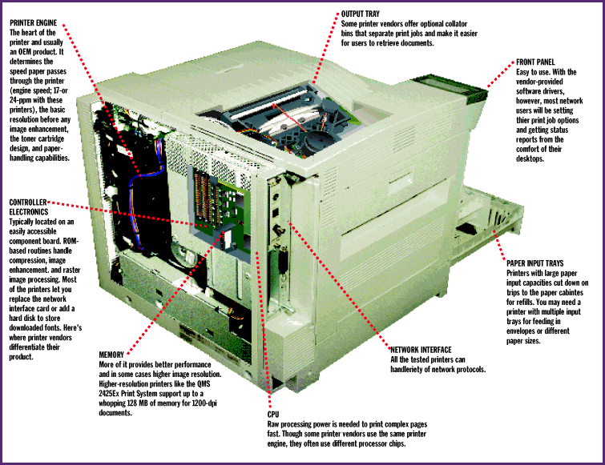

# Six Laser Printers for Workgroups

*BYTE Hardware Lab Report*

These network lasers have the speed and capacity to handle the printing needs of any large workgroup.

-Dorothy Hudson, Jim Kane, and John McDonough

Today's departmental laser printers cost less, print faster, and produce sharper output than ever before. Since we last looked at midrange network printers (November '95), several models in the under-$10,000 class have followed Hewlett-Packard's lead with the LaserJet 5Si and adopted Canon's 24-pages-per-minute (ppm) P-550 print engine. While these printers don't have the duty cycle of 30-ppm printers costing $20,000 and more, they are catching up both in performance and in paper capacity. Lexmark's 24-ppm Optra N 245($4199) actually performed faster in our tests than one of the 30-ppm printers we tested last year.

We tested six midrange

network lasers

with the speed and paper capacity to handle printing for a large workgroup. The printers -- from Apple, Hewlett-Packard, IBM, Lexmark, QMS, and Xerox -- range in price from $1999 to $6999 as tested. Though large, these are tabletop units, all with at least 600-dpi resolution. They have either 17-ppm or 24-ppm print engines and large paper capacities. All support forms of PostScript and HP Printer Control Language (PCL) page-description languages, and they automatically switch between the two as needed.

All the printers can detect and automatically switch between a set of common network protocols, particularly NetWare and TCP/IP. All support a variety of network operating systems and provide client software that lets users of several types of systems print and access printer status information. Several units also support hard disks that store fonts, forms, and macros -- and in the process decrease the traffic on your network.

We judged the printers on the basis of four important considerations: print speed, quality of output, features, and usability for both end users and network managers. We tested for both Mac and Windows platforms.

What Matters

It's important to match the printer to the workload. You can save money by buying a printer with a lower duty cycle rating, but if you overload that printer, quality and reliability will suffer in the long run. Several of these printers now have rated duty cycles of 100,000 pages per month, which is roughly half that of the more expensive printers in the 30-ppm class.

People don't want to hang around waiting while their print job lingers in the queue. A network printer with a fast print engine and adequate RAM can spool files off the system quickly and increase the overall efficiency of the network. Increased network speed means quicker release of the host system and increased user productivity. Among the printers we tested, the more expensive 24-ppm models have the speed advantage. Our own performance-sensitive scoring favors the 24-ppm printers. A 17-ppm printer might make more sense for lighter loads.

As a network administrator, only you know how much printing traffic to expect from your network-attached users. While a 24-ppm laser printer is fast enough for NSTL's 70-employee work force, it might not be fast enough for a smaller office that pumps out more documents.

Print quality is getting much better with network lasers. All the tested printers offer at least 600- by 600-dpi resolution, and many offer electronic image enhancement that increases test sharpness and gray-scale capabilities beyond the native resolution of the print engine. The Xerox DocuPrint 17 ($3300) and the Apple LaserWriter 16/600 ($2429) produced the best output; these printers are good choices if your office generates lots of documents with graphics and halftones.

One trend we've noticed with workgroup printers is that they have more sophisticated paper-handling capabilities than ones we've reviewed before. Roomy standard and optional paper trays hold from 850 to 3100 sheets of paper, which cuts down on trips to the supply room. These printers are available with optional envelope feeders and money-saving duplexing capabilities for printing on both sides of the paper. When fully configured, the HP LaserJet 5SiMX ($4899), the IBM Network Printer 17 ($1999), and the Lexmark Optra N 245 ($4199) can have five input trays hanging off them to supply letter-, legal-, and ledger-size paper.

Privacy can be a concern with a network printer. The Xerox and IBM models offer as an option a lockable mailbox output unit -- just the thing for printing worker evaluations or other confidential documents (see Details on page 104). You enter a password at the printer front panel to open one of the locked slots. The system administrator sets up whether a slot locks or not, and who has access. The HP LaserJet 5SiMX and the QMS 2425 Print System ($6999) support multibin mailboxes for separating documents from different print jobs, providing convenience but not security.

Total Control

All the network lasers we tested come with software for managing printers from across the network. At the very least, these slick utilities let you know from your desktop system if the printer is on-line, out of paper, or busy with somebody else's print job. Some let you cancel a job that's in the queue. The utilities -- Apple's LaserWriter Utility, HP's JetAdmin, IBM's Network Printer Manager, Lexmark's MarkVision, QMS's CrownAdmin, and Xerox's Document Services for Printing -- are all full of features for choosing printing options.

We particularly like the easy-to-use Windows interface in Lexmark's MarkVision. As do several other of the print management utilities, MarkVision uses bidirectional communications to maintain, configure, and track the printer's status. A graphical representation of the printer's control panel and a detailed printer-status window let you know what's going on. HP's JetAdmin deserves mention because it is a 32-bit Windows 95 utility; it's also easy to install.

After setting up and using the different models covered in this Lab Report, we can say that printing over the network is getting easier and more intuitive for the end user. The rest of the good news is that workgroup printers are getting faster and less expensive.

Contributors

Jim Kane, project manager/NSTL

Dorothy Hudson, project manager/NSTL

John McDonough, technical writer/NSTL

Dave Rowell, senior technical editor/BYTE

## Laser Printers

Copyright

1994-1997 BYTE

%?#

g?#

%?#

g?#

[@#

%?#

g?#

%?#

g?#

%?#

g?#

eA#

%?#

g?#

%?#

g?#

^D#

%?#

g?#

%?#

g?#

%?#

g?#

%?#

g?#

%?#

g?#

%?#

g?#

%?#

g?#

%?#

g?#

%?#

g?#

%?#

g?#

%?#

g?#

LV#

%?#

g?#

%?#

g?#

%?#

g?#

%?#

g?#

%?#

g?#

_\#

%?#

g?#

%?#

g?#

%?#

g?#

C]#

%?#

g?#

%?#

g?#

%?#

g?#

#A%

%?#

g?#

%?#

g?#

VD#

## Images

