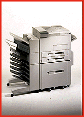

# HP Makes a Mopier

*BYTE Hardware Lab Report*

As this issue hit the streets, Hewlett-Packard was announcing a version of the LaserJet 5Si called the Mopier. What's a mopier? A printer that produces "mopies," or multiple original prints. Instead of printing a document once and then making copies on a photocopier, you print all the copies on the Mopier. Given the 24-pages-per-minute speed of this 600-dots-per-inch printer, and the fact that the print driver software sends only a single copy of the document over the network, this makes good sense in terms of saving time. HP claims the cost per page is competitive with a photocopier.

The $9549 Mopier is a specially equipped 5Si with 12 MB of RAM, a duplex unit, and a 2000-sheet paper bin. A 420-MB hard drive stores incoming documents so that it can make multiple prints from a single network transmission. Unlike the standard 5Si, the Mopier has a mailbox output-tray unit that can staple, like a business copier. The output unit has five addressable bins, a stapling bin, and a general-purpose bin. The QMS 2425Ex has a similar option. For a total of $8998, you also get a scanner and software that lets you use the printer as a copy machine.

## HP's New Mopier

Copyright

1994-1997 BYTE

sZ%

"Z%

"Z%

"Z%

T[%

"Z%

"Z%

h`%

"Z%

"Z%

"Z%

"Z%

## Images

