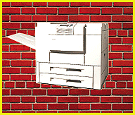
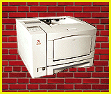
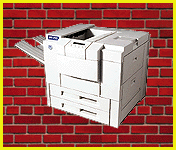

# Workgroup Printer Ratings

*BYTE Hardware Lab Report*

Best Overall:

## Lexmark Optra N245

The 24-ppm Optra N 245 was tops in our speed tests, though its very

=good print quality trailed in a tightly clustered field. The

Enetwork-friendly printer supports a variety of paper sizes and has a

A3100-sheet paper-input capacity. Lexmark's MarkVision management

Esoftware gives users easy access to printer functions while they sit

Dat their desktop systems. Lexmark's workgroup printer also finishes

1near the top in the Best for Macintosh category.

Weighting:

Price 5%

Technology 5%

Features 14%

Performance 43%

Usability 14%

Quality 19%

## Ratings

O Price Tech- Imple- Perfor- Fea- Usa- Battery OVERALL

N nology menta- mance tures bility RATING

& tion

Lexmark Optra $4199 **** **** ***** **** **** **** ****

N 245

MHP LaserJet $4899 **** **** **** **** **** **** ****

5SiMX

MQMS 2425Ex $6999 **** **** *** **** ***** **** ****

Print System

Xerox DocuPrint $3300 **** **** ** ***** **** **** ***

4517

LIBM Network $1999 **** ***** ** **** **** **** ***

Printer 17

Apple Laser- $2429 **** *** *** **** *** *** ***

Writer 16/600

Key

***** Outstanding

**** Very Good

*** Good

** Fair

* Poor

Best for High Quality:

## Xerox DocuPrint 4517

The Xerox DocuPrint 4517 produces the best print quality of all the

Bprinters in our roundup. The 600- by 600-dpi printer incorporates

EDP-Tek's TrueRes edge-enhancement technology to sharpen the edges of

Bletters and offers 141 gray-scale levels to tighten up halftones.

Though small, the 17-ppm DocuPrint 4517 can hold 1350 sheets of paper

Fif you add two optional 500-sheet decks. An optional 125-MB hard disk

Cstores forms, fonts, and logos for merging with documents prior to

printing.

Weighting:

Price 5%

Technology 5%

Features 14%

Usability 14%

Quality 48%

Performance 14%

## Ratings

O Price Tech- Imple- Perfor- Fea- Usa- Battery OVERALL

N nology menta- mance tures bility RATING

& tion

Xerox DocuPrint $3300 **** **** ** ***** **** **** ****

4517

Lexmark Optra $4199 **** **** ***** **** **** **** ****

N 245

MQMS 2425Ex $6999 **** **** *** **** ***** **** ****

Print System

MHP LaserJet $4899 **** **** **** **** **** **** ****

5SiMX

MIBM Network $1999 **** ***** ** **** **** **** ****

Printer 17

Apple Laser- $2429 **** *** *** **** *** *** ****

Writer 16/600

Key

***** Outstanding

**** Very Good

*** Good

** Fair

* Poor

Best for Macintosh:

## QMS 2425Ex Print System

The 24-ppm QMS 2425Ex Print System edges out Lexmark's Optra N 245 as

Athe best printer for Macintosh users. The 2425Ex Print System is

Fpricier than the other printers, but it comes with 24 MB of RAM and a

A256-MB internal hard disk. Capable of 1200- by 1200-dpi enhanced

Eresolution, the printer comes with a standard Ethernet interface and

<supports a wide range of paper-handling options including a

D2000-sheet input tray, a duplex unit, a 2000-sheet stacker/stapler,

and a 100-envelope feeder.

Weighting:

Price 5%

Technology 5%

Features 14%

Performance 43%

Usability 14%

Quality 19%

## Ratings

P Price Tech- Imple- Perfor- Fea- Usa- Battery OVERALL

O nology menta- mance tures bility RATING

& tion

NQMS 2425Ex $6999 **** **** ***** **** ***** **** ****

Print System

Lexmark Optra $4199 **** **** ***** **** **** **** ****

N 245

NHP LaserJet $4899 **** **** **** **** **** **** ****

5SiMX

NIBM Network $1999 **** ***** *** **** **** **** ****

Printer 17

Xerox DocuPrint $3300 **** **** *** ***** **** **** ****

4517

Apple Laser- $2429 **** *** *** **** *** *** ***

Writer 16/600

Key

***** Outstanding

**** Very Good

*** Good

** Fair

* Poor

## Lexmark Optra N245

## Xerox DocuPrint 4517

## QMS 2425Ex Print System

Copyright

1994-1997 BYTE

z>&

## Images

