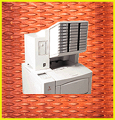
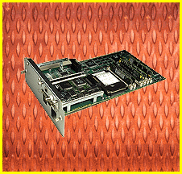
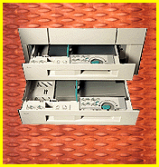

# Details

*BYTE Hardware Lab Report*

Privacy, Please: You can get the Xerox and IBM printers equipped with an optional 10-bin locking mailbox/collator to secure private documents. After configuring the printer, you press an identification code at the front panel to unlock the slot containing your documents.

Quick Change: Except for the Apple LaserWriter 16/600, all the units we tested have modular printer controller circuitry that you can remove without tools. The slide-out boards make it easy to install a different network card or add a hard drive for font storage. Installing a hard drive on the IBM Network Printer 17 board took around a minute.

Paper Handling: The paper trays in the HP, Lexmark, and QMS printers can take a variety of paper sizes. You adjust one paper dimension with a movable locking divider. The other dimension sets with a locking knob. Adjustment positions are clearly labeled. The upper tray adjusts to four sizes; the lower tray handles two additional larger sizes.

## Locked Slots for Privacy

## No Tooltime Necessary

## Size by Choice

Copyright

1994-1997 BYTE

%k'

Ib(

ab(

## Images

