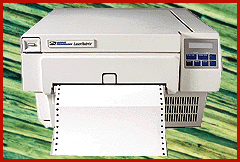

# Printing Continuous Forms on a Laser

*BYTE Hardware Lab Report*

One good reason dot-matrix printers survive in the market is that they can print on continuous-form paper. Output Technology sells a laser printer that's designed to print on continuous forms. Most laser printers have a serpentine paper path. But Output's has a straight path. While it can't hammer out multipart forms like a dot-matrix model, the

LaserMatrix 2405

($5000) is kinder on the ears. Output Technology aims the LaserMatrix at companies that print long batch runs of items such as utility bills and invoices or that use the printer's straight paper path to print bar codes, adhesive labels, or thicker media that don't move well through the convoluted paper path of standard laser printers.

The printer, which supports PCL and PCL 5 emulations, did not fare well in our suite of performance and quality tests when compared to the six workgroup lasers, but it's not designed to compete with those units. The LaserMatrix has a 24-pages-per-minute (ppm) print engine with a 300-dots-per-inch (dpi) print resolution. The low- to medium-duty laser's simple design pulls the continuous media through a six-pin tractor feed and dumps the throughput onto a table or into an optional refolding stacker. The LaserMatrix is suited for overnight jobs as it can print up to 3000 sheets of paper without operator intervention.

Output's LaserMatrix 2405 has a toner system that harks back to the laser printers of yore. To replenish the toner supply, you must pour the powder from a bottle into a well. (Better dress casual.) You must also keep the unit level when moving it, as we discovered. But these are minor inconveniences to get quieter, higher-quality printing on continuous-form paper.

## Where To Find

LaserMatrix 2405.....................$5000

Output Technology

Spokane, WA

Phone: (509) 536-0468

Fax: (509) 533-1280

http://www.output.com/

Internet:

http://www.output.com/

Circle 1064 on Inquiry Card.

## Continuous and Quiet

Copyright

1994-1997 BYTE

4e(

ve(

4e(

ve(

jf(

4e(

ve(

4e(

ve(

4e(

ve(

nl(

4e(

ve(

4e(

ve(

nn(

4e(

ve(

4e(

ve(

4e(

ve(

?o(

4e(

ve(

qo(

4e(

ve(

4e(

ve(

4e(

ve(

yp(

4e(

ve(

4e(

ve(

4e(

ve(

4e(

ve(

4e(

ve(

4e(

ve(

## Images

