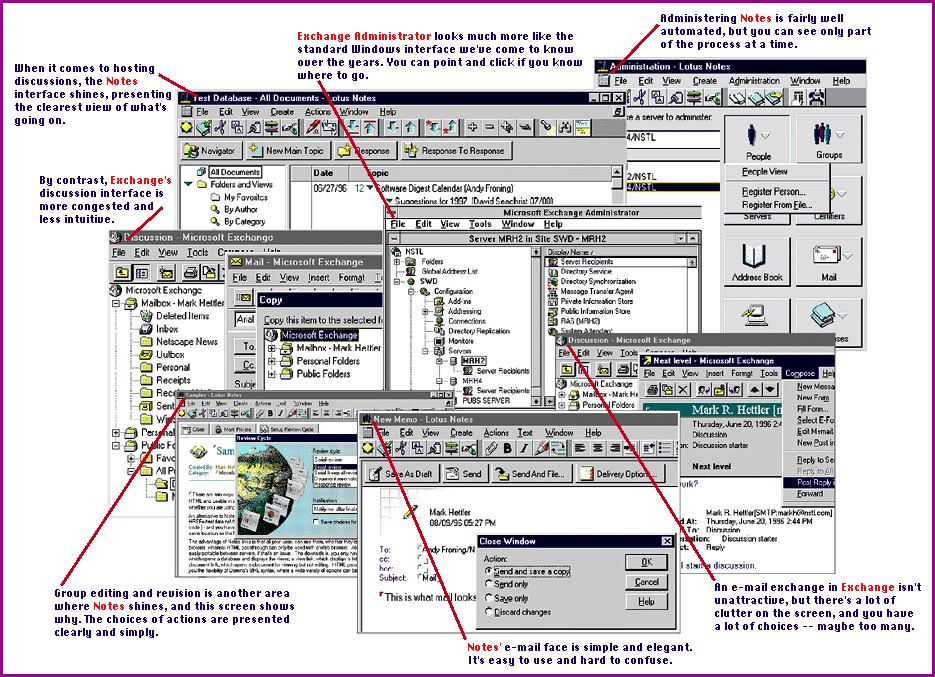
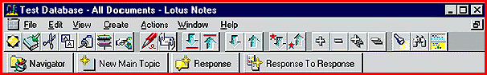

# Lotus Notes vs. Microsoft Exchange

*BYTE Software Lab Report*

Lotus Notes and Microsoft Exchange seek to be unified environments for group projects, but they approach this goal differently.

Mark Hettler

For most people, groupware is defined by one product: Lotus Notes. And though some industry analysts have heralded Microsoft's Exchange as a Notes competitor, Microsoft has instead been playing Exchange as an enterprise-wide messaging system. (Another potential competitor, Novell's GroupWise 5.0, has just been released; see our review in the November BYTE.) Besides these dedicated LAN- and WAN-based products, alternative platforms are emerging: the Internet, the Web, and intranets. (See the sidebar "The Inter/Intranet Alternative".)

While the term can encompass a wide range of software, true groupware

must include

at least these six essential functions -- e-mail, on-line discussion (conferencing), document management (including version control, commenting, and revisions), work flow, group scheduling, and local replication of data -- all in a client/server environment.

Lotus Notes

At its heart, Notes brings the power and convenience of database management to the storage of nontraditional, unstructured information. Each entry in a Notes database is a document, not a record, with a few information fields (author, subject, date, etc.) and the document itself, stored in rich text format (RTF) and possibly including attached files. Users can browse views (lists of documents in a database) that display the information fields. They can customize views to sort or group documents, filter displayed documents based on field qualifiers, and add fields to a view. Thus, Notes facilitates categorizing and locating documents in a way not possible in a standard file system. A server maintains all configuration and user information in a special database -- the name and address book -- whose documents describe all servers at the site, registered users, connections with off-site servers, special-purpose databases, and any other needed system information.

In the Notes architecture, mail is just a way to move stored documents. When a user composes a mail message, Notes saves it in a special database for outgoing mail. The system recognizes anything in that database as outgoing mail and routes it to its destination. Each user has his or her own mailbox, which is simply another Notes database.

Replication: I See, I See

Replication is what gives Notes its unique character. The same database can exist in multiple locations; when users add, delete, or modify documents, the system synchronizes all the changes. For enterprise-wide information sharing, Notes provides replication between servers. Each server's name and address book contains connection documents specifying the servers with which to replicate, the replication schedule, and mail routing. Companies can also replicate information with their customers or other business associates.

Replication helps users who connect via modem or take Notes databases on the road.Users can initially replicate any database, selecting the documents they want to work with off-line. Once disconnected, users can create or edit documents and post mail messages to an outgoing mail database. After reconnecting to the server, the system routes outgoing mail to the server's mailbox and replicates any changes to other databases.

Databases, Work Flow, and Security

Notes provides templates to facilitate creating databases; the most common templates are for discussion, document library, and mail. All use the same underlying database storage but differ in views (forms for entering documents) and fields. Discussion databases allow quick responses to existing documents, and a default threaded discussion view groups related documents and responses. The document library lets users configure review cycles and maintain multiple versions and revision histories.

In past versions of Notes, macros could automate tasks; version 4 now includes the LotusScript language. Forms designers can add programming that executes when users click a button or access certain fields, or designers can divide a form into sections, each containing the fields a particular user is to fill out. Each time a user saves the form, agents monitor the database and notify the next person on the routing list.

Notes security is certificate-based. The system provides each user with an ID file containing an encrypted key that certifies the holder as a valid user in the organization. At log-in time the locally stored ID file validates his password, eliminating the need to send passwords over the net. Each server validates the ID by the certifier key.

Hierarchical certification allows an organization to certify divisions, which in turn certify smaller units, which certify users. Servers with a common certification can replicate their name and address books, thus providing a global address book. Different organizations can "cross- certify" one another to allow exchange of information. Certification forms the basis of electronic signatures.

Documenting the Interface

With all its power, Lotus Notes is very complex and often unintuitive. Rather than point-and-click options, many

configuration tasks

require typing information into fields or a database. But in most cases, particularly initial setup, the printed manuals and help system provide clear, step-by-step instructions. For example, setting up the Lotus Domino software for Web access requires manually copying subforms from one template to another. (More on Domino later.) Instructions step the user through the process.

The Notes 4 user interface automates many common tasks. Server administration -- registering users, editing user options, and entering server commands -- is much easier. Add multiple replicas of the same database and the system creates a single icon on the desktop with a pick list. On-demand replication is an easy menu option. In setting up a second server, the system automatically produces the needed connection documents to allow replication. In addition, the Windows NT server now supports the SPX protocol, simplifying NetWare connectivity.

But a task that isn't automated or that lacks step-by-step instructions can be confusing. Adding a second communication protocol to a server requires making changes in two different places. The manual tells you what to change in the port settings dialog, but not where to find that dialog. And the only way to remove a document from the "favorites" folder without deleting it from the database is to add a button that executes a script.

During our tests, we moved user mailboxes from one server to another. Reconfiguring clients to look for mail on the new server was a major challenge. After we edited the NOTES.INI file, the client software changed the setting back to its previous value. The same thing happened after we reran the setup program and specified a new server. The only recourse was to completely remove and reinstall the client software. Later, by accident, we discovered that you have to make a change in the client's "location" configuration.

But such snafus were the exception. In most cases, users who take time with the documentation will find that following the instructions produces the desired results.

Internet Access

The InterNotes Web Publisher converts Notes forms, documents, views, and databases to Hypertext Markup Language (HTML) for publication on the Web. The InterNotes Web Navigator lets a Notes server act as a browser, saving Web pages in Notes databases. This helps Notes users who don't have Internet access and allows future reference off-line. At press time, Lotus is about to make its SMTP Message Transfer Agent add-on available for NT; it's already available for OS/2. This will allow a Notes server to function as an Internet mail server.

http://domino.lotus.com

The heart of Notes' Internet integration is Domino, a downloadable add-on (

http://domino.lotus.com

) that turns a Notes server into a Web server. Domino converts Notes objects to HTML upon request, allowing browsers to access Notes forms, documents, views, and databases as if they were a standard Notes client. (See our Eval in the October BYTE.)

Lotus Notes is targeted as a cross-platform solution for a variety of operating systems. It's currently available for Windows NT, OS/2, and a variety of Unix platforms, with client software for 16-bit Windows and Macintosh. Storage and security mechanisms are completely OS-independent. Except for minor installation differences, Notes functions identically on different platforms.

Mail-Centered Exchange

Where Notes is a database manager, Microsoft Exchange is a messaging system. A major upgrade to Microsoft Mail, Exchange is designed primarily to move information from one place to another. It's essentially a mail system with storage added, whereas you can think of Notes as a storage system with mail added. Exchange provides many of the same mail features as Notes. A point-and-click interface helps set up users and connectors to transfer mail with other Exchange servers and mail systems, such as Internet mail.

Exchange begins with private mailboxes and adds public folders (mailboxes that don't belong to specific users), which are similar in many ways to Notes databases. Folder owners can determine which users have what access. Public folders serve for discussions, posting topics, and responses, and they can display a threaded discussion view. But Exchange lacks the built-in smarts of Notes' templates. There are no predefined views geared specifically to a public folder's use, no specialized interface features.

Exchange is tied tightly to Windows NT. Each Exchange user corresponds to an NT user account, and it's the OS that authenticates users. Administrators can install an advanced certification-based security system, similar to Notes', that enables electronic signatures.

In order to share information, two servers must either be in the same NT domain or their domains must have a trust relationship -- that is, a link between them that allows one domain to recognize the user accounts of another domain, trusting that other domain to authenticate the log-ons of its users. Exchange refers to several servers at the same location as a site, and several sites can be grouped into an organization. Administrators view all servers within a site in a single window in the administration program; they can open other windows to administer other sites if they have the rights. But it stops there. Exchange provides no facilities for replicating public folders between different organizations. Two different business entities, such as an organization and its client, can't replicate public folder contents unless they set up their NT networking and Exchange infrastructure as though they were the same organization. Exchange can, however, route mail messages between different organizations.

A Matter of Form

Exchange's Electronic Form Designer lets you create custom forms for mail and folder postings. Designers can enhance a form's functionality using Visual Basic. A message built upon a form can display different information and functionality to sender and recipient. But while Notes just saves a form in a database, Exchange requires a cumbersome process of registering forms in the Organization Forms Registry (OFR). When we reached that point, the OFR wasn't presented as an available option. A Microsoft representative explained that we had to first configure the OFR on the server and stepped us through the process of finding and configuring the OFR. But later on, the OFR again became unavailable, and this time the recommended fix didn't work for us.

Visual Basic is available only within forms. There's no equivalent to LotusScript in Notes agents. For automating system behavior, Exchange developers have only limited, predefined options, which limits Exchange's usefulness for work-flow applications. Several Microsoft programs, including Word and Excel, support serial routing with Exchange, but there's no way to develop the sophisticated work-flow applications that are standard fare at Notes installations. For example, a user cannot post a message to a public folder that triggers a serial routing process and presents each recipient on the list with a different set of tasks.

Interface Gotchas

Where Notes requires complex, multistep procedures and manual data entry, Exchange offers simple point-and-click choices in tabbed dialogs. But time and again, we followed the directions and got an entirely unintended result, leading to a trial-and-error hunt to discover some obscure (but vital) detail we had overlooked. For instance, adding a second server to a site is simple if you use the same service account on both servers. If you don't, however, it's almost impossible to undo the mistake short of reinstalling Exchange from scratch or granting several obscure and undocumented privileges in both Exchange and NT. We also had to experiment with granting the administrators various rights on each other's domains before the servers could communicate.

We set up several clients in a seemingly identical manner. All but one connected properly to the server. We compared settings carefully but couldn't determine why one could never connect. There's virtually no documentation on client configuration.

The server administration program lists public folders by site, not server, so it's difficult to tell where a public folder resides. If a folder's server is down, the folder will be listed but inaccessible. The system synchronizes a public folder between two servers only after replication has been set up explicitly. It's difficult to test whether replication works properly because the administrator can't tell which server's folder he or she is viewing.

The client program lists public folders together with mail folders, which might be convenient. But whenever you are positioned in a public folder, selecting the toolbar's "new" button creates a new e-mail message, not a new posting for the folder. To create a new item for a folder, you must explicitly select "New post in this folder" from the Compose menu. Lastly, Exchange's Uninstall program didn't completely remove the software; a technician had to manually delete dozens of entries from the NT registry to avoid error messages on system start-up.

Which One?

Microsoft's counterpart to Domino, still in development, will integrate Exchange with Microsoft's Internet Information Server. This will combine the benefits of a full-featured Web server, including access to standard HTML files and customized Web applications, with access to Exchange mail and public folders. The Exchange server includes Internet Mail Connector, which can forward mail to Internet hosts and receive mail from the Internet.

All in all, Lotus Notes does a better job incorporating mail into its document database architecture than Exchange does incorporating document management and groupware into its messaging structure. Moreover, Notes is far ahead in terms of seamless integration with the Internet.

Evaluations in this report represent the judgment of BYTE editors, based on extensive tests conducted by National Software Testing Labs and documented in a recent issue of NSTL's monthly Software Digest. To purchase a copy of that report, with their own evaluations and data, contact NSTL at 625 Ridge Pike, Conshohocken, PA 19428; (610) 941-9600; fax (610) 941-9950; editors@nstl.com. For a subscription, call (800) 257-9402. BYTE Magazine and NSTL are both operating units of The McGraw-Hill Companies.

## Product Information

Exchange.......................$1970 server license

...............................$ 54 per client

## Microsoft

Redmond, WA

Phone: (206) 882-8080

Fax: (206) 93-MSFAX

http://www.microsoft.com/exchange

Internet:

!http://www.microsoft.com/exchange

Circle 1020 on Inquiry Card.

Notes..........................$495 server license

...............................$295 per client

Lotus Development

Cambridge, MA

Phone: (617) 577-8500

Fax: (617) 693-0968

http://www.lotus.com

Internet:

http://www.lotus.com

Circle 1021 on Inquiry Card.

## Features

Notes 4.1 Exchange Server 4

SERVER PLATFORMS

:Windows NT 3.5x, 4.0 y y

%Unix, OS/2, NetWare y

:NetBIOS, named pipes, y y

NetWare SPX, TCP/IP

CLIENT PLATFORMS

:Windows 3.x, 95, NT y y

%Unix y

:OS/2 y A

:Macintosh y y

E-MAIL ADMINISTRATION

:X.400 routing, MAPI support, y y

SMTP gateway

%Automatic space reclamation y

:Roll forward from transaction log y

E-MAIL USER FEATURES

:Threaded discussion view y B

:Fax capability C y

:Voice-mail integration C C

:Change message to task y C

DOCUMENT MANAGEMENT

:Folders within folders, y y

user-created folders

:Full-text indexing y C

:Index based on categories y y

%Changes stored as new document y

%View multiple versions y

of document

:Index text of word processor y C

documents

:Access documents on multiple y y

servers

CONFERENCING/DISCUSSIONS

:Threaded discussion view or y y

outline view

:Hot link to original posting y y

REPLICATION

:Scheduled replication y y

:Change-triggered replication D y

:On-demand replication y E

:Automatic alternate routing y

%Replicate selected documents y

outside organization

WORK FLOW

:Serial routing y C

:Track messages through y C

routing process

:Predefined routing lists y C

%Rules-based routing lists y

SCHEDULING

:Find first open time for D y

all participants

:Check for conflicts, request D y

confirmation

:Assign tasks y C

:Accept/decline/delegate tasks F C

:Notify of task completion y C

INTERNET FEATURES

:Access Web without browser y G

%Store URL contents in y

database or folder

:View folders and documents y G

using Web browser

:Post documents to public y G

folders using browser

%Use document links in browser 3

## Security

:Certificate-based security y H

%Trust relationships y

outside organization

:Electronic signatures y y

Key

-A Can run Windows 3.x client under OS/2 3.0.

*B Messages must be moved to common folder

8C Available as add-on, separate, or third-party product

!D To be available in version 4.5

E Local-to-server replication

F Accept or decline

G Available in future upgrade

,H X.509-based certificates at message level

!Groupware Systems Best Overall:

Lotus Notes 4.1

Experience shows as Notes keeps well ahead of

its main competitor.

P Cost, server Cost, client Technology Implementation

2 license license

Lotus Notes 4.1 $ 495 $295 **** ****

Microsoft Exchange $1970 $ 54 *** ***

Server 4

Key

***** Outstanding

**** Very Good

*** Good

** Fair

* Poor

!Similarity Ends at the Interface

While Exchange and Notes do many of the same things, they look very different while doing them.

## Lotus Notes Toolbar

mailto:"mark_hettler@nstl.com"

Mark Hettler pioneered NSTL's coverage of SQL servers and multiuser databases. You can reach him at

mark_hettler@nstl.com

Copyright

1994-1997 BYTE

D#)

m')

l-)

16)

l6)

N8)

"<)

c=)

e>)

&?)

N?)

G@)

KA)

!B)

VC)

<D)

xD)

#E)

$F)

cG)

cH)

#I)

bI)

^J)

TK)

xL)

KM)

vN)

6O)

RP)

IQ)

*R)

"S)

VS)

vT)

^U)

1V)

MW)

4X)

CY)

GZ)

o[)

+\)

>])

f])

\^)

e_)

$`)

Z`)

=a)

&`,

za,

C>)

#\)

## Images

