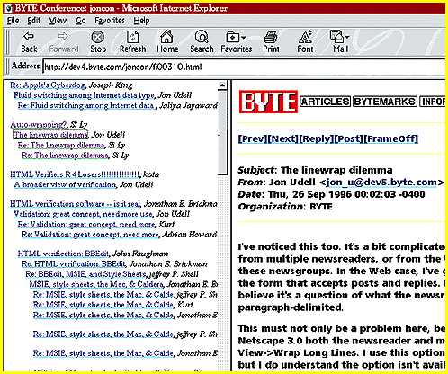

# The Inter/Intranet Alternative

*BYTE Software Lab Report*

Even when Notes had no real competition, the Internet was being considered a serious alternative. Its infrastructure is designed for sharing information between sites around the world, and an ever-growing array of tools for browsing and downloading information means organizations don't need to distribute specialized software. The existing wired network eliminates the need to set up private communication links between clients and servers. Lack of security has been a traditional criticism of Internet-based information sharing, but the emergence of Secure Sockets Layer (SSL), firewalls, and encryption has made this less of an issue.

Even within local sites, organizations are seeing the value of intranets, using Web servers and browsers to share information over a LAN or WAN. Here again, Web tools preclude the need for proprietary software. Moreover, such intranets readily allow seamless access to information from the outside world.

Internet mail has become the common means by which many organizations communicate. There is some question whether current Internet-based routing between sites in an organization can handle heavy volumes of mail as efficiently as proprietary packages, but providers of Internet-based solutions should be able to address such issues.

Internet newsgroups provide discussion features and functionality similar to those of Notes and Exchange. Most readers are familiar with public Usenet forums, but news servers can also host private discussions. Newsgroups allow readers to post responses, start new topics, and display messages in a threaded view.

Where Internet and proprietary solutions diverge is in document management. Newsgroups are a convenient way to post messages and attachments, but there's no way to categorize them except the user-entered subject line. Also, newsgroups don't allow users to edit or delete posted documents or to let some postings expire and others live indefinitely.

The most common way to make information available, whether on the Internet or an intranet, is with Web pages. A Web page may contain information, or it may provide links to other pages and files for downloading. While the Web is convenient for finding and viewing information, it's awkward to manage. Making a document available on the Web requires authoring a page and providing links to the new document.

Web sites are simply unusable for group document management. Once a document is published, people can easily read it or download it, but it is nearly impossible for them to edit it. Making and saving changes involves republishing the original Web page; maintaining multiple versions involves publishing a new page for each revision. Beyond the inconvenience, there's no database for storing and organizing documents; we're back to the OS's file system, with documents scattered among directories and held together by hypertext links.

One important consequence of file system-based storage is the lack of facilities for replication between sites. Newsgroups allow the propagation of new postings to multiple sites, but replicating Web sites is more difficult. While some might argue that the Internet is designed to make information in a single location accessible to users around the world, the large number of mirrored sites already in existence points out the Net's inadequacy. Moreover, many organizations will want to have proprietary information replicated to sites in various locations protected by firewalls rather than in a single location that is accessed remotely. File transfers can move information from one site to another, but there are no mechanisms for synchronizing changes made at multiple sites.

Despite these disadvantages, the Internet is here to stay, and using Web browsers to retrieve documents will become the primary means whereby people access information. The only question is what role existing PC software technology will play in the Internet environment. Both Lotus and Microsoft are working to move their groupware technologies to the Internet, but it is uncertain how well they'll compete with products designed for the Internet from the ground up.

)Web Tools Enhance Intranet Communication

Web-based discussion on The BYTE Site

Copyright

1994-1997 BYTE

Q|,

gk-

## Images

