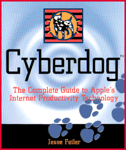
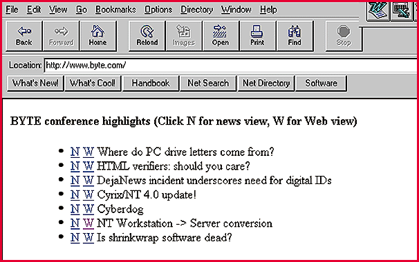

# Dual-Mode Conferencing

*Web Project*

^News-style conferencing has its advantages, and so does Web conferencing. Why not have both?

Jon Udell

In a pair of columns last May and June I explored two approaches to text conferencing on the Internet. The news approach relies on the same Network News Transfer Protocol (NNTP) servers and clients that support public discussion on the Usenet. The Web approach uses Hypertext Transfer Protocol (HTTP) servers running applications that play in standard browsers. I like aspects of both so much that I've combined them into a single hybrid system (

see the screen

I use both halves of this system myself because, while I prefer the news method, there's no NNTP gateway on our corporate firewall. So I use a newsreader from my home office and a Web browser while at work. Users, too, initially preferred their newsreaders, but I've noticed increasing traffic on the Web side of the system as I've beefed up its capabilities. The point is that with a choice of clients, a dual-mode conferencing system can appeal to a wider audience than a purely news-based or Web-based system can.

## Key Components

BYTE's dual-mode conferencing system consists of four essential elements:

Internet News Daemon (INND) -- This foundation component controls the primary message database. Newsreaders talk directly to this database. Web browsers talk indirectly to this database by way of several Common Gateway Interface (CGI) applications. (I'm using INND 1.4, which comes with Caldera's Linux.) As I wrote last May, INND is a scary and complex beast, but if you focus on conferences that live only on your own site, you can ignore the thorny problem of replication with other news servers. Because this site-specific mode limits your feed to local postings, you may also be able to ignore the often-vexing process of message expiration (I do). These two simplifications make INND far more manageable than is normally the case.

http://www.oac.uci.edu/indiv/ehood/mhonarc.html

HonArc -- Earl Hood's Perl application transforms collections of RFC 822 messages into navigable Hypertext Markup Language (HTML) archives. It's typically used to make listserv archives visible on the Web, but since mail and news messages share the same RFC 822 headers, MHonArc also works on INND message databases. It creates index pages in a variety of formats, including the one I prefer: messages organized by conversational thread, with newest threads first. Because MHonArc can add or remove individual messages, and reprocess the index page accordingly, incremental updates to an MHonArc-generated archive are inexpensive. You can download MHonArc at

/http://www.oac.uci.edu/indiv/ehood/mhonarc.html

inews -- This command-line tool comes with INND. Here's one way to post a message to a news server with inews:

/usr/lib/news/bin/inews

Newsgroups: test

This is a test.

And here's how to reply to that message using inews:

/usr/lib/news/bin/inews

Newsgroups: test

References: 012abc@host.com

This is a test.

The References: line in the header of the reply contains the message ID of the original message. How can you discover that? Here's one way: In the Netscape newsreader, do View->Headers->All. If you type the message ID correctly when you post the reply with inews, newsreaders will display it indented below the original, and so will MHonArc's threaded index page.

CGI scripts -- The final component, and the only one I had to build myself, is a set of Perl scripts that extend MHonArc. The most important new feature they add is the ability to post and reply. The Web archive that MHonArc builds is read-only. My script adds Post and Reply links to each archive page. In the case of Reply, other scripts fetch the original message from the INND database, present it in a Web form, and transmit annotations back to INND by way of inews. I also added a frame view of the archive (see the sidebar "Frame Games").

HonArc is freely available Perl code that anyone can modify, and that's just what I planned to do at first. After a few false starts and a bit of reflection, I decided to take another tack. From one point of view, MHonArc is a moderately complex Perl program. Mastering it well enough to extend it is challenging; carrying those extensions forward to new versions of MHonArc would be equally challenging.

But wait! From another point of view, MHonArc is just a black box that consumes one set of well-structured text files and produces a different set of equally well-structured files. All I really had to do was run MHonArc on a set of news messages to create one kind of HTML archive, then filter that to create a new one. This reduced the problem to the sort of pattern-matching exercise at which Perl excels.

Hypertext Authoring

http://www.byte.com/

Anyone who participates in a news- or Web-based conference can be a hypertext author. You're probably familiar with automatic activation of Web URLs -- type the string "

http://www.byte.com/

F" in a message and, when it's posted, that string will become a link.

You can also create links to other conference messages. Unfortunately, the procedure isn't nearly so familiar, convenient, or standard.

Let's say you want to construct a reference to a message in another conference. On the news side, in Netscape, you can do this: Go to the target message, reveal its ID with View->Headers->All, then right-click the message ID and capture it as a URL by selecting Copy Link Location. Now, when composing a new message or a reply, you can paste in the URL to create a link to your target message.

Phew! Why is this so hard? Because on the Usenet, nonlocal references to messages are hardly worth the trouble. Odds are that a message will have expired by the time someone tries to follow a link to it. When you create stand-alone NNTP conferences like ours, though, there's a real incentive to layer and interweave the discussion using message URLs. Some BYTE conference participants are doing this now, despite the awkwardness of the procedure. As site-specific conferencing gains momentum, I hope the newsreaders will streamline that procedure.

On the Web side, it's reasonably straightforward to construct a message URL. Just go to that document, copy its URL, then paste it into a new message or reply. In a system like ours that stores messages as HTML files, the URL will simply name the file. In a system that keeps messages in a database, the URL will be a long string of CGI gobbledygook. Either way, automatic URL activation (if available) should yield an appropriately behaved link.

Message Pointers

Have you spotted what's wrong with this picture? Let's say you're reading a dual-mode conference using a newsreader. A message contains a news-style message URL constructed by another participant who is using a newsreader. You click it, and view the message in your newsreader. Now suppose that message contains a Web-style message URL. Click that link and you'll find yourself viewing the next message in your Web browser. This unpleasant contextual shift -- which doesn't occur in the reverse case, by the way, since Web browsers can usually handle news:// and http:// URLs natively -- leads to the notion of dual-mode message pointers. Why not have it both ways?

I've explored two versions of this idea. When I feature conference messages on our home page, I tuck the news URL behind a clickable letter N and the Web URL behind a clickable W. When the site e-mails conference updates to registered users, the summary of new messages includes both flavors of URL so that you can click through and see complete messages in the environment you prefer (if your mailer supports automatic URL recognition).

The next logical step would be to postprocess both message databases and double up the message pointers. But I haven't taken that step yet, and I'm not sure I want to. It's doable, I'm sure (everything is), but it's more work than I want to invest in a system whose useful lifetime I guess might be six to 12 months. By then I expect the convergence of newsreaders and Web browsers will erode or eliminate the advantages that dual-mode conferencing offers today.

In the meantime, those advantages are real. Conferencing is a powerful and still largely underexploited tool. News-style conferencing appeals to many Usenet-literate folks and offers a variety of features -- a rich, responsive user interface; multiple sorted views; unread message tracking; replication for off-line use -- that you can't get easily (if at all) today in the Web realm. Web conferencing, meanwhile, appeals strongly to many in the Web generation who are not Usenet-literate. It's also handier when you need to conference across firewalls and when you want to brand your conferences with a distinctive look.

http://www.byte.com/art/download/dualmode.zip

If you want to give dual-mode conferencing a try, and if you're willing to deploy INND, inews, and MHonArc as I've described, then you should check out my scripts at

-http://www.byte.com/art/download/dualmode.zip

. Enjoy!

## Toolwatch

GIF89a plug-in for Adobe Illustrator

Company: Adobe

http://www.adobe.com/prodindex/illustrator/main.html#gif

Internet:

8http://www.adobe.com/prodindex/illustrator/main.html#gif

BYTE's New Media production ace Joy-Lyn Blake now spends far less time retouching text when she makes illustrations Web-ready. The antialiasing in this free GIF exporter really works.

## Booknote

Cyberdog: The Complete Guide to Apple's Internet Productivity

Technology

, by Jesse FeilerPublisher: AP Professional

http://www.appnet.com/

Internet:

http://www.appnet.com/

Price: $34.95

What users and developers need to know about Apple's slick OpenDoc-based Internet component framework.

## Best of Both Worlds

News-Style Conferencing

$Offers a rich, responsive interface

Presents multiple sorted views

Tracks unread messages

*Provides replication for off-line reading

Web-Style Conferencing

"More intuitive for Usenet novices

Crosses firewalls

3Lets you brand conferences with a distinctive look

## Cyberdog

## Taking the Wider View

Because individual tastes and technologies determine conferencing preferences, dual-mode conferencing will appeal to a wider audience.

mailto:"judell@bix.com"

Jon Udell (

judell@bix.com

,) is BYTE's executive editor for new media.

Copyright

1994-1997 BYTE

yn-

5n-

5n-

5n-

Ro-

5n-

zo-

5n-

5n-

Dp-

5n-

hr-

5n-

5n-

5n-

Eu-

5n-

5n-

5n-

I|-

5n-

5n-

5n-

5n-

Q}-

5n-

5n-

5n-

5n-

?~-

5n-

5n-

5n-

5n-

5n-

5n-

5n-

5n-

5n-

5n-

5n-

5n-

5n-

5n-

5n-

5n-

5n-

5n-

5n-

5n-

5n-

5n-

5n-

5n-

5n-

5n-

5n-

5n-

5n-

5n-

5n-

5n-

5n-

5n-

5n-

5n-

5n-

5n-

5n-

5n-

5n-

5n-

5n-

5n-

5n-

5n-

5n-

5n-

5n-

5n-

5n-

5n-

5n-

5n-

<p-

Wx-

## Images

