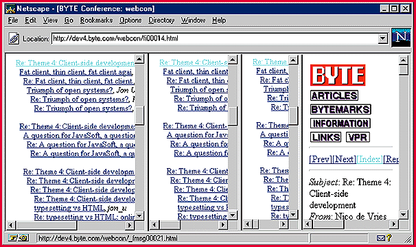

# Frame Games

*Web Project*

I prototyped a frame-enabled version of the BYTE on-line archive a while back, then shelved the project. Why? Mostly because the complexity of the four-pane system I envisioned, with links cascading across two levels of index pages, was daunting. The Web half of our dual-mode conferencing system presented a simpler challenge. Here the model was the classic two-pane arrangement you see in the Windows 95 Explorer and countless other applications: index pane on the left, linked to document pane on the right.

For the first naive implementation I tweaked my MHonArc postprocessor to crank out an extra version of the index page. Then I wrote a frameset page to define the layout and contents of the index and document panes. I placed a link to this frameset page on the main index page that said: "Frame view."

Qualified Success

This scheme worked; that is, it produced a two-pane browser whose index-pane links called the appropriate files into the document pane. But there were two problems with this. First, you missed the option to turn on frames if you jumped directly to a message, bypassing the index page. Second, if you clicked on nonlocal Web links in the document page (for example, the BYTE Site's home icon), the system would recurse. You could even create a "hall of mirrors" effect by successively launching two-pane browsers in an ever-diminishing series of document panes (

see the screen

The solutions to both problems are related. To solve the first, I tweaked the postprocessor to add FrameOn and FrameOff links to the toolbar on every message page. The FrameOn link should, obviously, point to the same frameset page already pointed to from the main index page. But how to code the FrameOff link? Here's the solution: <a href="threads.html" target="_top">. FrameOff's Action, in other words, is to fetch the main index page and display it in the browser's top-level window. The same trick worked for the row of BYTE Site icons at the top of every message page.

More Problems

Having killed two birds with one stone, I spotted two more on the horizon. First, the FrameOn transition didn't preserve context. If you clicked it from message 57, you'd end up in frame view with message 0 in the document pane. The reverse FrameOff transition did preserve context because the postprocessor could generate unique-per-message links to match corresponding targets on the index page. But every FrameOn link pointed to the same frameset page, so they all reset your context to message 0.

The second problem was that the "_top" trick wasn't right for the Index link in frame view. Its effect in that case was the same as FrameOff -- harmless, perhaps, but confusing.

The solutions to both these problems are, once again, related. Both solutions involve a strategy I'll call overgeneration. In the first case, the problem was that the single frameset page could not handle multiple contexts. Well, who said there could be only one frameset page? Another postprocessor tweak yielded one frameset page per message. The one for message 57, for example, sets the title of message 57 at the top of the index page and loads message 57 into the document pane. Then I tweaked the postprocessor to point each FrameOn link at the appropriate frameset page. Voil

! Now FrameOn was quickly transformed into a context-preserving action.

Overgeneration to the Rescue

Solving the second problem involved another kind of overgeneration. The reason there was no right way to code the Index link for frame view was that it didn't belong there at all. In frame view the index is by definition always visible, so an Index link makes no sense. But since the framed and frameless modes shared the same set of message pages, I was stuck.

Well, who said there could be only one set of message pages? Yet another postprocessor tweak doubled the set. This move enabled me to drop the unnecessary FrameOn link from frame view and vice versa. And most intriguingly, it allowed me to aim the Next and Prev links -- in frame view -- at the context-specific frameset pages I'd already generated to smooth the FrameOn transition. If you go to one of the BYTE Site conferences, click an index-pane title in frame view and the document pane reacts. That's the expected behavior with frames. Now click Next in the document pane. It reacts, as you'd expect, and so does the index pane! This two-way linkage is an effect I always prize, but seldom encounter, in multipane information displays. I didn't think it was possible to achieve this effect with HTML frames but, if you're willing to overgenerate, it is.

## Not So Great Upon Reflection

When using HTML frames, incorrectly coded links result in this dreaded "hall of mirrors" effect.

## Images

