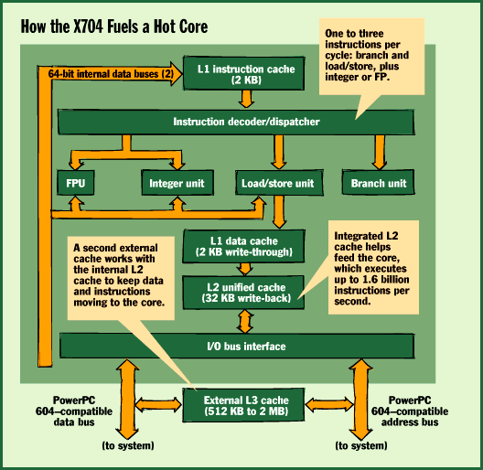
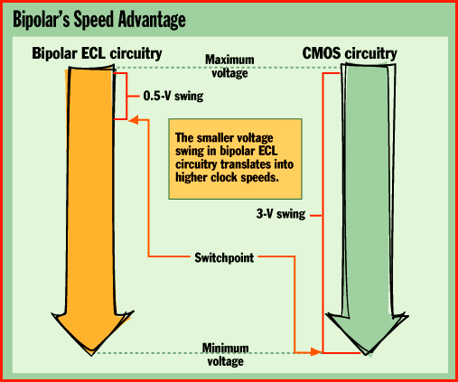

# PowerPC Speed Demon

*Features*

Exponential Technology's 533-MHz bipolar microprocessor will breathe new life into the PowerPC architecture and the Macintosh.

Tom R. Halfhill

There's an old joke about a computer so fast it can execute an infinite loop in 10 seconds. Exponential Technology's new PowerPC-compatible X704 chips aren't quite that fast, but their clock speeds of 466, 500, and 533 MHz make you wonder if that joke might come true.

You can bet that Intel isn't laughing. Exponential's CPUs will munch on Pentium and Pentium Pro chips for breakfast. What's more, the X704 appears to have plenty of headroom for future performance gains. It's actually a conservative design that doesn't push the limit of what's possible.

Until now, the only microprocessor announced at 500 MHz was Digital Equipment's Alpha 21164, an exotic and expensive chip for high-end workstations and servers. The 21164 still has an edge in performance. At 500 MHz, it delivers an estimated 15.4 SPECint95, compared to Exponential's estimate of 11 to 13 SPECint95 for the X704.

But Intel's swiftest Pentium Pro chip, currently at 200 MHz, offers only 8.09 SPECint95. Intel will introduce a faster version by the time the X704 ships in the second quarter of 1997, but the Pentium Pro still won't threaten the X704's performance lead among relatively affordable desktop computers and servers.

The X704 is compatible with the PowerPC 604 from IBM and Motorola and meshes well with existing 604-based system designs. By mid-1997, when the X704 appears in new Macs, Mac clones, and PowerPC systems that retail for around $5000, it may become the chip of choice for desktop publishing, image editing, software development, and other CPU-intensive tasks.

Those aggressive prices are possible because Exponential expects to sell the X704 for about $1000. That's roughly $500 less than the price of a 433-MHz Alpha (the 500-MHz Alpha's price wasn't set at press time). The X704 will debut at about the same introductory price as the 66-MHz Pentium in 1993 and the 150-MHz Pentium Pro in 1995. Yet it will hit the ground running at clock speeds unprecedented for a mainstream CPU.

Mood Swings

Exponential's secret weapon is bipolar logic. As reported earlier in BYTE (see "Watch Out: 500-MHz PowerPCs Planned for 1997," May), Exponential's design combines fast-switching bipolar transistors in the logic circuits with economical CMOS transistors in the memory cells.

Bipolar transistors switch states by swinging between two intermediate voltages, while CMOS transistors must alternate between their minimum and maximum voltages (see the figure

"Bipolar's Speed Advantage"

P). The smaller voltage swing (about 0.5 V) translates into higher clock speeds.

The result: The

X704 is

a model of speed and efficiency. Remarkably, it's made on a 0.5-micron fabrication process. Intel makes both the Pentium and Pentium Pro at 0.35 micron, and by next year it will move to 0.28 micron, with 0.25 micron soon to follow. Likewise, IBM and Motorola are phasing in 0.35-micron PowerPC chips, and 0.25 micron is coming in late 1997 or 1998. Yet Exponential expects to keep the X704 at 0.5 micron until mid-1999.

One reason may be that bipolar transistors run hotter and therefore can't be packed as closely together (more on this later). Exponential says CMOS chips need smaller and smaller geometries to reach higher clock speeds, while the X704 already runs comfortably at 466 to 533 MHz on its current process. Moreover, the 0.5-micron process is less costly than the newer, smaller processes. And it's probably easier for Exponential to find a fab partner if the X704 does not need leading-edge technology. (Exponential isn't yet naming its partner, but it's an Asian semiconductor manufacturer.)

Even at the relatively large geometry of 0.5 micron, the X704 has a small die of only 150 square millimeters. It has only 2.7 million transistors (partly because bipolar logic gates don't require extra transistors for speed buffers), less than half as many as the Pentium Pro. What's even more impressive is that only 700,000 of those transistors are bipolar logic -- the rest are CMOS memory cells in the caches. To put this into perspective, the X704 has roughly the same number of logic transistors as an Intel 486.

Design Simplicity

By today's standards, the X704 is almost a back-to-nature RISC chip. It's considerably less complex than a 604, 604e, or Pentium Pro. It's not superpipelined, and it omits such fancy features as speculative execution, instruction reordering, and register renaming. The primary (Level 1, or L1) instruction and data caches are surprisingly small -- only 2 KB each. The X704 has three-way superscalar execution and branch prediction, but nowadays that's nothing special.

What is unusual is an integrated secondary (Level 2, or L2) cache. At 32 KB, it accounts for most of the chip's transistors and 80 percent of the CMOS transistors. The only other CPU with an integrated L2 cache is the Alpha. (Although the Pentium Pro has an L2 cache in the same package as the CPU, it's still an external cache on a separate die.)

Exponential integrated the L2 cache because a processor as wickedly fast as this one is in perpetual danger of starvation. At its peak rate of three instructions per cycle, a 533-MHz X704 executes 1.6 billion instructions per second. It won't be easy for a typical system bus running at a poky 50 or 66 MHz to keep this extraordinary core fed with instructions and data.

Exponential is tackling this problem in several ways. In addition to the internal caches, the X704 needs an external L3 cache, ranging from 512 KB to 2 MB, for best performance. The write-through L1 caches are direct-mapped for the fastest possible access, and the unified L2 cache is eight-way set-associative and has a write-back mode. There's also a burst mode and built-in cache coherency for multiprocessor systems.

The X704 also supports bus speeds as fast as 100 MHz. However, only the 500-MHz chip can drive the bus at that rate.

In most systems, the 466- and 533-MHz chips will limit the bus to 66 MHz, because 100 MHz doesn't yield an even clock-divisor ratio. Clearly, the X704-500 will be the golden CPU for I/O-intensive servers.

But don't get too excited yet. Designing a system that runs at such high bus speeds is tricky. Apple, like most system vendors, has never made a motherboard faster than 66 MHz. The X704 will probably isolate those higher bus speeds on a daughtercard that plugs into a slot on the motherboard. Apple's high-end Power Macs and similar Mac clones already support such a daughtercard, so users can upgrade their CPUs.

That means some Mac owners will simply plug in a new daughtercard to get an X704. The only drawback is that current systems put the L2 cache (which acts as an L3 cache for the X704) on the motherboard. It can't run faster than 66 MHz.

Exponential's future solution is an in-line cache managed by a new ASIC on the daughtercard. The ASIC will contain an L3 cache controller and dual ports. One port connects the 100-MHz CPU bus to synchronous-burst static-RAM (SRAM) chips in the L3 cache, which are also on the daughtercard. The other port bridges to the 66-MHz system bus through the daughtercard slot. This would effectively segregate the difficult 100-MHz bus and L3 cache on the daughtercard.

Another measure of the X704's simplicity is that it has

only four

execution units: an integer unit, a load/store unit, a branch unit, and an FPU. The X704 can execute all integer instructions (except multiply and divide) in a single cycle. The instruction decoder can issue up to three instructions per cycle to the execution units, which can process a load/store, a branch, and an integer or floating-point instruction during each cycle.

The instruction pipeline is only six stages long -- less than half the length of the Pentium Pro's superpipeline. This allows the X704 to recover more quickly from stalls and mispredicted branches.

Although the X704 is compatible with the PowerPC 604, it's noticeably less complicated. That leaves room for Exponential to boost the performance of future chips in two ways: by improving their microarchitectures and by shrinking their components smaller than 0.5 micron for even-higher clock speeds.

Exponential could hit two possible roadblocks, however. First, a more advanced microarchitecture could defeat the purpose of fast-switching transistors if the additional complexity bogs down the pipeline. For Exponential, simpler might always be better.

The second potential roadblock is heat. The X704 is a hot chip in more ways than one: Power

dissipation is

a scorching 75 to 85 W. It's practically a light bulb. That kind of heat could make it very difficult to squeeze the transistors closer together without causing trouble. However, Exponential says it's confident that future bipolar chips will migrate to 0.35-, 0.25-, and even 0.18-micron processes.

Coping with the extra heat will also require some careful system design, but nothing that's out of the ordinary. The X704 works in existing Power Mac 9500 boxes with the standard 390-W power supply; all it needs for cooling is a new fan to blow air across the CPU's modest heat sink. However, this is one chip that you won't see in a laptop, unless users are willing to wear asbestos trousers and tow a wheelbarrow full of batteries.

PowerPC Boost

Exponential's speed demon could not come at a better time for the PowerPC Alliance. Wisely, IBM and Motorola have licensed Exponential the patents it needs to make the X704 without getting mired in legal squabbles. The X704 will anchor the high end of the PowerPC line while IBM and Motorola continue to serve the bulk of the market with the 603e, 604e, and 620, which are approaching 300 MHz. For high-end Mac users, who have an insatiable appetite for CPU power to handle their graphics-intensive applications, the X704 offers horsepower that an x86-based system can't match.

The biggest challenge for Exponential might be keeping up with demand. Problems in the BiCMOS manufacturing process could result in hordes of frustrated users. But if Exponential carries through, the X704 will significantly brighten the PowerPC's future.

## Where To Find

Exponential Technology

San Jose, CA

Phone: (408) 441-6050

Fax: (408) 441-6051

E-mail: info@exp.com

http://www.exp.com

Internet:

http://www.exp.com

## X704 Dossier

Price: $1000

!Performance: 11 to 13 SPECint95*

Volume production in Q2 1997

Core speeds: 466, 500, and 533 MHz

Bus speeds: 50 to 100 MHz

PowerPC 604-compatible bus

0.5-micron BiCMOS process

!Die size: 150 square millimeters

356-pin ball-grid-array package

*Based on company estimates.

## Hot Chip

Bipolar transistors offer performance advantages, but one

drawback is heat.

9Product Power dissipation

6PowerPC 604 16.5 W

6Digital Equipment Alpha 21164 37 W

6Exponential X704 75 to 85 W

6Standard light bulb 60 to 100 W

## How the X704 Fuels a Hot Core

]A simple CPU. The X704 has only four execution units: FPU, integer, load/store, and branch.

## Bipolar's Speed Advantage

To change staes, CmOS transistors switch from highest to lowest voltages. Bipolar transistors change at an intermediate voltage.

mailto:"thalfhill@bix.com"

]Tom R. Halfhill is a BYTE senior editor based in San Mateo, California. You can reach him at

thalfhill@bix.com

Copyright

1994-1997 BYTE

Y!0

]%0

R&0

+)0

)+0

4-0

".0

w/0

j40

980

'90

Z90

(:0

.;0

V;0

\<0

d=0

=>0

1?0

i?0

&@0

:A0

rB0

[%1

s%1

z&1

F'1

!+0

_&1

## Images

