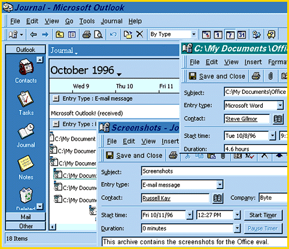

# Towards a More Productive Office in '97

*Reviews*

Microsoft raises the suite standard with better, smarter, easier-to-use productivity applications.

Steve Gillmor

With

Office 97

, Microsoft adds more user-friendliness and automation to ever-greater Web integration. Shared code, suite-wide Visual Basic for Applications (VBA), and the new Outlook collaborative information manager should help Office remain the market leader.

Outlook is the new hub of Office, replacing both Schedule+ and Win95's Exchange Inbox with innovative messaging, scheduling, lists, and groupware tools. AutoCreate converts e-mail to appointments or meeting requests, AutoName and AutoAddress separate input into fields, and AutoJournal records events from all Office applications.

Microsoft has streamlined the user interface with drag-and-drop toolbars, tear-off menus, and shared components. In Office Assistant, a better Answer Wizard, animated characters guide you through tasks. It's smart, but the help screens become annoying.

Much more intuitive is Word 97's Grammar Check, which highlights errors on-the-fly. The program analyzes context, correctly handling the difference between it's and its (but not two and too). Spell-It and AutoCorrect are integrated; you can right-click, replace, and add frequent misspellings in one action.

Word 97 adds versioning, in-place comments, and a split-screen, hyperlinked document map. You can wrap text around irregular objects and link text boxes across multiple pages. Word detects macro viruses and converts WordBasic macros to VBA.

Excel 97 formulas speak English; you can type "=cost/sales" instead of normal cell references or named ranges. Formula AutoCorrect handles 15 common formula errors, such as unmatched quotes.

Excel can now rotate text, indent cells, and handle multiple undos. You can drag horizontal and vertical page breaks in Page Break Preview mode. Chart Tips identify chart elements, and you can add a table of data values below any 2-D or 3-D chart. Shared workbooks now allow interactive formatting, adding, and deleting of cells. You can track changes, merge workbooks, and create personal views without affecting other peoples' settings.

PowerPoint files are automatically compressed/decompressed on saving/launching -- with no perceptible speed hit. Multimedia additions include action buttons, a kiosk mode, voice narration, and AVI movie support. An intelligent Expand Slide feature takes too-busy text screens and generates multiple slides with comparable hierarchy. The Slide Finder lets you preview, retrieve, and archive slides on a network. Spell-It, VBA, and a macro recorder now join PowerPoint, and one PowerPoint file can store multiple slide shows.

The Access 97 database reflects Microsoft's Web strategy with Internet and partial table replication, a new hyperlink data type, and static and dynamic Web publishing of forms, reports, and queries. If a form or report has no VBA code, Access creates a fast-loading "lightweight" version, and the Make.MDE command speeds things up even more by removing source code.

Office 97's new features, especially such unique tools such as the Journal's Timeline view and AutoPreview, which displays the first few lines of messages and documents, show how Microsoft thinks we'll work in the future.

## Product Information

Office 97......................Price to be determined

## Microsoft

Redmond, WA

Phone: (206) 882-8080

Fax: (206) 93-MSFAX

http://www.microsoft.com

Internet:

http://www.microsoft.com

Circle 1057 on Inquiry Card.

## Ratings

Technology *****

Implementation *****

performance *****

Key

***** Outstanding

**** Very Good

*** Good

** Fair

* Poor

## The Outlook is Optimistic

Outlook, the newest Office application, helps integrate many tasks.

mailto:"sgillmor@aol.com.atings"

Steve Gillmor, of Southern Digital, has extensive experience with groupware applications. You can reach him at

sgillmor@aol.com.atings

## Images

