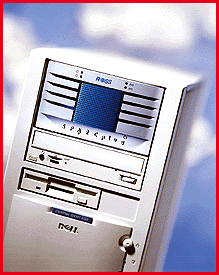

# The Power of Fusion

*Reviews*

It's Unix inside! The SPARCplug is a SparcStation-compatible add-in for Pentium systems.

Tom Yager

When you're building an Internet server, whether for internal or external access, you face a dilemma: Some software packages run best on Unix, while others benefit from Windows NT's ease of use. Many shops (including mine) mix operating environments to gain access to all the best software. But this solution is costly, in terms of both cash and space.

Ross Technology offers an innovative solution to the problem of multiple OS personalities: Run Unix and NT in the same box -- not alternately, but simultaneously.

Ross's SPARCplug

is a SparcStation 20-class workstation housed entirely in a full-height, 5-1/4-inch drive enclosure. (The unit that Ross supplied for this review was already built into a Dell Optiplex PC.) You can also buy the SPARCplug unit alone and do your own integration. In that case, the only drawback is that you have to add a special connector to your power supply. Ross documents the required modifications.

The SPARCplug's fusion with the host PC is managed entirely through a 10Base-T Ethernet cable. As you do when developing Internet applications in a non-networked environment, you simply bridge the SPARCplug's Ethernet port to your PCs with an included cable. To reach the outside world, you must connect both systems to your LAN. Communicating between systems in this way reduces the hassles of more proprietary methods (e.g., SCSI), but it slows all your transfers down to the speed of the Ethernet link. For most of us, that's about 1 MBps.

The SPARCplug appears to Sun's Solaris OS as -- and is purportedly 100 percent compatible with -- a Sun SparcStation 20, even down to the SBus and MBus expansion cards. Ross supplies a connector panel that lets you attach a Sun-compatible keyboard and mouse; it also connects you to the SPARCplug's on-board digital audio. There's no display connection on the back panel, however; Ross gives you a patch cable that connects the SPARCplug's serial port to the host PCs. You can view the SPARCplug's console through the serial port during the boot process and then connect via X Window System once Solaris is running.

Ross deserves considerable credit for innovation. The SPARCplug outstripped my performance expectations, helped by its 128 MB of RAM and dual 100-MHz SPARC CPUs. This configuration also ships with some serious software: Netscape's FastTrack Web server, Netscape's Navigator Gold browser and authoring tool, and Hummingbird's eXceed X Window Server and Maestro NFS server. All that comes packaged in a Dell 133-MHz Pentium system with 32 MB of RAM for a list price of just over $10,000. That price, by the way, does not include the extra 64 MB of RAM included with the review unit. Pricing for that upgrade was not available at press time.

The best prospects for the SPARCplug are users who must run Solaris/SPARC applications. Having Windows NT a mouse-click away eliminates the downside of choosing only one OS. I am solidly impressed by the SPARCplug, but there's one drawback, besides slow data transfer to and from the PC host: excessive noise. This is definitely not a system for a developer's desk. The triple fans set up an amazing racket for such a small chassis. But even if you have to invest in some earplugs, the SPARCplug is an excellent value. Even if you don't much value the PC, a dual-processor SPARC system for $10,000 is worth lining up for.

## Product Information

SPARCplug.........................$10,052

" (as an add-in to a Dell Optiplex

133-MHz Pentium system with

32 MB of RAM)

Ross Technology, Inc.

Austin, TX

+Phone: (800) 767-7937 or (512) 436-2000

Fax: (512) 349-3101

http://www.ross.com

Internet:

http://www.ross.com

Circle 1058 on Inquiry Card.

## Ratings

Technology *****

Implementation ****

Key

***** Outstanding

**** Very Good

*** Good

** Fair

* Poor

## SPARCplug Powers Up

The SPARCplug fits into a full-height, 5-1/4-inch drive bay. 10Base-T Ethernet connects it to the PC.

mailto:"tyager@maxx.net"

`Tom Yager is a freelance writer and consultant based in Fort Worth, Texas. He can be reached at

tyager@maxx.net

Copyright

1994-1997 BYTE

QR3

#S3

KS3

6X3

}Z3

Kb3

Rc3

<d3

xd3

Me3

df3

4g3

cg3

3h3

dh3

9e3

## Images

