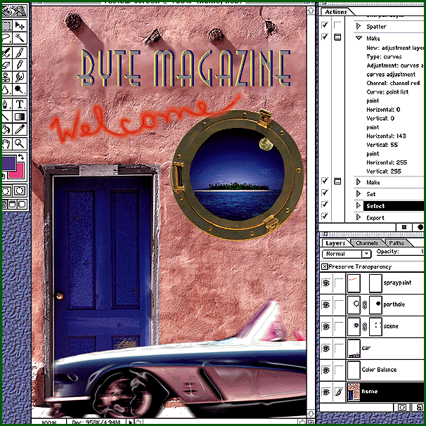

# A (Re)Touch of Genius

*Reviews*

Photoshop 4 automates many procedures and adds new layers of features, making it more powerful and easy to use.

Joy-Lyn Blake

Long the graphic artist's first choice for image manipulation, Photoshop is now

even better

than before. Release 4.0, which I worked with in beta form on a PowerMac, incorporates more functions and is easier to use. Two areas stand out: combining operations and undoing.

The batch processing capability in Photoshop's customizable "action lists" is welcome. Selecting "New Action" from the action palette brings up a dialog box that lets you start recording -- the action list includes those steps you click "OK" on and excludes those you cancel. Make a mistake and you can always "Record Again" with new parameters. These actions are stored in files for future use, and you can append them to another action list. Dialog steps can be toggled on or off, depending upon what you want to do to the image you're working on, which is important if the settings vary from image to image. The action palette supports drag-and-drop, so you can quickly customize actions and create new ones. The actions have ties into OLE Automation and AppleScript.

Some of Photoshop's flexibility comes from its ability to manipulate an image in layers. Two new layer formats extend this power. Layer masking lets you control which areas of a layer are hidden or revealed. The mask can apply to the entire layer or to a selection within the layer. The adjustment layer also acts as a mask; you can make changes to a layer -- to see the effects of the alterations -- without actually changing the image. You can make color and tonal adjustments without degrading image quality. You can't merge adjustment layers, and a single layer can specify only one type of change, but these layers provide enormous flexibility. However, adjustment layers won't work with a masked layer.

Until someone finds a way to support multiple undos in a raster domain, the "free transform" capability will have to do. One step can combine scaling, perspective, and rotation, and a single command will undo everything.

Photoshop now includes guides and grids to simplify layout and alignment. Plus, dragging the slider control on the navigator palette scales the image quickly in continuous zoom levels from .13 to 1600 percent. The filter menu now includes Adobe's updated Gallery Effects collection of 32-bit brush strokes, distortions, and textures.

The only annoying feature I found is the way Photoshop handles text, insisting on placing each new item of text in its own layer. You can fix this after the fact, but it's no fun to "merge down" 13 layers of text or to turn off all except the text layers and "merge visible." Despite this minor flaw in the program, I've already put in my order for the shipping version.

## Where To Find

Photoshop 4.0................$895 suggested retail (for Mac and Windows)

.............................$149 upgrade for registered owners

.............................$249 upgrade for registered Photoshop LE owners

Adobe Systems

Mountain View, CA

Phone: (415) 961-4400

http://www.adobe.com

Internet:

http://www.adobe.com

Circle 1023 on Inquiry Card.

## Ratings

Technology *****

Implementation *****

Key

***** Outstanding

**** Very Good

*** Good

** Fair

* Poor

## Activate Your Image Processes

Combining text, graphics, and special effects is Photoshop's bread and butter.

mailto:"joylyn@bix.com"

]Joy-Lyn Blake is a production associate in BYTE's New Media department. You can reach her at

joylyn@bix.com

## Images

