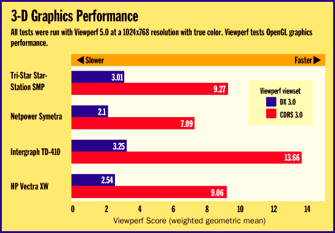
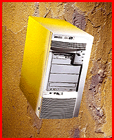
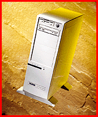
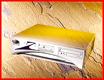
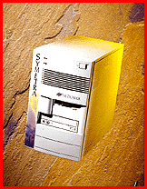

# Affordable 3-D Workstations

*Reviews*

With dual Pentium Pros, accelerators, and NT, these machines make fast 3-D graphics cheaper than ever.

Robert L. Hummel

Professional-quality real-time 3-D imaging has traditionally been the province of high-cost workstations with powerful graphics subsystems. Until recently, these Unix-based systems, costing $20,000 and up from companies like Digital, HP, IBM, and Silicon Graphics (SGI), have been the only feasible option for serious 3-D graphics design. RISC-based SGI workstations, for example, produced the awe-inspiring scenes in the movie Jurassic Park.

Demand for these increasingly powerful systems has remained high, but price has kept them out of reach for many professionals engaged in research, engineering, design, architecture, or animation. Within the last two years, however, a few workstation vendors, particularly Intergraph, have developed cost-effective and powerful 3-D graphics systems built around the latest Intel CPUs and running Microsoft Windows NT.

Another thing that's making gee-whiz imaging more affordable are fast, relatively low-cost graphics accelerator chips that encapsulate the 3-D functions required to implement the OpenGL 3-D API. Several vendors now ship PCI graphics cards based on 3Dlabs' Glint chips, for example. And Intergraph has transferred some of its proprietary graphics technology into its lower-cost Intense 3-D OpenGL card. Priced at around $2000, these new cards are not yet commodity items. But graphics workstations built around these cards, coupled with NT, bring economies of scale to both 3-D hardware and software.

We just finished testing four systems that represent the coming wave of affordable Intel-based 3-D graphics: Hewlett-Packard's Vectra XW, Intergraph Computer's TD-410, Tri-Star's StarStation SMP, and Netpower's Symetra. Because of their Intel chip sets, these Pentium Pro systems are remarkably similar. We requested comparable configurations: 128 MB of memory, dual 200-MHz Pentium Pro CPUs, a 4-GB SCSI hard drive, Fast Ethernet, a 17-inch display, and a 3-D graphics card with 16 MB of memory. The systems came with NT 3.51 because NT 4.0 drivers weren't available for the graphics cards at review time.

The differences we measured in

## 3-D Graphics Performance

N were due chiefly to the systems' graphics cards. The performance winner, the

## Intergraph TD-410

, came with the company's Intense 3D; the other systems used cards based on 3Dlab's latest Glint 500TX/Delta chip duo. We tested the 3-D capabilities of these machines using Viewperf, an industry standard OpenGL benchmark. Although Viewperf does not take advantage of the multiprocessing capabilities of these workstations, there are 3-D applications such as Microsoft's Softimage 3D package that can. We found these systems very capable at manipulating fairly complex images. Experiments with animation rendering in Softimage 3D, however, showed that even with two processors, there is still a need for $100,000 workstations.

Hewlett-Packard's

Vectra XW

illustrates the company's reputation for engineering. Housed in a wide mini-tower, the XW is built like a tank, with nearly every component manufactured for a custom fit. With its AccelGraphics' ProT2500 Glint-based graphics card, the Vectra XW provided solid but middle-of-the-road 3-D graphics performance, a bit behind the Tri-Star system, which uses a similar AccelGraphics card.

The system board is able to accommodate up to 512 MB of system memory in eight standard SIMM slots. The system board also provides floppy, IDE, and 8-bit UltraSCSI interfaces (internal and external). Multimedia features include a Hitachi 8x IDE CD-ROM drive, integrated SoundBlaster 16 audio interface, a MIDI port, appropriate jacks, and a front-panel volume control.

The case opens easily from the front; you lift two latches and slide it forward. An integral key lock on the rear can secure the cabinet. Of the system's three PCI slots, two are occupied by the network and 3-D graphics cards. There are also three ISA slots (one shared). The price for the roomy expansion area is cramped quarters around the drive interface connectors and memory slots. However, HP designed the power supply to release with thumb screws and slide out of the way without disconnecting. You need some patience to work inside the Vectra XW.

A slim-line desktop case and best-of-show performance make the Intergraph TD-410 an unbeatable value. Although it came in a TDZ-410 case, the system we tested is based on Intergraph's Intense 3D board with texture option, so it's actually a TD-410. Matched with Intergraph's nice 17-inch 17sd86 monitor, the TD-410's performance is complemented by its engineering and styling.

The quiet TD-410 employs large heat sinks with only two fans, mounted at the rear on the power supply. The system board can accommodate up to 512 MB in eight standard SIMM slots. It provides an UltraSCSI interface. The Intense 3D card takes up two of the machine's three PCI slots. The card's size, coupled with obstructions on the system board, may make it difficult to put anything but a short card in the adjacent slot.

If the machine's accompanying user manual is any indication, Intergraph must not think much of the technical expertise of its customers. All "detailed information," such as how to open the system unit, install expansion cards, and set jumpers, is only in the optional System Reference manual. The box also lacks an external reset button.

The complete multimedia support includes an 8x SCSI CD-ROM drive, Creative Labs Vibra 16C interface on the system board, and the ConcertMaster "multimedia keyboard" with built-in stereo speakers. The microphone, mute button, and volume control are located conveniently at your fingertips. Jacks for headphones, external microphone, and a powered subwoofer are also on the keyboard.

The Symetra's

3-D capability is fueled by Netpower's TrueFX Pro card and coupled with a 17-inch Iiyama Vision Master 17 monitor. Developed with 3DLabs, and using the same 500TX and Delta chips as the other Glint cards, the 16-MB TrueFX Pro trailed in performance on the Viewperf tests. The Symetra was the only system to come with the 512-KB-cache version of the 200-MHz Pentium Pro. Buying the version with 256-KB cache will save you $2000 and cost you only a small drop in performance.

The Symetra is packaged in a wide mini-tower that's constructed of an odd array of panels, pins, latches, and tabs. The system board can accommodate up to 512 MB of memory in four 168-pin DIMM slots. Accessing the Symetra's interior can be a challenge. You must take off the cover, release two latches, and remove a side panel to access expansion card and memory slots. Adding a drive requires removing all four cover panels and possibly disassembling the drive bay assembly to reach the mounting screws.

Of the four PCI slots inside the Symetra, one of which is a shared PCI/ISA slot, two are used by the 3-D graphics card. An Adaptec SCSI PCI card takes a third and controls the 4-GB Fast-and-Wide SCSI hard drive. The integrated Wide UltraSCSI interface goes unused. An integrated SoundBlaster 16-compatible audio interface provides multimedia support, along with an 8x CD-ROM drive.

The Tri-Star

StarStation SMP

workstation comes with a version of the AccelGraphics Pro T2500 card and a 17-inch Iiyama Vision Master monitor. Coming in with the lowest system price ($8544), it provided the best performance of the three Glint-based systems. Housed in a large tower with lots of drive bays, the StarStation has the largest memory capacity of the four systems: up to 768 MB in six standard SIMM slots.

The system provides four PCI and three ISA slots (one shared), but three of the available PCI slots are occupied by the Adaptec SCSI card, 10/100Base-T network card, and the 3-D graphics card. In addition to two 3-1/2-inch bays, the StarStation's tall case provides six 5-1/4-inch drive bays -- all accessible from the front of the machine. Two bays in our evaluation unit were occupied by the hard drive and the Plextor 8x SCSI CD-ROM drive. No sound capabilities were provided with this unit.

Driving Performance

As is the case when evaluating any workstation component, comparing high-performance graphics cards requires both a philosophy of testing and a dependable benchmark. Vendors typically quote 3-D graphics performance as the number of primitives (such as triangles) the computer draws per second. But without additional information, such as the context, size, shading, color depth, and smoothing method used to draw those triangles, direct comparisons are meaningless.

http://www.specbench/org/

To address this problem, the OpenGL Performance Characterization subcommittee has developed the Viewperf benchmark (available at

http://www.specbench/org/

). It's a portable benchmark and the current industry standard for evaluating OpenGL performance. Viewperf does not benchmark individual primitives -- it measures the performance of actual application data sets called viewsets.

For benchmarking the systems in this evaluation, we chose two viewsets. The CDRS viewset is derived from Parametric Technology's modeling and rendering software for computer-aided industrial design. It is used to create concept models of automobiles, consumer electronics, and appliances.The test measures seven different operations on a model of a lawnmower. The DX viewset is based on IBM's Visualization Data Explorer, a general-purpose scientific data visualization and analysis package. The 10-test benchmark draws a set of particle traces through a vector flow field. Viewperf measures frames per second for each component test. The single result for each viewset is a weighted geometric mean.

Our benchmark tests show that the Intergraph TD-410's performance makes it the clear leader in this class of personal graphics workstations. Its price reflects the additional power of the Intense 3D board as much as it does the price of Intergraph's engineering and good customer support. If monetary constraints place the TD-410 out of your reach, the Tri-Star StarStation SMP offers somewhat more modest performance at a greatly reduced price.

## Product Information

HP Vectra XW........................$11,594 (estimated street price)

# (two 200-MHz Pentium Pros, 128 MB

" of RAM, 4-GB hard drive, 17-inch

# display, 16-MB 3-D graphics card)

## Hewlett-Packard

Palo Alto, CA

+Phone: (800) 752-0900 or (303) 635-1000

Fax: (800) 333-1917

http://www.hp.com

Internet:

http://www.hp.com

Circle 1059 on Inquiry Card.

Intergraph TD-410...................$11,231 (estimated street price)

# (two 200-MHz Pentium Pros, 128 MB

" of RAM, 4-GB hard drive, 17-inch

# display, 16-MB 3-D graphics card)

Intergraph Computer Systems

Huntsville, AL

Phone: (205) 730-5441

http://www.intergraph.com/ics

Internet:

http://www.intergraph.com/ics

Circle 1060 on Inquiry Card.

Netpower Symetra ...................$12,483 (estimated street price)

# (two 200-MHz Pentium Pros (512-KB

% L2 cache), 128 MB of RAM, 4-GB hard

# drive, 17-inch display, 16-MB 3-D

graphics card)

Netpower

Sunnyvale, CA

+Phone: (800) 801-0900 or (408) 522-5199

Fax: (408) 720-8558

http://www.netpower.com

Internet:

http://www.netpower.com

Circle 1061 on Inquiry Card.

,Tri-Star StarStation SMP............$ 8,544

# (two 200-MHz Pentium Pros, 128 MB

" of RAM, 4-GB hard drive, 17-inch

# display, 16-MB 3-D graphics card)

Tri-Star Computer

Tempe, AZ

+Phone: (800) 844-2959 or (602) 731-4926

Fax: (602) 731-9010

http://www.tri_cad.com

Internet:

http://www.tri_cad.com

Circle 1062 on Inquiry Card.

## 3-D Graphics Performance

With its Intense 3D card, Intergraph's TD-410 provides good OpenGL performance. The three slower systems use cards based on 3DLabs' Glint 500TX and Delta chips.

## HP Vectra XW

## Ratings

Technology ****

Implementation ****

Performance ****

Key

***** Outstanding

**** Very Good

*** Good

** Fair

* Poor

Advantages:

+ Quality engineering and rugged construction

+ Case opens easily

Disadvantages:

- Pricey for the performance

## Tri-Star Starstation SMP

## Ratings

Technology ***

Implementation ****

Performance ****

Key

***** Outstanding

**** Very Good

*** Good

** Fair

* Poor

Advantages:

+ Lowest price

+ Second-best 3-D performance

+ Lots of expansion room

Disadvantages:

- Lacks sound card

## Intergraph TD-410

Ratings: BYTE Best

Technology *****

Implementation *****

Performance *****

Key

***** Outstanding

**** Very Good

*** Good

** Fair

* Poor

Advantages:

+ Top performance

+ Full multimedia integration

+ Solid, stylish chassis

Disadvantages:

- Technical documentation optional

## Netpower Symetra

## Ratings

Technology ****

Implementation ***

Performance ***

Key

***** Outstanding

**** Very Good

*** Good

** Fair

* Poor

Advantages:

+ Two 512-KB-cache Pentium Pro CPUs

Disadvantages:

- Relatively high price

- Slowest performance

- Hard to access interior

mailto:"rhummel@monad.net"

]Robert L. Hummel is an electrical engineer, programmer, and consultant. You can reach him at

rhummel@monad.net

## Images

