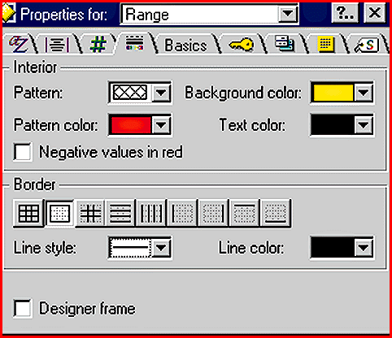
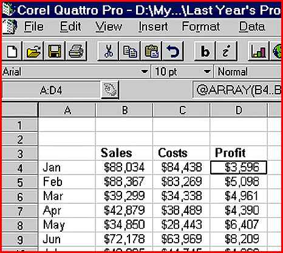
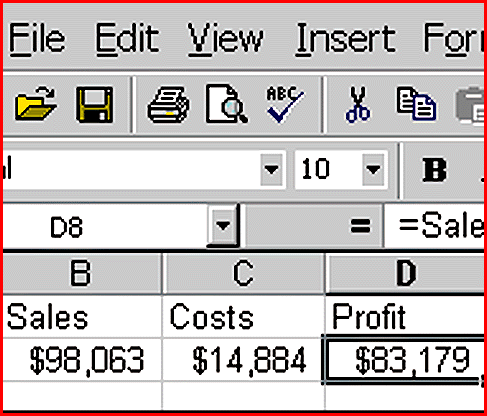
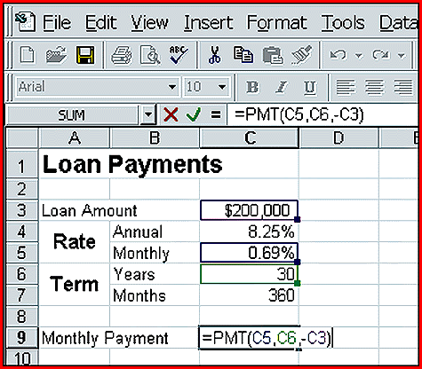

# The Spreadsheet War, Revived

*Reviews*

Now that 1-2-3 and Quattro pro com in true Windows 95 flavors, can they shake Excel's dominance?

Richard Cranford

It's a three-way race again. With Lotus's long-delayed release of 1-2-3 97 (the first 32-bit version) this winter, market-leading Microsoft Excel finally has some serious competition. And by the time you read this, the latest version of Microsoft's 32-bit spreadsheet, Excel 97, should be on its way to store shelves. Corel's (formerly Novell's, formerly Borland's) Quattro Pro 7 appeared last June.

All three products have notable

## New Features

, but equally notable is

what's missing

. The new version of 1-2-3 doesn't offer some of the goodies its users have clamored for, and Corel and Lotus have failed to adopt some of Excel's slicker features for their spreadsheets.

Productivity Tools

These spreadsheets are chock-full of functions that are accessible from the right mouse button. Behind these functions sit ad hoc menus of tasks related to a selected object. For example, right-clicking on a row number on the left side of a worksheet's frame pops up a menu that lets you delete that row.

All three programs let you fill in a range with a preset series of labels (e.g., the months of the year) or with ascending values. Excel and 1-2-3 let you do this by dragging; the trick is to the get the mouse pointer to the lower left corner of a starting cell (containing, say, the word January) before dragging either down or right. In Quattro, you can fill a range with labels, but only by selecting the range first and then right-clicking on the range and selecting from the pop-up menu.

You can create your own fill lists, such as the names of a company's locations, in all three spreadsheets. Lotus 1-2-3 has finally done away with a tedious system that required opening an INI file with a text editor and manually keying in a new sequence. You now add to 1-2-3's repertoire of fill lists by selecting File/User Setup/SmartFill Setup. Lotus 1-2-3's setup routine gathers up the lists in the INI file so that users don't have to reenter their custom lists.

Excel and Quattro both offer array formulas, which let you write one formula to populate a range of cells. Array formulas help preserve the integrity of a spreadsheet model by letting you create a block of formulas that perform a consistent function and by preventing changes to one member of a set. Lotus 1-2-3 has yet to add a comparable feature.

You can now group some of the worksheets in a 1-2-3 model without grouping all of them. When you group worksheets, the changes made in one sheet to column widths, numeric formats, and other attributes are passed along to all other sheets in the group. This has been an all-or-nothing proposition in 1-2-3 since the program went 3-D back in 1989. Many users have complained about it in forums on CompuServe and elsewhere. Now you can still create only one group, but you can decide which sheets it will include. You could use this feature, for example, to make a group out of sheets B through E in a nine-worksheet model.

Excel and Quattro have both been there and done that, and they also offer nice variations on the theme. Quattro lets you create groups for multiple sets of worksheets and even assign names to groups (e.g., sheets B through E can be one group, with the user-assigned name Sales, while sheets G and H might belong to a group called Op Costs). With Group mode turned on, changes made in the Sales group are passed to other sheets in that group, but not to the ungrouped sheets or to those in the Op Costs group.

Excel lets you select noncontiguous worksheets. Both Quattro and Excel allow you to put an entry into the same cell of all worksheets in a group. That is, if you type a label in cell A1 of one worksheet in a group and press Ctrl-Enter instead of Enter, the label goes into all the cells A1 in the group. Lotus 1-2-3 can't do this as easily. In addition, Quattro and Excel let you move a worksheet from one position to another within its file just by dragging its tab. This is another feature wished for in the on-line forums, but it doesn't appear in the newest version of 1-2-3.

Lotus did, however, give its spreadsheet two operational features that are not found in its competitors. One is auto-totaling; 1-2-3 97 creates the @SUM formulas that sum up the columns or rows of a table when you enter the word Total below or to the right of the table. And its Info Box (

see the screen

) is a dialog box that offers one-stop shopping for numerical formats, text attributes, colors, borders, and other attributes. Since it's modeless, the Info Box instantly passes changes to the spreadsheet without your having to click OK.

Excel wins the prize for most interesting ease-of-use features. For one thing, it now allows natural-language formulas: After setting up a table with headings for the columns or rows, you can enter a formula using the headings without having to assign range names.

In the screen

h, for example, you could complete the model by entering "=sales-costs" rather than "=B8-C8" in cell D9.

Also nice is the Range Finder, which shows the cells or ranges referenced by a formula when you edit that formula. In the screen at right, the formula in cell C9 indicates a (clearly wrong) monthly loan payment of $7400.

Editing the formula

instantly shows that it refers to the term in years, not in months. Dragging the green rectangle to cell C7 corrects the formula. The same screen illustrates a new alignment option in Excel called Merge Cells. Notice how the word Rate is centered vertically relative to the words Annual and Monthly. Merge cells let you turn cells A4 and A5 into a double-high cell and create this effect.

Much is made of the Web these days, so it comes as no surprise that the major spreadsheet makers all claim to have the spreadsheet that works hand-in-hand with the Web. Excel, 1-2-3, and Quattro all have handy buttons that launch your Web browser and transport you to a certain Web site (typically one operated by Microsoft, Lotus, or Corel). In 1-2-3, you can highlight a snippet of text and run a Yahoo search using that text.

Excel and 1-2-3 can open files directly from Internet ftp sites, or they can save worksheet files to ftp servers or Web sites via the normal File/Save menu. Quattro can open Hypertext Markup Language (HTML) files from the Web, from disk drives, or from LAN directories, and it can save data in the HTML format for later uploading to the Web.

You can also enter formulas that refer to bits of information on the Web. The disadvantage of this is that you must wait to dial into a Web site (or sites) to get all the most up-to-date information whenever you recalculate the worksheet.

Get with the Program

Lotus 1-2-3's approach to programming hasn't changed much since 1986, and Quattro's language has been a close variation on 1-2-3's. Each product's language employs a set of commands spelled with braces (e.g., {GETNUMBER}) and entered in a range of worksheet cells.

Programs (i.e., macros) written in these languages have some serious limitations. For instance, to execute code conditionally, you must write one long label consisting of an {IF} command followed by the code to be executed when {IF}'s Boolean statement is true. You create IF...THEN routines rather than IF...THEN...ELSE routines.

Microsoft has included a version of its Visual Basic language in Excel for a few years now. The latest version, Visual Basic for Applications (VBA), is a full-featured language that allows for complex IF...THEN...ELSE and DO...WHILE routines and the like. With its latest release, 1-2-3 joins the club and allows for programming in Lotus Script, a language that's very much like VBA. And Quattro Pro offers PerfectScript, which is closer to the old macro language than to VBA, but which allows for more complex programming tasks. Both 1-2-3 and Quattro support their respective macro languages.

Live Previews

Quattro Pro 7

still uses a static print preview to show how a worksheet will look on paper. You can view the preview, or you can leave Preview mode to modify the worksheet, but never the twain shall meet.

By comparison, 1-2-3 and Excel provide concurrent previewing and editing. Excel's approach is a lot like invoking the full-page view available in the major Windows word processors. When you switch from Normal mode to Page Break Preview mode, the zoom factor is reduced and all margins and page breaks are visible, but all worksheet functions are still possible. While zoomed out, you can make changes such as applying shades or drawing boxes around ranges. If you need to edit individual cells, you can zoom in on the sheet without leaving Page Break Preview mode.

Lotus 1-2-3's approach is different, but still good. Its Dynamic Print Preview feature opens a print-preview window and tiles it with the current worksheet window. You apply changes in the worksheet and see them reflected in a full-page preview.

The Artist Within

In any of these three spreadsheets, you can add simple drawn objects to a worksheet model. In 1-2-3 and Quattro Pro, these objects are limited to lines, arrows, ellipses, rectangles, and freehand shapes and doodles. Excel offers these and several others, inluding triangles, a pentagon, a heart, stars (with various numbers of points), the international "no" symbol, and flowchart symbols. Excel also offers many more ways to spruce up these shapes; you can apply textures such as marble, crumpled paper, and woodgrains, choose from several styles of gradient fills, and even give the objects depth and rotate them in 3-D space.

The drawing tools in all three programs support text blocks (as they've done for a few years now), and Excel lets you create WordArt objects as well. You can use WordArt to create an eye-catching worksheet title whose text is, for example, curved, tinted to simulate a metallic finish, or casting a shadow. Just click the WordArt button on Excel's Drawing Toolbar, pick a style from a gallery of suggestions, and supply some text.

## The Race Is On

All three products provide the features we now take for granted in spreadsheets -- a dizzying array of chart types, maps, version management, and programming tools -- and add attractive extras.

Excel offers the most robust set of ease-of-use features as well as a more venerable language for developers (although 1-2-3's new language compares favorably). Lotus 1-2-3's modeless Info Box is nicely conducive to fiddling with a worksheet to get its look just right. Quattro Pro seems a bit harder to work with, although it has a simpler programming language.

On balance, Excel has the most complete and best-implemented feature set. If you're already an Excel shop, you're where you want to be.

If 1-2-3 is your standard spreadsheet, it may be time to switch, unless you have a major investment in 1-2-3-related skills. You won't go too far wrong by moving to 1-2-3's new 32-bit version, but you'll be getting a spreadsheet that still isn't as good as Excel. While Excel once was unwieldy for casual users, it now beats 1-2-3 in almost every area.

Quattro Pro has the best price and is a solid product. Stay with it if it's what you already use. But if you don't, consider it carefully, if for no other reason than that you'll be much in the minority.

## Product Information

Excel 97............................Price undetermined at press time

Microsoft Corp.

Redmond, WA

+Phone: (800) 426-9400 or (206) 882-8080

Fax: (206) 936-7329

http://www.microsoft.com

Internet:

http://www.microsoft.com

Circle 977 on Inquiry Card.

)Lotus 1-2-3 97......................$329

Lotus Development Corp.

Cambridge, MA

+Phone: (800) 343-5414 or (617) 577-8500

http://www.lotus.com

Internet:

http://www.lotus.com

Circle 976 on Inquiry Card.

)Quattro Pro 7.......................$ 99

Corel Corp.

Ottawa, Ontario, Canada

+Phone: (800) 836-3729 or (613) 728-8200

Fax: (613) 761-9176

http://www.corel.com

Internet:

http://www.corel.com

Circle 978 on Inquiry Card.

## Advantages and Ratings

Lotus 1-2-3 97

## ADVANTAGES

+ Auto-totaling

/+ Modeless dialog boxes make changes instantly

Disadvantages

/- Requires Lotus Approach for database queries

and PivotTables

- No array formulas

## Ratings

Technology ***

Implementation ****

Excel 97

## ADVANTAGES

+ Feature-rich

)+ Supports Visual Basic for Applications

Disadvantages

- Large file sizes

- Has fewest @ functions (234)

## Ratings

Technology *****

Implementation ****

Quattro Pro 7

## ADVANTAGES

.+ Has the easiest-to-use programming language

+ Lowest-priced

!+ Has the most @ functions (483)

Disadvantages

#- Not as easy to use as the others

- Outmoded print previewing

## Ratings

Technology ****

Implementation ***

Key

***** Outstanding

**** Very Good

*** Good

** Fair

* Poor

## Feature Comparison

1-2-3 97 Excel 97 Quattro Pro 7

Cells per sheet 2,097,152 16,777,216 2,097,152

N (256 columns X (256 columns (256 columns X

L 8192 rows) X 65,536 rows) 8192 rows)

Maximum number 256 Unlimited Unlimited

of worksheets

Maps from y y y

worksheet data

PivotTables Requires Lotus y Requires add-in

L Approach (included) (included)

Programming 1-2-3 macro Visual Basic 1-2-3-like macro

M languages language; for Applications language;

O Lotus Script PerfectScript

O (a BASIC-like (a BASIC-like

M language) language)

Number of functions 280 421 483

2Supports custom y y

functions

Array formulas y y

Create your own y y y

fill series

Can act as OLE 2.0 y y y

server or client

Internet support Export data Export data Open HTML file;

O as HTML; open as HTML; open save files in

P file from, or save file from Web or HTML; save file

N file to, Web or ftp site; save file to Web page

8 ftp site to ftp site

Key

y = yes.

## 1-2-3 97

## Quattro Pro

## Excel

## Excel's Editing Highlights

Editing a formula in Excel 97 highlights cells and ranges the formula refers to.

Richard Cranford is a freelance writer and consultant based in Cambridge, Massachusetts. He was formerly senior associate editor at Lotus magazine. You can contact him at rcranford

Copyright

1994-1997 BYTE

\ :

~!:

7":

F#:

n#:

4$:

M%:

u%:

9&:

O':

2(:

q(:

2):

k):

2*:

Z*:

h+:

V,:

5-:

h-:

E.:

~.:

>/:

I0:

q0:

C1:

k1:

92:

j2:

O3:

?4:

$5:

/6:

d6:

/7:

W7:

>8:

f8:

O9:

9::

B;:

j;:

P=:

x=:

E>:

0?:

x@:

&A:

NA:

vA:

7f<

v":

## Images

