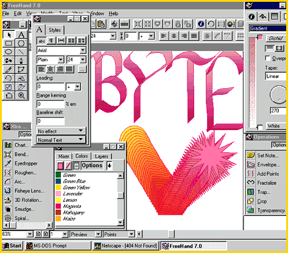

# Graphics and Web-Page Production Suite

*What's New*

Joy-Lyn Blake

Macromedia's FreeHand Graphics Studio 7 includes four integrated cross-platform graphics programs: FreeHand 7, Macromedia xRes 3, Extreme 3D 2, and Fontographer 4.1. Together, they provide tools you can use for illustration and page design; image creation and editing; 3-D modeling, animation, and photo-realistic rendering; and font design. I tested the beta version of the suite on a Dell Optiplex XM 575 running Windows 95 and on a Power Mac 7100 running System 7.5.3.

The customizable palettes (drag-and-drop tabbed items to combine frequently accessed menus) and its docking feature (similar to "grouping" objects) ease work flow and save navigation time (

see the screen

). I found the ability to drag and drop from Adobe Photoshop, Adobe Illustrator, and Macromedia xRes -- and between color palettes and objects or other menus -- a highlight.

Built-in support for Shockwave lets you embed FreeHand graphics in Web pages. In addition, the suite provides cross-platform graphics export in GIF, JPEG, PNG, or PDF format. FreeHand easily handles QuarkXPress and Adobe PageMaker files, and includes AppleScript support. With behind-the-scenes file linking, FreeHand automatically updates changes to imported images without requiring you to reimport the edited file.

If you can tolerate the cumbersome nature of component switching, the trade-off with FreeHand Graphics Studio 7 is dynamite graphics production.

## Where To Find

FreeHand Graphics Studio 7.............about $449

Macromedia, Inc.

San Francisco, CA

+Phone: (800) 326-2128 or (415) 252-2000

Circle 979 on Inquiry Card.

## More Power from Macromedia

Copyright

1994-1997 BYTE

6E?

## Images

