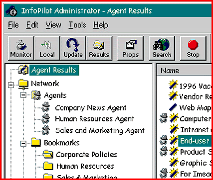

# Manage Corporate Information

*What's New*

Consisting of a Windows 95 administrative client, Solaris and Windows NT server software, and Mac and Windows 3.1/95 client versions, InfoPilot (starter kit, $3375) helps you assemble catalogs of corporate data from a variety of sources, including World Wide Web and document-based information, which it automatically places or "publishes" on an intranet server for client access.

Contact: FirstFloor, Mountain View, CA

+Phone: (800) 639-6387 or (415) 968-1101

http://www.firstfloor.com

Internet:

http://www.firstfloor.com

Circle 981 on Inquiry Card.

## First Floor: Data Catalogs

Copyright

1994-1997 BYTE

~N?

4O?

~N?

~N?

~N?

~N?

~N?

?R?

~N?

~N?

~N?

[S?

~N?

~N?

~N?

~N?

%R?

## Images

