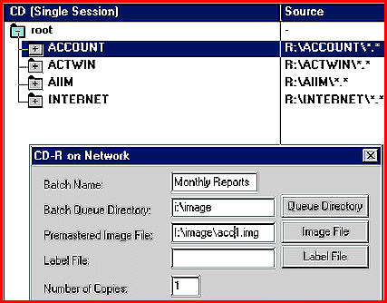

# Network CD Recording

*What's New*

To create data, audio, video, or mixed-mode CDs over a network, you simply install SmartCD ($795) for recording on Windows NT or NetWare servers and attach a CD recorder. Windows 3.11, 95, and NT workstation users then drag and drop files and directories onto individual CDs. SmartCD is also available for high-volume CD-recording applications using auto-loaders (from $4200).

Contact: Smart Storage, Inc., Andover, MA

+Phone: (888) 479-0100 or (508) 623-3300

http://www.smartstorage.com

Internet:

http://www.smartstorage.com

Circle 985 on Inquiry Card.

## Customized CD Storage

Copyright

1994-1997 BYTE

$j@

## Images

