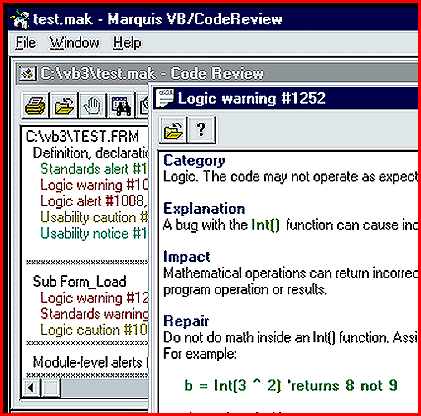

# Quality Control for Visual Basic

*What's New*

VB/CodeReview Professional Edition ($249.95) automatically reviews Visual Basic code against a database of bugs and conditions, including ActiveX, OCX, VBX, and DLL bugs; Visual Basic 3.0 and 4.0 bugs; DAO, Jet, and ODBC bugs; and Windows API bugs. The package includes code formatting and naming systems, as well as tools for developing code metrics such as function points and complexity.

Contact: Marquis Computing, Inc., Pomfret Center, CT

+Phone: (800) 818-1611 or (860) 963-7065

http://www.marquistools.com

Internet:

http://www.marquistools.com

Circle 986 on Inquiry Card.

## Buggy Code Review

Copyright

1994-1997 BYTE

Rl@

Rl@

lm@

Rl@

Rl@

go@

Rl@

Rl@

1p@

Rl@

Rl@

Rl@

Oq@

Rl@

Rl@

Rl@

Rl@

## Images

