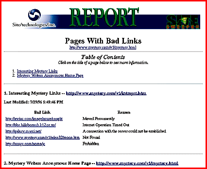

# Maintain Multiple Web Servers

*What's New*

A Windows 95/NT Web-site maintenance tool, SiteSweeper 1.0 ($299) evaluates file types (text, image, audio, or video), their sizes, and dates of last modification; the number of images on a page; the total download size of the page; and the links to and from the page. You get a suite of reports that you can generate on demand or at scheduled times. SiteSweeper is based on an open-database architecture.

Contact: Site/technologies, Inc., Durham, NC

+Phone: (800) 722-0607 or (919) 416-3113

http://www.sitetech.com

Internet:

http://www.sitetech.com

Circle 989 on Inquiry Card.

## Report Suite from SiteSweeper

Copyright

1994-1997 BYTE

HeA

`eA

## Images

