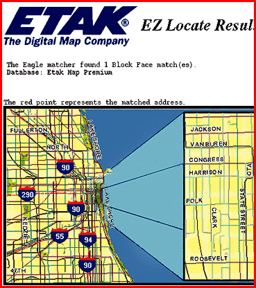

# Custom Mapping for Web Publishers

*What's New*

Etak's suite of Internet mapping products (call for prices) includes E-Map View, which contains Etak's nationwide digital map database, a map server, customization control of the map's "look and feel," and a CGI for the Web interface; E-Map Route, which adds routing capability to E-Map View and allows you to dynamically generate directions between two points; and E-Map Locate, a geocoding server that assigns latitude and longitude coordinates to addresses, intersections, or cities.

Contact: Etak, Inc., Menlo Park, CA

+Phone: (800) 765-0555 or (415) 328-3825

http://www.etak.com

Internet:

http://www.etak.com

Circle 990 on Inquiry Card.

## Map It Out

Copyright

1994-1997 BYTE

|hA

9hA

9hA

9hA

_iA

9hA

mkA

9hA

9hA

9hA

9hA

9hA

4mA

9hA

9hA

9hA

9hA

## Images

