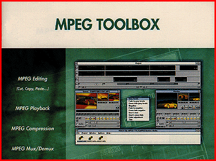

# Compress and Edit MPEG-1 Video

*What's New*

If you want to incorporate MPEG video into your Web pages, the MPEG Toolbox CD-ROM ($125) lets you convert and compress video sequences (AVI or WAV format) or series of images (BMP, TIFF, TGA, GIF, or PCX format) into an MPEG-1 sequence in audio, video, system, or Video CD format; edit MPEG-1 sequences, adding special effects, such as titles and fade-in and fade-out; and run MPEG-1 and Video CD files full-screen at a rate of between 25 and 30 images per second on a Pentium 90 machine.

Contact: Vitec-HTS, Sarasota, FL

Phone: (941) 351-9344

http://www.vitechts.com

Internet:

http://www.vitechts.com

Circle 991 on Inquiry Card.

## Easy MPEG

Copyright

1994-1997 BYTE

|&E

## Images

