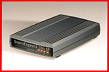

# Fax Modem to Share Voice and Data

*What's New*

Incorporating a speakerphone, the SupraExpress 336 Sp with ASVD (internal, $149; external, $169) delivers transmission speeds of 33.6 Kbps and V.80 video-phone functionality for synchronous exchange of audio and video. The package includes Thought Communications' FaxTalk Messenger software with remote-notification and fax-on-demand capabilities, Databeam's FarSite application-sharing software, and VDONet's VDOPhone software for videoconferencing over ordinary phone lines.

Contact: Diamond Multimedia Systems, Inc., San Jose, CA

+Phone: (800) 727-8772 or (360) 604-1400

http://www.supra.com

Internet:

http://www.supra.com

Circle 1000 on Inquiry Card.

## Merge Voice and Data

Copyright

1994-1997 BYTE

]BE

@CE

DEE

{FE

"GE

## Images

