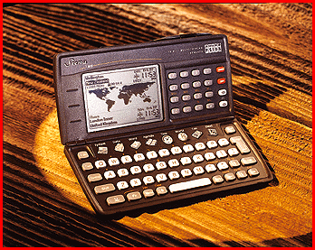

# An Office in Your Pocket

*What's New*

Dave Andrews

With the Siena, Psion has created a hand-held information management device that you can carry without a second thought. It uses the same NEC V30 processor as its bigger, older cousin, the Psion Series 3A, but weighs just 6.7 ounces, including two AAA batteries, and is only 2-3/4 inches wide, making it an easy fit for just about any pocket. Despite its size, I found the keyboard, like the Series 3A's, acceptable for two-finger typing.

Like other vendors of hand-held devices, Psion is addressing PC connectivity. When you combine the Agenda Synchronizer with a serial link to the PC, it lets you automatically update with Microsoft Schedule+ 1 and 7, and Lotus Organizer 2.1. You can also use the program to back up Siena files. Siena also supports infrared data transfer to other Sienas. The preliminary unit I used didn't support printers or PCs, but Psion is working on that.

The Siena lacks slots for holding solid-state disks as found in the Series 3A. For an extra $79, however, you can buy an external solid-state disk expansion drive. The Siena doesn't support modem communications, and thus is positioned more as an information manager. However, lack of remote connectivity is about the only thing that might prevent you from carrying this unit on the road. Its size certainly won't.

## Product Information

Siena ............................$249 512-KB version

..................................$299 1-MB version

Psion, Inc.

Concord, MA

+Phone: (800) 997-7466 or (508) 371-0310

http://www.psioninc.com

Internet:

http://www.psioninc.com

Circle 998 on Inquiry Card

## Psion Does it Light

## Images

