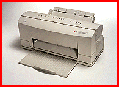

# Photo-Realistic Color Printer/Scanner

*What's New*

Using Alps Electric's patented Micro Dry inks, the MD-4000 (about $699) delivers 16.7 million colors at a resolution of 600 by 600 dpi or black-and-white text and graphics at 1200 by 600 dpi. The MD-4000 comes with an integrated 600-dpi, TWAIN-compatible, single-pass, 24-bit full-color scanner and a 100-page automatic sheet feeder that accommodates letter-, A4-, B5-, and legal-size paper.

Contact: Alps Electric (USA), Inc., San Jose, CA

+Phone: (800) 825-2577 or (408) 432-6000

http://www.alpsusa.com

Internet:

http://www.alpsusa.com

Circle 1004 on Inquiry Card.

## Photo Realism from Alps

Copyright

1994-1997 BYTE

YPG

## Images

