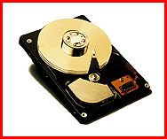

# High-Capacity Hard Drives

*What's New*

The 1.6-GB WNR-31601A ($268), 2.1-GB WNR-32100A ($342), and 2.4-GB WNR-32501A ($400) 3-1/2-inch hard drives feature a 16.6-MBps host transfer rate, PRML Read Channel technology, Fast ATA-2 performance via PIO mode 4 and multiword DMA mode 2, an 11-ms seek time, and a 5400-rpm rotational speed.

Contact: Samsung Electronics America, Inc., Ridgefield Park, NJ

+Phone: (800) 933-4110 or (201) 229-4000

http://www.sosimple.com

Internet:

http://www.sosimple.com

Circle 1005 on Inquiry Card.

## Simply Samsung

Copyright

1994-1997 BYTE

=SG

5UG

zVG

!WG

e{G

}{G

## Images

