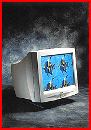

# Flat-Screen Color Monitors

*What's New*

The CL15e, with a 15-inch diagonal screen ($379), and the CL17, with a 17-inch screen ($679), feature a dot pitch of 0.28 mm, a maximum noninterlaced resolution of 1280 by 1024 pixels, horizontal frequencies of up to 69 kHz, a vertical refresh rate of up to 120 Hz, and on-screen display digital controls. The monitors come with antireflection and antistatic screens, and controls for color temperature and geographic screen adjustments.

Contact: Pacom Data, Inc., Fremont, CA

+Phone: (888) 297-2266 or (510) 440-7200

http://www.pacomdata.com

Internet:

http://www.pacomdata.com

Circle 1006 on Inquiry Card.

-Flat-Screen Monitors Feature Technical Depth

Copyright

1994-1997 BYTE

V~G

V~G

V~G

V~G

V~G

V~G

V~G

V~G

V~G

V~G

V~G

V~G

V~G

## Images

