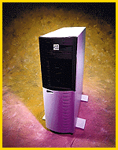

# Pentium Pro Server

*What's New*

The ALR Revolution MP Pro (from $3995) lets you start with one 200-MHz Pentium Pro processor and easily add a second processor. The server comes with a 256- or 512-KB L2 cache; 32 MB of ECC RAM (expandable to 1 GB); eight expansion slots (four PCI, one EISA, and three shared PCI/EISA); one 3-1/2-inch floppy drive bay; five 5-1/4-inch front-accessible and five internal 3-1/2-inch drive bays; and support for up to four IDE devices. Other features include a 2-MB PCI graphics adapter; two 16550 UART serial ports; one ECP/EPP bidirectional parallel port; and ALR's InforManager, an array of integrated sensors that continuously monitor information such as system and processor temperatures, fan operations, and system voltages.

Contact: Advanced Logic Research, Inc., Irvine, CA

+Phone: (800) 444-4257 or (714) 581-6770

http://www.alr.com

Internet:

http://www.alr.com

Circle 1008 on Inquiry Card.

## Pentium Processor Times Two

Copyright

1994-1997 BYTE

-<H

## Images

