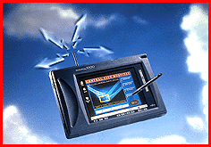

# Tablet PC Has Wireless LAN Radio

*What's New*

A Windows 95-compatible tablet PC, the Stylistic 1000 RF features Proxim's RangeLAN2 2.4-GHz wireless radio with 15 independent channels, a 1.6-Mbps data transfer rate, and a 200- to 500-foot indoor wireless range to an Ethernet access point. The 3.6-pound system includes a 100-MHz 486 processor; 8 MB of DRAM, expandable to 40 MB; a 260- or 340-MB hard drive with a preloaded OS and LAN drivers; a lithium-ion battery pack, for 4 to 6 hours of operation; a metal-barrel stylus; serial, parallel, video, mouse, and keyboard connectors; a 72-pin port-replicator connector; and an IrDA infrared wireless port. Three 8-inch LCDs are available: DSTN color ($4830), transflective monochrome ($4340), and transmissive monochrome ($4185).

Contact: Fujitsu Personal Systems, Inc., Santa Clara, CA

+Phone: (800) 831-3183 or (408) 982-9500

http://www.fpsi.fujitsu.com

Internet:

http://www.fpsi.fujitsu.com

Circle 1012 on Inquiry Card.

## Listen to the Wireless

## Images

