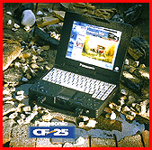

# 6.5-Pound Ruggedized Color Notebook

*What's New*

Encased in lightweight magnesium and resistant to shock, vibration, water, and dust, the CF-25 notebook (about $3329 to $3869) is available with a 100- or 133-MHz Pentium CPU; an 840-MB or 1.35-GB hard drive; 8 MB of RAM, expandable to 72 MB; a 32-bit PCI-bus architecture; a Card Bus and ZV port; 16-bit stereo sound; a DayBrite 10.4-inch active-matrix color LCD screen; three stacked PC Card Type II slots; and an optional six-speed CD-ROM drive that swaps with the floppy drive.

Contact: Panasonic Personal Computer Co., Secaucus, NJ

+Phone: (800) 662-3537 or (201) 271-3182

http://www.panasonic.com

Internet:

http://www.panasonic.com

Circle 1013 on Inquiry Card.

## Rugged on the Road

## Images

