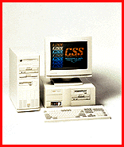

# Pentium Pro PC for Less Than $2,000

*What's New*

Available with a 150-, 180-, or 200-MHz Intel Pentium Pro CPU, the Preferred 6200's (from $1950) desktop or tower configurations include five drive bays and seven drive bays, respectively; 256 to 512 KB of L2 pipelined burst cache memory; up to 768 MB of RAM; support for up to four IDE drives; four PCI and three ISA expansion slots; two serial ports; one parallel port; and two USB ports.

Contact: CSS Laboratories, Inc., Irvine, CA

Phone: (714) 852-8161

http://www.csslabs.com

Internet:

http://www.csslabs.com

Circle 1014 on Inquiry Card.

## Pentium Pro Preferred

Copyright

1994-1997 BYTE

KKK

cKK

## Images

